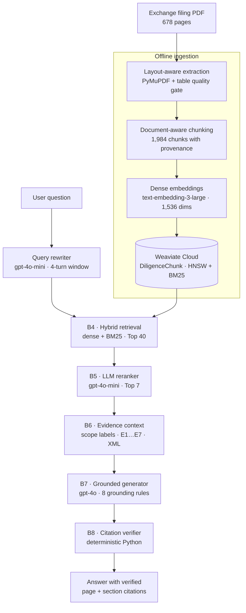

# AI Due Diligence Co-pilot

**Source-grounded RAG for financial due diligence.** Ask a question about a 678-page exchange filing and get an answer where factual claims are tied to specific pages and sections — with citations checked by deterministic Python before they reach the user.

[](https://www.python.org/)
[](tests/)
[](https://docs.astral.sh/ruff/)
[](https://mypy-lang.org/)
[](LICENSE)

[](docs/assets/demo.mp4)

**[Watch the 81-second walkthrough](docs/assets/demo.mp4)** (3.7 MB, MP4)

**New here? Choose a path:**

- **Reviewing or testing the code:** no live credentials needed. See [Verify without credentials](#verify-without-credentials).
- **Running live Q&A:** you need your own Weaviate Cloud cluster, OpenAI key, and the 678-page filing. See [Quick start](#quick-start).
- **Learning the implementation:** read [Architecture](#architecture), then the [19-part learning series](docs/learning/).

---

## The problem

Due diligence decisions depend on numbers that can be traced back to a filing, a note, or a financial statement. A plausible answer with a fabricated page reference is worse than no answer at all.

Most RAG demos stop at "the model found something relevant." This project treats the harder problem as the product: **provenance survives ingestion, evidence is selected before generation, and citations are verified after generation by code that cannot hallucinate.**

## What this is

**RAG in one sentence:** find the right passages first, then ask the AI to answer using only those passages.

A production-oriented, single-document vertical slice built on the **HDFC Bank FY2025-26 exchange filing (678 pages: 629-page Integrated Annual Report plus filing paperwork)**:

- **1,984 document-aware chunks** with page numbers, section headings, heading paths, element IDs, and table provenance.
- **Hybrid retrieval** over Weaviate Cloud (dense vectors + BM25, Top 40 candidates).
- **LLM reranking** down to the 7 most useful evidence passages.
- **Grounded generation** that may only use supplied evidence and may only cite evidence tokens such as `[E1]`.
- **Deterministic citation verification** that checks headline numbers and entities against the cited passage, and flags anything it cannot support.
- **Explicit refusal** when the document does not contain the answer.

The interface is a terminal CLI (a text-only app you run in the terminal) designed for analysts: ask a question, read the answer, inspect sources, or open a developer trace of every pipeline stage.

### Plain-English glossary

- **Chunk:** one small piece of the PDF that can be searched on its own.
- **Embedding:** a list of numbers that represents the meaning of a chunk. Similar text gets similar numbers.
- **Vector database (Weaviate):** a search engine for embeddings and keywords.
- **HNSW:** the fast index Weaviate uses to find vectors that are close to the question vector.
- **Hybrid search:** finding chunks by both exact words (BM25) and meaning (vectors).
- **Retrieval:** collecting candidate chunks that might answer the question.
- **Reranking:** putting the most useful chunks first and discarding the rest.
- **LLM:** the language model that writes or ranks text (here, OpenAI `gpt-4o` and `gpt-4o-mini`).
- **Generation:** the AI writing an answer from the selected chunks.
- **Context block:** the selected chunks packaged for the AI, with short labels such as `[E1]`.
- **Evidence ID:** a short token like `[E1]` that points to one chunk, so the AI never types a page number from memory.
- **Citation:** the page and section shown next to a claim.
- **Verification:** Python checking that the AI's numbers and page references actually appear in the cited chunk.

### Example output

> **Q:** How many branches did HDFC Bank have as of March 31, 2026?
>
> As of March 31, 2026, HDFC Bank had 9,689 branches, including nine Digital Banking Units (DBUs) [1] [2] [3] [4].
>
> `[1]` HDFC Bank Annual Report FY2025-26 — Page 647 — PLANT LOCATIONS  
> `[2]` HDFC Bank Annual Report FY2025-26 — Page 61 — REDEFINING BANKING AT SCALE  
> `[3]` HDFC Bank Annual Report FY2025-26 — Page 43 — CUSTOMER CENTRICITY  
> `[4]` HDFC Bank Annual Report FY2025-26 — Page 34, 35 — CHAIRMAN'S MESSAGE

Page numbers in this example are physical PDF pages of the 678-page exchange filing, not the 629-page standalone report.

The same answer was returned by the recorded benchmark run behind the demo. Live source counts can vary slightly with index and model updates; the verifier flags any claim it cannot support. Unanswerable questions take the other path: an explicit "not disclosed in the ingested document" response rather than an invented number.

## Architecture

### What happens, in plain English

**Once, before anyone asks a question:**

1. Read the PDF.
2. Split it into small chunks.
3. Turn each chunk into numbers (embeddings).
4. Store the chunks and numbers in Weaviate.

**For every question:**

1. Rewrite the question if it refers to earlier chat.
2. Find 40 candidate chunks.
3. Rerank them and keep the best 7.
4. Put those 7 chunks into a context block with evidence IDs.
5. Ask the AI to answer using only that evidence.
6. Check the answer's numbers and citations in Python before showing it.



### Pipeline stages

| Phase | Module | Technology | Responsibility |
|---|---|---|---|
| Ingestion | `ingestion/parser.py`, `layout.py`, `table_extractor.py` | PyMuPDF; optional Gemini vision | Extract text and tables, reconcile layout, enforce a single-owner block invariant, and route degraded tables through a quality gate |
| Chunking | `ingestion/chunker.py` | Document-aware chunker | Preserve headings, tables, page ranges, and element IDs; repeat table headers across chunk boundaries |
| Embeddings | `retrieval/embeddings.py` | `text-embedding-3-large` (1,536 dims) | Batch-embed document chunks and queries with retry handling |
| Index | `retrieval/weaviate_store.py` | Weaviate Cloud | Store `DiligenceChunk` objects with dense vectors and BM25-indexed text |
| Query rewrite | `retrieval/query_rewriter.py` | `gpt-4o-mini` | Resolve conversational references; bypass the LLM when there is no history |
| B4 retrieval | `retrieval/retriever.py` | Weaviate hybrid search | Retrieve Top 40 candidates and filter subsidiary-scope leakage |
| B5 reranking | `retrieval/reranker.py` | `gpt-4o-mini`, JSON mode | Rank candidates by evidence value using 10 financial principles; return Top 7 |
| B6 context | `retrieval/context_builder.py` | Deterministic Python | Deduplicate, label statement scope, order for attention, sanitize, and serialize evidence as XML |
| B7 generation | `agents/generator.py` | `gpt-4o`, temperature 0 | Synthesize an answer strictly from evidence; return claims with explicit `evidence_ids`, never page numbers |
| B8 verification | `agents/citation_verifier.py` | Deterministic Python | Resolve tokens to real pages/sections, verify claim support, convert failures to warnings |

## How grounding is enforced

1. **Provenance is captured at ingestion.** Every chunk carries its source page range, section heading, and heading path. Citations are resolved from stored metadata, not reconstructed from model memory.
2. **Evidence is selected before the model writes.** Retrieval and reranking decide what the generator is allowed to see. The generator cannot search the document on its own.
3. **The generator returns structured claims.** Each claim lists the evidence IDs that support it, and B7 places the `[E1]` tokens deterministically. The generator never types page numbers or document names.
4. **Verification is independent and deterministic.** For every structured claim, `check_claim_evidence_support()` checks the claim against its full evidence set: every referenced chunk must contribute, and every headline number or named entity must appear in at least one cited chunk. One claim may cite several chunks; one chunk may support several claims. Unresolved or unsupported tokens become `[Unverified: EX]` with a diagnostic, rather than a fabricated citation.
5. **Absence is a valid answer.** If retrieval and reranking cannot supply supporting evidence, the pipeline returns an explicit refusal instead of guessing.

## Engineering highlights

- **Layout reconciliation with a single-owner invariant.** Every extracted text block belongs to exactly one element; the ingestion report must show zero unowned and zero multiply-owned blocks. This prevents duplicated or silently dropped content.
- **Tables are first-class citizens.** Of 747 detected table regions, local Tier 1 extraction handles the clean cases; complex or fragmented tables are routed to an optional vision fallback. Tables that span chunks repeat their headers.
- **Entity scope isolation.** Parent-bank and subsidiary figures are kept apart so a subsidiary metric is not presented as a consolidated HDFC Bank number.
- **LLM reranking replaced CPU cross-encoders.** Cross-encoders were measured at roughly 50 seconds per query on CPU, truncated tables at 512 tokens, and systematically undervalued markdown schedules. The current reranker sees full passages and returns structured JSON.
- **Query rewriting is bounded and injection-aware.** History is capped at four turns, inputs are sanitized against XML delimiters, and the no-history case makes zero LLM calls.
- **Verification is cheap.** In the recorded benchmark, B6 context assembly averaged ~0.43 ms and B8 verification ~0.31 ms per question — fast enough to keep in the request path.
- **Fail-closed behavior.** Reranker API failures fall back to retrieval order; missing evidence produces a refusal; unsupported citations are flagged, not displayed as facts.

## Evaluation

The repository includes a 50-question golden benchmark (25 core + 25 adversarial) spanning **17 failure modes**, including direct lookups, cross-page synthesis, table extraction, conversational follow-ups, calculation from explicit values, and negative/no-evidence questions.

The harness measures:

| Metric | What it checks |
|---|---|
| Retrieval recall @ 40 | Whether any expected page appears in the hybrid candidate pool |
| Rerank recall @ 7 | Whether expected evidence survives reranking |
| Evidence recall | Whether all required evidence items reach the generator |
| Fact coverage | Whether expected facts appear in the generated answer |
| Citation validity | Whether citations resolve to real evidence and expected pages |
| Uncertainty accuracy | Whether negative questions are refused instead of answered |
| Stage latency | Per-stage timing for retrieval, reranking, context, generation, and verification |

The harness writes JSON and Markdown reports to `data/processed/` (git-ignored). Treat results as point-in-time snapshots, not universal product metrics: scores depend on the corpus snapshot, index state, and model versions. Re-run the harness after re-indexing rather than comparing across snapshots.

```bash
# Full run (live Weaviate + OpenAI)
uv run python scripts/run_b9_evaluation.py --dataset tests/eval/data/golden_qa_25.json

# Add the adversarial half
uv run python scripts/run_b9_evaluation.py \
  --dataset tests/eval/data/golden_qa_25_additional.json \
  --output-json data/processed/b9_additional_report.json \
  --output-md data/processed/b9_additional_report.md
```

## Quick start

### The short version

1. [Install the code](#setup).
2. [Run the tests without accounts](#verify-without-credentials).
3. [Configure live services](#configure-live-services) — only for live Q&A.
4. [Get the exact PDF](#source-document) — only for live Q&A.
5. [Build the index](#build-the-index) — only for live Q&A.
6. [Ask questions](#ask-questions).

Steps 1–2 prove the project works on your computer. Steps 3–6 are only needed to ask real questions about the document.

### Prerequisites

For tests and code review:

- Python 3.11+ — the language the project is written in.
- [uv](https://docs.astral.sh/uv/) — installs the project's Python packages and runs its commands.
- No live Weaviate or OpenAI credentials.

For live Q&A, additionally:

- An OpenAI API key — lets the code use OpenAI's embedding and language models.
- A Weaviate Cloud cluster — the search database that stores the chunks and vectors. The code uses `connect_to_weaviate_cloud`, not a local vector store.
- The source PDF — the document the system will read and answer questions about (see [Source document](#source-document)).

### Setup

```bash
# Download the project code.
git clone https://github.com/KushagraPan/ai-due-diligence-copilot.git

# Move into the project folder.
cd ai-due-diligence-copilot

# Install the Python packages. --extra dev also installs pytest, ruff, and mypy.
uv sync --extra dev

# Create your local settings file from the template.
# This works on Windows, macOS, and Linux.
uv run python -c "from shutil import copyfile; copyfile('.env.example', '.env')"
```

The `.env` file is gitignored. Never commit it.

### Verify without credentials

The test suite is mocked and does not call Weaviate or OpenAI. The blank values in `.env.example` are enough.

```bash
# Run the tests. No accounts needed.
uv run pytest -q
```

Expected: no failures. Tests that need the source PDF or optional `torch` skip automatically. You do not need a live cluster or real API keys for this step.

The tests avoid live services by design:

- **Generator tests** inject a fake OpenAI client (`MagicMock(spec=openai.OpenAI)`), so `chat.completions.create` never leaves the process.
- **Weaviate tests** patch `weaviate.connect_to_weaviate_cloud` or pass a fake client/collection.
- **Retrieval tests** use a deterministic local embedding provider and a mocked Weaviate collection.
- **Integration/CLI tests** assemble `DiligencePipeline` with mocked retriever, reranker, query rewriter, and generator components.
- **Blank `.env` values** only satisfy settings loading. Tests that need a real connection inject dummy settings or mocks instead of calling out.

In short, the suite tests the application logic at its seams. The network clients are replaced by fakes, so no credential is ever exercised.

### Configure live services

For live ingestion and Q&A, edit `.env` and set:

- `OPENAI_API_KEY` — create one at [platform.openai.com/api-keys](https://platform.openai.com/api-keys).
- `WEAVIATE_URL` — the Weaviate Cloud **REST endpoint**, including `https://` (e.g. `https://xxx.weaviate.network`). Do not paste only the hostname or the console URL.
- `WEAVIATE_API_KEY` — the cluster API key.

Create a cluster in the [Weaviate Cloud console](https://console.weaviate.cloud/). A Sandbox/Serverless cluster should be enough for 1,984 chunks; check current plan limits. This repo is wired to Weaviate Cloud, so a local Docker Weaviate is not supported out of the box.

Live runs call OpenAI and are billed. The first index build embeds 1,984 chunks; each question uses `gpt-4o-mini` for rewriting/reranking and `gpt-4o` for generation. Only send documents to services you are authorized to use.

### Source document

The PDF is not committed because of size and copyright. This repository is pinned to the **678-page exchange filing dated 10 July 2026** (Ref. No. `SE/2026-27/65`), which contains:

- 1-page covering letter to BSE/NSE
- 24-page AGM notice
- 629-page Integrated Annual Report
- 22-page Annexure 7 extract (printed pages 2-23)
- 2-page debenture-holder web-link letter dated 10 July 2026

Download the exact file, then save it with the exact filename shown below:

- NSE (reliable): [HDFCBANK3_10072026234853_Final_IAR.pdf](https://nsearchives.nseindia.com/corporate/HDFCBANK3_10072026234853_Final_IAR.pdf)
- BSE (alternate; may show "Access Denied" when opened directly): [BSE filing 39fa5483-1cd9-47bf-89e8-4f58a1ae1783](https://www.bseindia.com/xml-data/corpfiling/AttachHis/39fa5483-1cd9-47bf-89e8-4f58a1ae1783.pdf)

Both links currently return the identical 12,667,766-byte file with the SHA-256 below.

Official annual reports page: [hdfc.bank.in/about-us/investor-relations/annual-reports](https://www.hdfc.bank.in/about-us/investor-relations/annual-reports)

At the time of writing (October 2026), that page publishes the **629-page standalone Integrated Annual Report** alongside the AGM notice as separate PDFs, not the combined 678-page filing. The standalone report's PDF page numbers are **25 lower** than the citations in this repository (`repository page = standalone report page + 25`). Downloading only the standalone report will fail `verify_source.py` and will not line up with the page citations.

The test suite does not require the PDF or live credentials. To reproduce ingestion and page citations, place the 678-page exchange filing at:

```text
data/raw/hdfc-bank__annual-report__fy2025-26.pdf
```

The filename must match exactly; the scripts look for this path. `data/raw/` is git-ignored; only `data/raw/.gitkeep` is tracked, so the PDF never enters the repository.

Expected page count: **678**

Expected SHA-256: `92de3c75b6fc05afe8731e97705c9d3534cc192e677af02f4b325e3d82eafca6`

SHA-256 is a fingerprint of the file. Matching it means your download is byte-for-byte identical to the file used for this project's benchmark.

Verify it before indexing:

```bash
# Page count is always fatal; a checksum mismatch only warns.
uv run python scripts/verify_source.py

# Require the exact pinned bytes before rebuilding the index.
uv run python scripts/verify_source.py --strict-checksum
```

Success looks like `Pages: 678` and `OK: source document verified.` If you see that, continue.

The verifier fails on a missing file or wrong page count. A checksum mismatch is a warning by default because HDFC may re-upload the same content with different bytes; use `--strict-checksum` to make it fatal.

### Build the index

This is a one-time step per cluster. It reads the PDF, splits it into chunks, turns each chunk into numbers, and uploads those numbers to Weaviate. The local embeddings and the Weaviate index are not committed.

```bash
# Read the PDF, split it into chunks, and create embeddings.
# This calls OpenAI and writes local files.
uv run python scripts/run_hdfc_embedding_validation.py --full

# Create the Weaviate collection and upload the embeddings.
# This does not call OpenAI; it uses the local files from the previous step.
uv run python scripts/run_hdfc_weaviate_indexing.py --recreate
```

Success looks like `Generated 1,984 canonical chunks` from the first command and `WEAVIATE CLOUD INDEXING & VERIFICATION COMPLETE` with `Indexed Objects: 1,984` from the second.

`--recreate` deletes and rebuilds the `DiligenceChunk` collection. Omit it when the collection already exists and you only want to add data. Run it only against your own cluster.

### Ask questions

```bash
# Interactive session
uv run diligence

# One-shot question
uv run diligence "What was the CET1 ratio as of March 31, 2026?"

# Developer view: retrieval counts, selected pages, and stage timings
uv run diligence "What drove the change in net interest income?" --trace

# Hide the source list (the answer remains evidence-grounded)
uv run diligence "What are the key risks?" --no-evidence

# Override retrieval budgets
uv run diligence "Summarize the liquidity coverage ratio" --top-n 60 --top-k 10
```

Success looks like a direct answer with numbered citations and a source list. Try a question the filing cannot answer; it should say it is not disclosed instead of inventing one.

Inside the interactive session:

```text
/help      Show commands
/sources   Show the full evidence list for the last answer
/trace     Show compact B4 → B8 diagnostics
/trace full
/clear
/exit
```

## Testing

```bash
uv run pytest -q          # 581 collected; PDF/torch tests skip if absent
uv run ruff check src tests
uv run mypy src
```

These checks are offline and do not need a live Weaviate cluster or OpenAI key. The tests do need a `.env` file; the blank values from `.env.example` are enough. Tests that need the source PDF or optional `torch` skip when those are absent; with both installed, all 581 run.

The suite covers extraction and table parsing, layout invariants, chunk provenance, metadata preservation, hybrid retrieval, reranking fallbacks, context assembly, grounding rules, citation verification, refusal behavior, and the CLI.

Evaluation datasets and integrity checks live in `tests/eval/`; unit and integration suites live in `tests/unit/` and `tests/integration/`.

## Common problems

- **`uv` or `git` is not recognized:** install it from the Prerequisites links, then close and reopen the terminal.
- **`weaviate_url` / `weaviate_api_key` is required:** `.env` is missing or not in the repository root. Copy `.env.example` to `.env`; blank values are enough for tests.
- **OpenAI 401 / 429:** check `OPENAI_API_KEY`, billing, and quota.
- **`Source PDF not found`:** place the filing at `data/raw/hdfc-bank__annual-report__fy2025-26.pdf`.
- **`Expected 678 pages, got 629`:** you downloaded the standalone report, not the exchange filing. Use the NSE/BSE link in [Source document](#source-document).
- **Checksum mismatch:** this is a warning by default. `--strict-checksum` makes it fatal; a different file may still work, but page citations may drift.
- **Weaviate 503 or timeout:** the cluster may be asleep or paused, or `WEAVIATE_URL` may point to the wrong region. Wake it in the console and paste the exact REST endpoint, including `https://`.
- **Weaviate auth error:** confirm `WEAVIATE_URL` is the cluster endpoint (not the console URL) and `WEAVIATE_API_KEY` is current.
- **`--recreate` removed my data:** that is expected; it deletes and rebuilds `DiligenceChunk`. Use your own cluster, or omit the flag.

## Repository layout

```text
src/due_diligence/
  ingestion/      PDF parsing, layout reconciliation, table quality gate, chunking
  retrieval/      embeddings, Weaviate store, hybrid retriever, reranker, context builder
  agents/         grounded generator and deterministic citation verifier
  evaluation/     golden dataset schemas, evaluator, benchmark runner
  prompts/        task prompts and grounding rules
  core/           settings, source-document guard, and shared configuration

scripts/          ingestion, indexing, validation, source verification, and benchmark entry points
tests/
  unit/           fast component tests
  integration/    mocked end-to-end pipeline and CLI tests
  eval/           golden datasets and dataset integrity tests
_docs/            architecture, ingestion design, RAG design, preflight audits, plan
docs/learning/    19-part build-along series
docs/assets/      demo video and poster
```

## Limitations

This is a deliberate vertical slice, not a finished enterprise product.

- **One document.** The index and chunk IDs target the HDFC Bank FY2025-26 report. Multi-document deal rooms and cross-company entity resolution are not implemented.
- **CLI only.** There is no API server, web UI, authentication, or multi-tenant access control.
- **PDF not included.** You must supply the [678-page source filing](#source-document); live ingestion and evaluation require OpenAI and Weaviate credentials.
- **Small benchmark.** Fifty questions on one document are useful for regression testing, not for claims of general accuracy.
- **Not investment or legal advice.** Outputs are evidence summaries for analyst review, not recommendations.

Planned next steps: multi-document ingestion, a proper API boundary, and a larger evaluation set with adversarial and contradictory-evidence cases.

## Documentation

- [`_docs/architecture.md`](_docs/architecture.md) — system architecture and design rationale
- [`_docs/rag_architecture.md`](_docs/rag_architecture.md) — retrieval, reranking, and generation design
- [`_docs/ingestion_system_design.md`](_docs/ingestion_system_design.md) — extraction, layout, and chunking decisions
- [`_docs/preflight_audits.md`](_docs/preflight_audits.md) — corpus-scale extraction audits
- [`_docs/plan.md`](_docs/plan.md) — milestone history and development log
- [`docs/learning/`](docs/learning/) — a 19-part series documenting how the system was built

### New to the codebase?

1. Run the credential-free tests above.
2. Read `_docs/architecture.md` for the big picture.
3. Read [`docs/learning/00_rag_big_picture.md`](docs/learning/00_rag_big_picture.md), then the rest of the series in order.
4. Open `src/due_diligence/` and read the module docstrings; each one explains its inputs, outputs, and dependencies.

## Tech stack

Python 3.11 · Pydantic v2 · PyMuPDF · OpenAI (`text-embedding-3-large`, `gpt-4o`, `gpt-4o-mini`) · Weaviate Cloud · uv · pytest · ruff · mypy

## License

[MIT](LICENSE)
