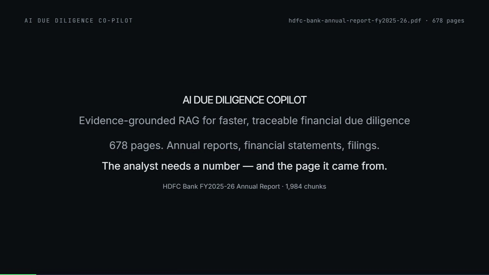
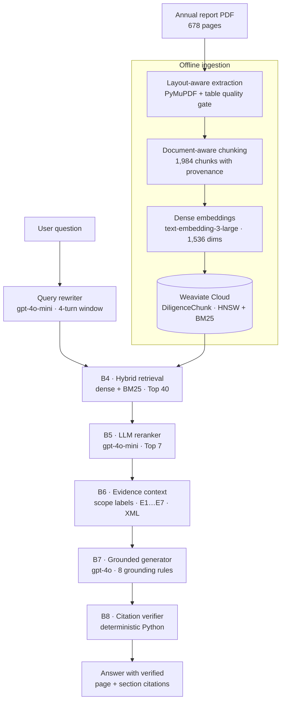

# AI Due Diligence Co-pilot

**Source-grounded RAG for financial due diligence.** Ask a question about a 678-page annual report and get an answer where factual claims are tied to specific pages and sections — with citations checked by deterministic Python before they reach the user.

[](https://www.python.org/)
[](tests/)
[](https://docs.astral.sh/ruff/)
[](https://mypy-lang.org/)
[](LICENSE)

[](docs/assets/demo.mp4)

**[Watch the 81-second walkthrough](docs/assets/demo.mp4)** (3.7 MB, MP4)

---

## The problem

Due diligence decisions depend on numbers that can be traced back to a filing, a note, or a financial statement. A plausible answer with a fabricated page reference is worse than no answer at all.

Most RAG demos stop at "the model found something relevant." This project treats the harder problem as the product: **provenance survives ingestion, evidence is selected before generation, and citations are verified after generation by code that cannot hallucinate.**

## What this is

A production-oriented, single-document vertical slice built on the **HDFC Bank FY2025-26 Annual Report (678 pages)**:

- **1,984 document-aware chunks** with page numbers, section headings, heading paths, element IDs, and table provenance.
- **Hybrid retrieval** over Weaviate Cloud (dense vectors + BM25, Top 40 candidates).
- **LLM reranking** down to the 7 most useful evidence passages.
- **Grounded generation** that may only use supplied evidence and may only cite evidence tokens such as `[E1]`.
- **Deterministic citation verification** that checks headline numbers and entities against the cited passage, and flags anything it cannot support.
- **Explicit refusal** when the document does not contain the answer.

The interface is a terminal CLI designed for analysts: ask a question, read the answer, inspect sources, or open a developer trace of every pipeline stage.

### Example output

> **Q:** How many branches did HDFC Bank have as of March 31, 2026?
>
> As of March 31, 2026, HDFC Bank had 9,689 branches, including nine Digital Banking Units (DBUs) [1] [2] [3] [4].
>
> `[1]` HDFC Bank Annual Report FY2025-26 — Page 647 — PLANT LOCATIONS  
> `[2]` HDFC Bank Annual Report FY2025-26 — Page 61 — REDEFINING BANKING AT SCALE  
> `[3]` HDFC Bank Annual Report FY2025-26 — Page 43 — CUSTOMER CENTRICITY  
> `[4]` HDFC Bank Annual Report FY2025-26 — Page 34, 35 — CHAIRMAN'S MESSAGE

The same answer was returned by the recorded benchmark run behind the demo. Unanswerable questions take the other path: an explicit "not disclosed in the ingested document" response rather than an invented number.

## Architecture



### Pipeline stages

| Phase | Module | Technology | Responsibility |
|---|---|---|---|
| Ingestion | `ingestion/parser.py`, `layout.py`, `table_extractor.py` | PyMuPDF; optional Gemini vision | Extract text and tables, reconcile layout, enforce a single-owner block invariant, and route degraded tables through a quality gate |
| Chunking | `ingestion/chunker.py` | Document-aware chunker | Preserve headings, tables, page ranges, and element IDs; repeat table headers across chunk boundaries |
| Embeddings | `retrieval/embeddings.py` | `text-embedding-3-large` (1,536 dims) | Batch-embed document chunks and queries with retry handling |
| Index | `retrieval/weaviate_store.py` | Weaviate Cloud | Store `DiligenceChunk` objects with dense vectors and BM25-indexed text |
| Query rewrite | `retrieval/query_rewriter.py` | `gpt-4o-mini` | Resolve conversational references; bypass the LLM when there is no history |
| B4 retrieval | `retrieval/retriever.py` | Weaviate hybrid search | Retrieve Top 40 candidates and filter subsidiary-scope leakage |
| B5 reranking | `retrieval/reranker.py` | `gpt-4o-mini`, JSON mode | Rank candidates by evidence value using 10 financial principles; return Top 7 |
| B6 context | `retrieval/context_builder.py` | Deterministic Python | Deduplicate, label statement scope, order for attention, sanitize, and serialize evidence as XML |
| B7 generation | `agents/generator.py` | `gpt-4o`, temperature 0 | Synthesize an answer strictly from evidence; emit `[E1]` tokens, never page numbers |
| B8 verification | `agents/citation_verifier.py` | Deterministic Python | Resolve tokens to real pages/sections, verify claim support, convert failures to warnings |

## How grounding is enforced

1. **Provenance is captured at ingestion.** Every chunk carries its source page range, section heading, and heading path. Citations are resolved from stored metadata, not reconstructed from model memory.
2. **Evidence is selected before the model writes.** Retrieval and reranking decide what the generator is allowed to see. The generator cannot search the document on its own.
3. **The generator emits abstract tokens.** It writes `[E1]`, `[E2]`, … and is explicitly forbidden from typing page numbers or document names. B8 maps tokens to citations using the evidence map.
4. **Verification is independent and deterministic.** For every citing sentence, `check_claim_support()` requires headline numbers (multi-digit values, percentages, currency) and multi-word entities to appear in the cited passage. Unresolved tokens become `[Unverified: EX]` with a diagnostic, rather than a fabricated citation.
5. **Absence is a valid answer.** If retrieval and reranking cannot supply supporting evidence, the pipeline returns an explicit refusal instead of guessing.

## Engineering highlights

- **Layout reconciliation with a single-owner invariant.** Every extracted text block belongs to exactly one element; the ingestion report must show zero unowned and zero multiply-owned blocks. This prevents duplicated or silently dropped content.
- **Tables are first-class citizens.** Of 747 detected table regions, local Tier 1 extraction handles the clean cases; complex or fragmented tables are routed to an optional vision fallback. Tables that span chunks repeat their headers.
- **Entity scope isolation.** Parent-bank and subsidiary figures are kept apart so a subsidiary metric is not presented as a consolidated HDFC Bank number.
- **LLM reranking replaced CPU cross-encoders.** Cross-encoders were measured at roughly 50 seconds per query on CPU, truncated tables at 512 tokens, and systematically undervalued markdown schedules. The current reranker sees full passages and returns structured JSON.
- **Query rewriting is bounded and injection-aware.** History is capped at four turns, inputs are sanitized against XML delimiters, and the no-history case makes zero LLM calls.
- **Verification is cheap.** In the recorded benchmark, B6 context assembly averaged ~0.43 ms and B8 verification ~0.31 ms per question — fast enough to keep in the request path.
- **Fail-closed behavior.** Reranker API failures fall back to retrieval order; missing evidence produces a refusal; unsupported citations are flagged, not displayed as facts.

## Evaluation

The repository includes a 50-question golden benchmark (25 core + 25 adversarial) spanning **17 failure modes**, including direct lookups, cross-page synthesis, table extraction, conversational follow-ups, calculation from explicit values, and negative/no-evidence questions.

The harness measures:

| Metric | What it checks |
|---|---|
| Retrieval recall @ 40 | Whether any expected page appears in the hybrid candidate pool |
| Rerank recall @ 7 | Whether expected evidence survives reranking |
| Evidence recall | Whether all required evidence items reach the generator |
| Fact coverage | Whether expected facts appear in the generated answer |
| Citation validity | Whether citations resolve to real evidence and expected pages |
| Uncertainty accuracy | Whether negative questions are refused instead of answered |
| Stage latency | Per-stage timing for retrieval, reranking, context, generation, and verification |

The harness writes JSON and Markdown reports to `data/processed/` (git-ignored). Treat results as point-in-time snapshots, not universal product metrics: scores depend on the corpus snapshot, index state, and model versions. Re-run the harness after re-indexing rather than comparing across snapshots.

```bash
# Full run (live Weaviate + OpenAI)
uv run python scripts/run_b9_evaluation.py --dataset tests/eval/data/golden_qa_25.json

# Add the adversarial half
uv run python scripts/run_b9_evaluation.py \
  --dataset tests/eval/data/golden_qa_25_additional.json \
  --output-json data/processed/b9_additional_report.json \
  --output-md data/processed/b9_additional_report.md
```

## Quick start

### Prerequisites

- Python 3.11+
- [uv](https://docs.astral.sh/uv/)
- An OpenAI API key
- A Weaviate Cloud cluster
- The source PDF (not committed because of size and copyright; see [Source document](#source-document))

### Setup

```bash
git clone <repository-url>
cd ai-due-diligence-copilot

uv sync

cp .env.example .env
# Fill in OPENAI_API_KEY, WEAVIATE_URL, and WEAVIATE_API_KEY.
# GEMINI_API_KEY is optional and only enables Tier 2 table extraction.
```

### Source document

The PDF is not committed because of size and copyright. This repository is pinned to the **678-page exchange filing dated 10 July 2026** (Ref. No. `SE/2026-27/65`), which contains:

- 1-page covering letter to BSE/NSE
- 24-page AGM notice
- 629-page Integrated Annual Report
- 22-page Annexure 7 extract (printed pages 2-23)
- 2-page debenture-holder web-link letter dated 10 July 2026

Download the exact file:

- NSE (reliable): [HDFCBANK3_10072026234853_Final_IAR.pdf](https://nsearchives.nseindia.com/corporate/HDFCBANK3_10072026234853_Final_IAR.pdf)
- BSE (alternate; may show "Access Denied" when opened directly): [BSE filing 39fa5483-1cd9-47bf-89e8-4f58a1ae1783](https://www.bseindia.com/xml-data/corpfiling/AttachHis/39fa5483-1cd9-47bf-89e8-4f58a1ae1783.pdf)

Both links currently return the identical 12,667,766-byte file with the SHA-256 below.

Official annual reports page: [hdfc.bank.in/about-us/investor-relations/annual-reports](https://www.hdfc.bank.in/about-us/investor-relations/annual-reports)

At the time of writing (October 2026), that page publishes the **629-page standalone Integrated Annual Report** alongside the AGM notice as separate PDFs, not the combined 678-page filing. The standalone report's PDF page numbers are **25 lower** than the citations in this repository (`repository page = standalone report page + 25`). Downloading only the standalone report will fail `verify_source.py` and will not line up with the page citations.

The test suite does not require the PDF. To reproduce ingestion and page citations, place the 678-page exchange filing at:

```text
data/raw/hdfc-bank__annual-report__fy2025-26.pdf
```

Expected page count: **678**

Expected SHA-256: `92de3c75b6fc05afe8731e97705c9d3534cc192e677af02f4b325e3d82eafca6`

Verify it before indexing:

```bash
uv run python scripts/verify_source.py
```

The verifier fails on a missing file or wrong page count. A checksum mismatch is a warning by default because HDFC may re-upload the same content with different bytes; use `--strict-checksum` to make it fatal.

### Build the index

```bash
# Extract, chunk, and embed the document; writes the canonical chunks + .npy vectors
uv run python scripts/run_hdfc_embedding_validation.py --full

# Create the Weaviate collection and index all chunks
uv run python scripts/run_hdfc_weaviate_indexing.py --recreate
```

`--recreate` deletes and rebuilds the `DiligenceChunk` collection. Omit it when the collection already exists and you only want to add data.

### Ask questions

```bash
# Interactive session
uv run diligence

# One-shot question
uv run diligence "What was the CET1 ratio as of March 31, 2026?"

# Developer view: retrieval counts, selected pages, and stage timings
uv run diligence "What drove the change in net interest income?" --trace

# Hide the source list (the answer remains evidence-grounded)
uv run diligence "What are the key risks?" --no-evidence

# Override retrieval budgets
uv run diligence "Summarize the liquidity coverage ratio" --top-n 60 --top-k 10
```

Inside the interactive session:

```text
/help      Show commands
/sources   Show the full evidence list for the last answer
/trace     Show compact B4 → B8 diagnostics
/trace full
/clear
/exit
```

## Testing

```bash
uv run pytest -q          # 552 tests
uv run ruff check src tests
uv run mypy src
```

The suite covers extraction and table parsing, layout invariants, chunk provenance, metadata preservation, hybrid retrieval, reranking fallbacks, context assembly, grounding rules, citation verification, refusal behavior, and the CLI.

Evaluation datasets and integrity checks live in `tests/eval/`; unit and integration suites live in `tests/unit/` and `tests/integration/`.

## Repository layout

```text
src/due_diligence/
  ingestion/      PDF parsing, layout reconciliation, table quality gate, chunking
  retrieval/      embeddings, Weaviate store, hybrid retriever, reranker, context builder
  agents/         grounded generator and deterministic citation verifier
  evaluation/     golden dataset schemas, evaluator, benchmark runner
  prompts/        task prompts and grounding rules
  core/           settings, source-document guard, and shared configuration

scripts/          ingestion, indexing, validation, source verification, and benchmark entry points
tests/
  unit/           fast component tests
  integration/    mocked end-to-end pipeline and CLI tests
  eval/           golden datasets and dataset integrity tests
_docs/            architecture, ingestion design, RAG design, preflight audits, plan
docs/learning/    19-part build-along series
docs/assets/      demo video and poster
```

## Limitations

This is a deliberate vertical slice, not a finished enterprise product.

- **One document.** The index and chunk IDs target the HDFC Bank FY2025-26 report. Multi-document deal rooms and cross-company entity resolution are not implemented.
- **CLI only.** There is no API server, web UI, authentication, or multi-tenant access control.
- **PDF not included.** You must supply the [678-page source filing](#source-document); live ingestion and evaluation require paid OpenAI and Weaviate credentials.
- **Small benchmark.** Fifty questions on one document are useful for regression testing, not for claims of general accuracy.
- **Not investment or legal advice.** Outputs are evidence summaries for analyst review, not recommendations.

Planned next steps: multi-document ingestion, a proper API boundary, and a larger evaluation set with adversarial and contradictory-evidence cases.

## Documentation

- [`_docs/architecture.md`](_docs/architecture.md) — system architecture and design rationale
- [`_docs/rag_architecture.md`](_docs/rag_architecture.md) — retrieval, reranking, and generation design
- [`_docs/ingestion_system_design.md`](_docs/ingestion_system_design.md) — extraction, layout, and chunking decisions
- [`_docs/preflight_audits.md`](_docs/preflight_audits.md) — corpus-scale extraction audits
- [`_docs/plan.md`](_docs/plan.md) — milestone history and development log
- [`docs/learning/`](docs/learning/) — a 19-part series documenting how the system was built

## Tech stack

Python 3.11 · Pydantic v2 · PyMuPDF · OpenAI (`text-embedding-3-large`, `gpt-4o`, `gpt-4o-mini`) · Weaviate Cloud · uv · pytest · ruff · mypy

## License

[MIT](LICENSE)
