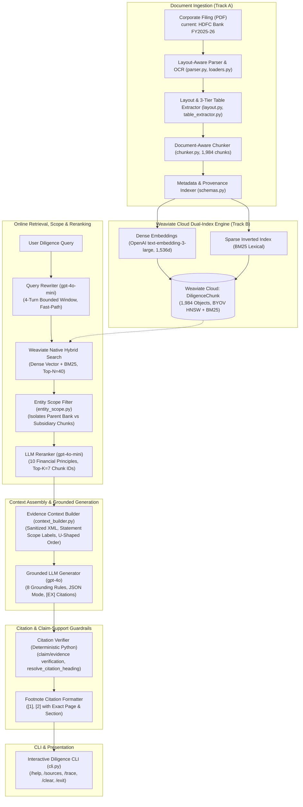
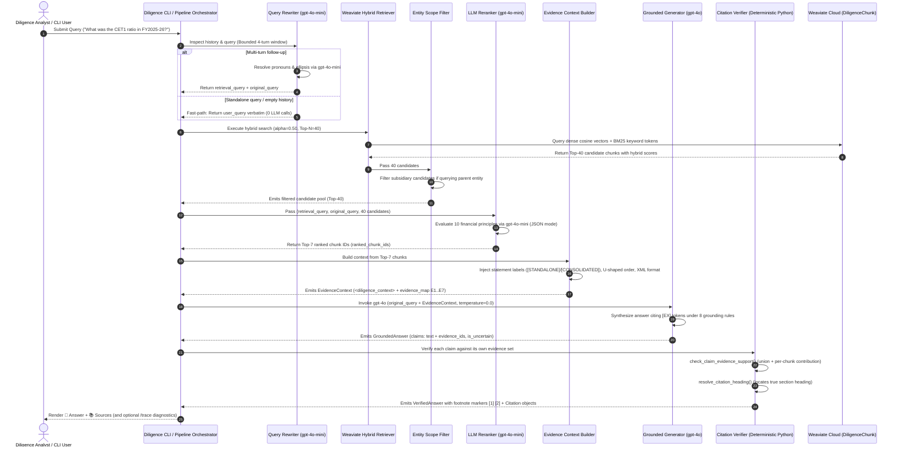

# AI Due Diligence Co-pilot: System Architecture

## 1. System Overview

The **AI Due Diligence Co-pilot** is a source-grounded Retrieval-Augmented Generation (RAG) system for financial due diligence. The current implementation is a single-document vertical slice: it ingests one 678-page annual report, preserves page and section provenance through chunking and indexing, and answers analyst questions with deterministic, audit-ready citations. Multi-document deal rooms and specialized agents are roadmap items, not current capabilities.

### 1.1 Core Objectives
- **Accurate Grounding:** No factual claim without supporting evidence.
- **Table-Aware Processing:** High-fidelity extraction of financial statements and tabular schedules from corporate filings.
- **Evidence-First Retrieval:** Hybrid search and LLM reranking select the evidence before generation begins.
- **Fail-Closed Behavior:** Missing or contradictory evidence produces an explicit refusal or warning, never a guessed number.
- **Audit-Ready Provenance:** Every displayed citation resolves to a real page and section in the ingested document.

---

## 2. High-Level Architecture Diagram

---

## 3. End-to-End Query-Response Lifecycle

---

## 4. Subsystem Specifications

### 4.1 Ingestion & Document Processing Subsystem
- **Multi-Format Ingestion:** Ingests PDF contracts, financial spreadsheets (XLSX/CSV), SEC filings (10-K, 10-Q), and pitch decks.
- **Preflight Verification & Quality Gates:** Full-corpus deterministic preflight audit layer (`scripts/run_table_preflight.py`, `scripts/run_layout_preflight.py`) producing persistent artifacts in `data/processed/`. Mathematically proves zero unowned text blocks, zero duplicate text ingestion, verifies multi-column reading orders, and evaluates a 5-point table quality gate (see [`_docs/ingestion_system_design.md`](ingestion_system_design.md) and [`_docs/preflight_audits.md`](preflight_audits.md)).
- **Layout & Table Preservation:** Uses layout-aware parsing (`pymupdf`) to preserve financial tables in Markdown formats rather than flattening them into meaningless prose, with a 3-tier extraction engine (Tier 1 column-projection, Tier 2 Gemini Flash vision fallback, Tier 3 graceful degradation).
- **Hierarchical & Semantic Chunking:** Chunks by natural semantic sections (headings, articles, exhibits) while preserving table integrity within single chunks or linking parent-child table rows.
- **Document Metadata Enrichment:** Assigns each chunk metadata: `deal_id`, `document_name`, `page_number`, `section_title`, `heading_path`, `bbox`, `chunk_id`, and `hash`.

### 4.2 Storage & Indexing Subsystem
- **Vector & Lexical Store (Weaviate Cloud):** The authoritative store is Weaviate Cloud using the v4 Python SDK (`DiligenceChunk` collection, 1,984 objects, 21 properties).
- **Dense Embeddings:** OpenAI `text-embedding-3-large` (1,536 dimensions) generated via Bring-Your-Own-Vectors (BYOV) in Python (`embeddings.py`).
- **Sparse Lexical Search:** BM25 inverted indexing natively maintained in Weaviate Cloud across chunk text, section headings, and table headers.
- **Hybrid Fusion:** Weaviate native Relative Score Fusion combining vector similarity and BM25 lexical matches ($\alpha = 0.50$, candidate pool Top-$N = 40$).
- **Entity Scope Filtering:** Deterministic filter (`filter_subsidiary_candidates`) separating parent bank disclosures from subsidiary reports (e.g., HDB Financial Services) to prevent entity contamination.

### 4.3 Query Rewriting Subsystem
- **Conversational Disambiguation:** Managed by `QueryRewriter` powered by **`gpt-4o-mini`** (configured via `Settings.query_rewriter_model`).
- **Fast-Path Optimization:** Standalone queries with empty or whitespace conversation history immediately bypass the LLM (0 API calls, 0 latency overhead).
- **Bounded Memory:** Bounded to the most recent 4 conversation turns (messages, not full dialogues).
- **Prompt Injection Defense:** History and query inputs are sanitized against XML delimiters (`<conversation_history>`, `<current_query>`, `<rewritten_query>`).
- **Dual Query Separation:** Produces `retrieval_query` (passed to B4 Weaviate search and B5 reranking) and preserves `original_query` (passed to B7 generation).

### 4.4 Reranking & Context Assembly Subsystem
- **LLM Reranker (B5):** `LLMReranker` powered by **`gpt-4o-mini`** (configured via `Settings.llm_reranker_model`), operating at `temperature=0.0` in JSON object mode. Re-ranks all Top-40 candidates against 10 strict financial ranking principles and returns at most Top-$K=7$ chunk IDs (`{"ranked_chunk_ids": [...]}`).
- **Historical Note:** Cross-encoders were completely removed due to 50s CPU latency and 512-token table truncation.
- **Evidence Context Builder (B6):** Packages the Top-7 reranked passages into sanitized XML (`<diligence_context>`), assigns abstract tokens (`E1`...`E7`), injects explicit statement-scope labels (`[STANDALONE ...]` / `[CONSOLIDATED ...]`), and applies U-shaped attention ordering ("lost-in-the-middle").

### 4.5 Grounded Generation & Guardrails Subsystem
- **Grounded LLM Generator (B7):** Powered by **`gpt-4o`** (`Settings.generation_model`) at `temperature=0.0` with `response_format={"type": "json_object"}`. Enforces 8 non-negotiable grounding rules and emits answers referencing `[EX]` tokens.
- **Citation Attribution & Claim Support (B8):** Deterministic Python subsystem (`CitationVerifier`):
  - `check_claim_evidence_support()`: Verifies each structured claim against its complete evidence set. The union of cited chunks must contain every headline number and named entity; each cited chunk must contribute at least one checkable element (or lexical support for qualitative claims). Violations convert the token to `[Unverified: EX]`.
  - `resolve_citation_heading()`: Resolves the nearest true section heading, filtering out data rows, Total lines, and footnote markers.
  - Records per-claim `verified` / `partially_supported` / `unverified` outcomes and translates abstract tokens into user-facing footnotes `[1]`, `[2]` with exact page numbers and document names.

### 4.6 Product CLI & Presentation Layer
- **Interactive Terminal:** `cli.py` (`uv run diligence` or `uv run python -m due_diligence.cli`) provides multi-turn conversation memory, friendly error handling, and structured output.
- **Interactive Commands:** `/help`, `/sources` (evidence excerpts), `/trace` (compact B4→B8 stage diagnostic), `/trace full` (forensic stage inspection), `/clear` (resets history), `/exit`.

---

## 5. Technology Stack Rationale

| Layer | Production Technology | Rationale |
|---|---|---|
| **Language & Runtime** | Python 3.11+ | Optimal ecosystem for RAG, Pydantic v2, async concurrency. |
| **Package Management** | `uv` + `pyproject.toml` | High-performance deterministic virtual environment and dependency locking. |
| **Data Validation** | Pydantic v2 | High-throughput schema validation and serialization. |
| **Document Processing** | PyMuPDF (`pymupdf`) | Fast and accurate PDF text/table layout extraction; multi-column reading orders. |
| **Vector & Lexical Store**| Weaviate Cloud (v4 SDK) | Sole vector store; native hybrid search (HNSW Cosine + BM25), 1,984 objects. |
| **Dense Embeddings** | OpenAI `text-embedding-3-large` | 1,536 dims; high semantic accuracy on corporate/financial filings. |
| **Query Rewriter** | OpenAI `gpt-4o-mini` | Fast, cost-efficient reference disambiguation over bounded 4-turn history. |
| **Hybrid Retrieval** | Relative Score Fusion ($\alpha=0.50$) | Balanced dense semantic discovery and exact lexical term precision ($N=40$). |
| **Reranker (B5)** | OpenAI `gpt-4o-mini` (LLM Reranker) | 10 financial ranking principles in JSON mode; scores Top-40 $\to$ emits Top-7 chunk IDs. |
| **Grounded Generator (B7)**| OpenAI `gpt-4o` | Strict evidence grounding, zero financial hallucinations, structured JSON output. |
| **Citation Verification (B8)**| Deterministic Python (`CitationVerifier`) | Normalized entity/numeric claim-support check; zero hallucinated page coordinates. |
| **Presentation & CLI** | Python Rich Terminal (`cli.py`) | Interactive diligence session with bounded history, `/sources`, and `/trace`. |

---

## 6. Security, Confidentiality & Compliance

- **Deal Room Isolation:** All document chunks, vectors, and metadata are tagged with a strict `deal_id` tenant identifier. Cross-deal data leakage is prevented at the database filter level.
- **No Data Retention / Training:** All LLM inference contracts must specify zero data retention (ZDR) and no model training on deal room data.
- **PII & Sensitive Redaction:** Ingestion pipeline includes optional PII detection and masking before embedding generation.
- **Audit Trail:** Immutable audit logs record who accessed what document, what queries were executed, and the exact chunks cited in answers.
