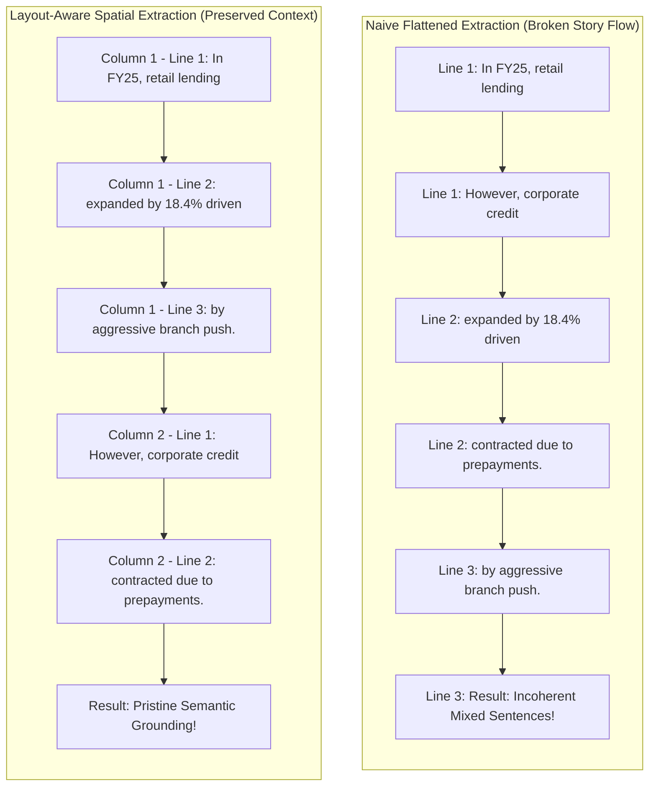
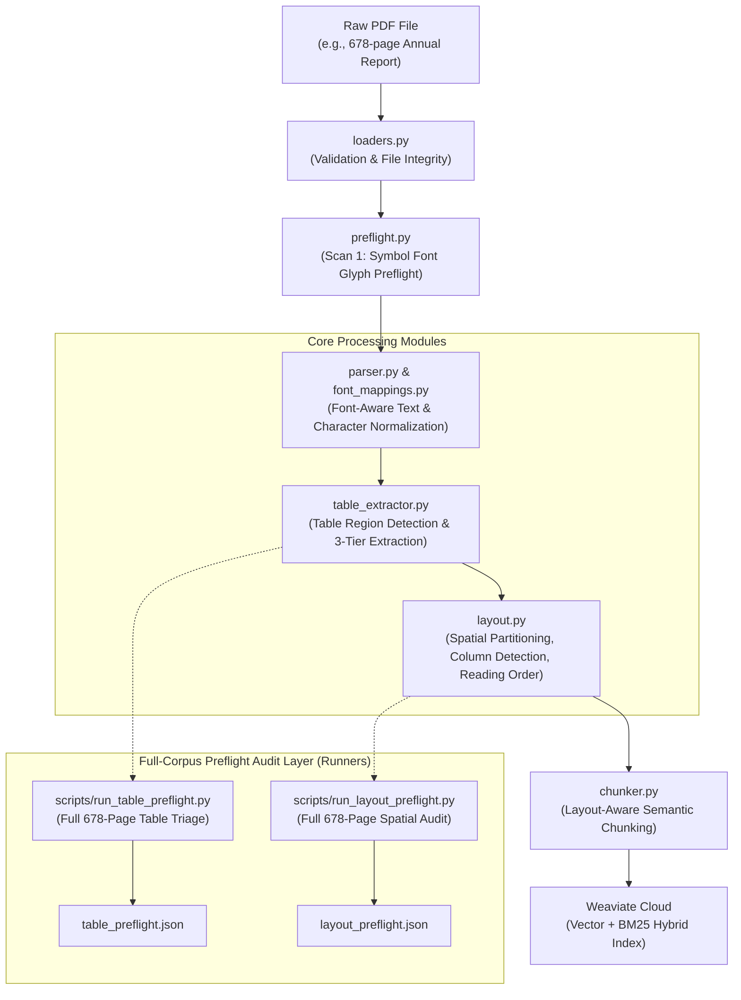
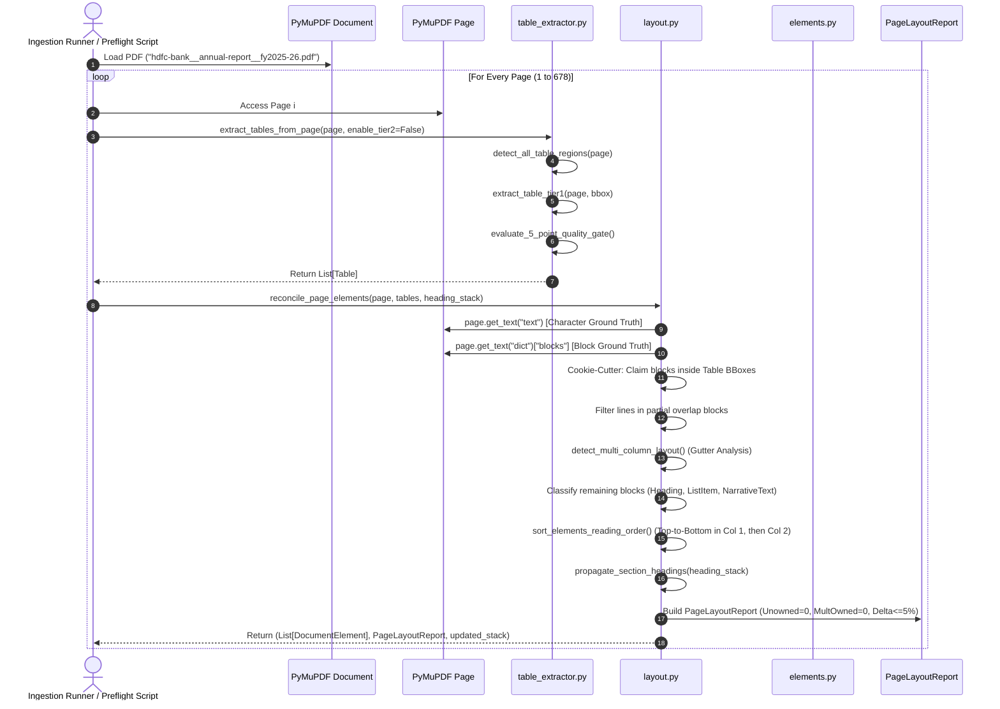
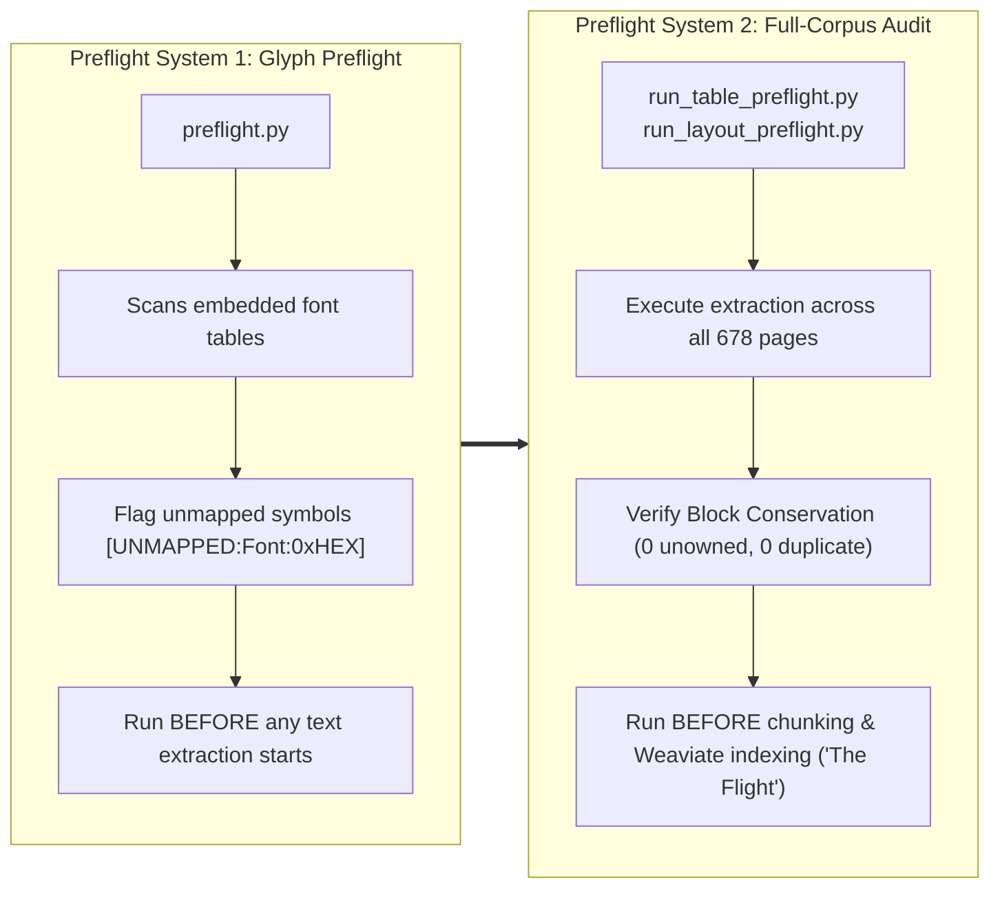
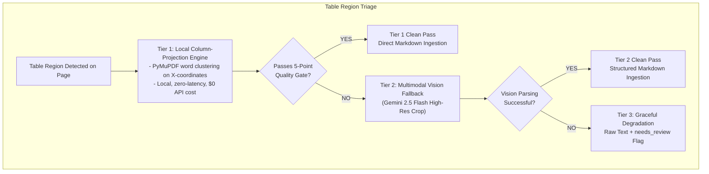
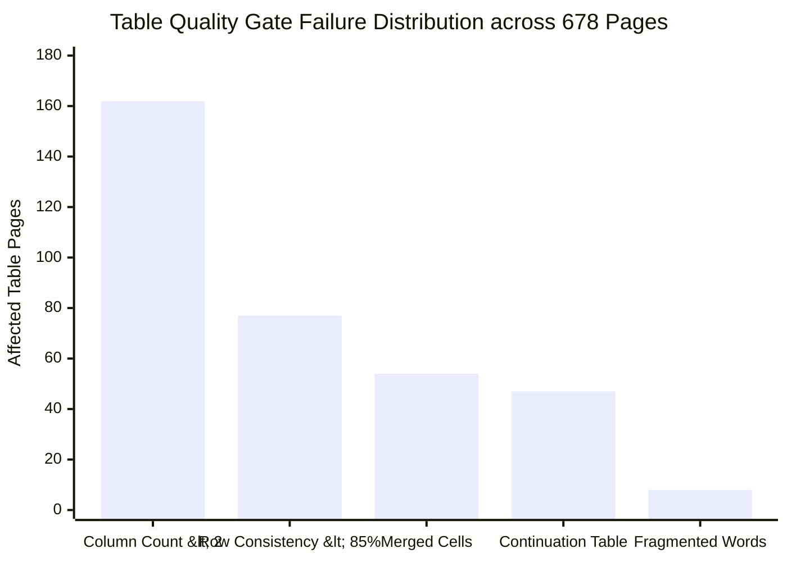
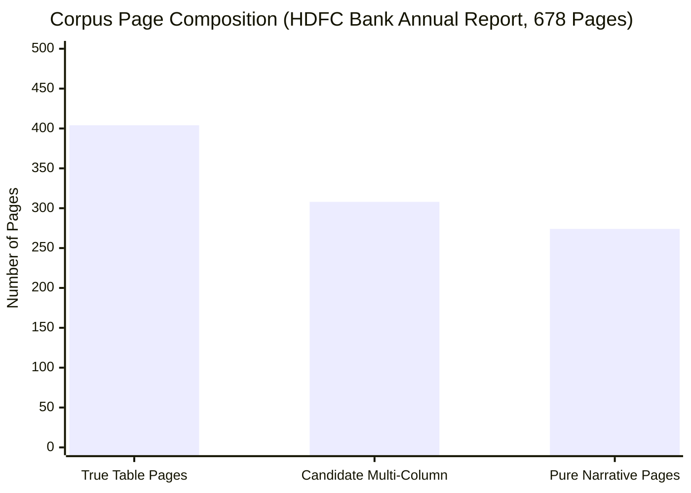
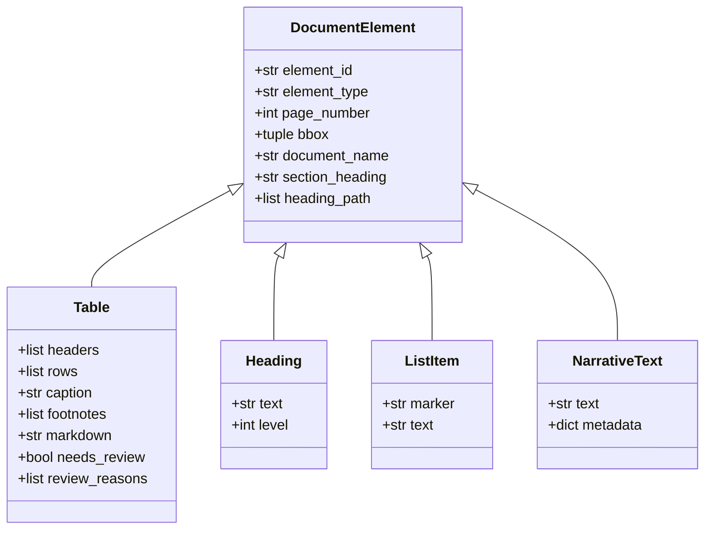
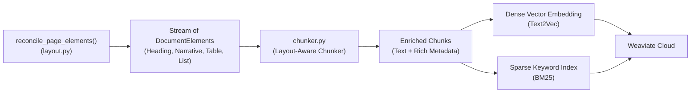

# System Design Document: Ingestion Engine, Spatial Reconciliation & Preflight Audits

**Status:** Living Design Specification  
**Scope:** Document Ingestion, Symbol Font Mapping, Table Extraction, Spatial Partitioning, and Deterministic Preflight Audits  
**Document Context:** Part of the AI Due Diligence Co-pilot Architecture  

---

## 1. Executive Summary & The "Silent Data Loss" Problem

### 1.1 The High-Stakes Nature of Due Diligence
In corporate due diligence (M&A deal rooms, private equity vetting, SEC filing analysis), an AI assistant must be **strictly source-grounded**. If a model hallucinates a debt maturity date, invents an EBITDA metric, or misses a non-compete clause, the financial and legal consequences can be catastrophic.

Most RAG (Retrieval-Augmented Generation) systems fail at step zero: **document ingestion**. When feeding a 600+ page annual report or 10-K filing into generic parsing libraries, the system frequently suffers from **Silent Data Loss**—data is omitted or scrambled without throwing any error:



1. **Multi-Column Text Flattening:**  
   *The Problem:* In a 2-column or 3-column layout (standard in annual reports and audited notes), standard PDF text streams extract words in arbitrary reading orders.  
   *Layman Analogy:* Imagine reading a two-column newspaper page by scanning all the way from the left edge of Column 1 directly across the page into Column 2, line by line. The resulting sentences become an incoherent jumble of two completely unrelated stories.
2. **Tabular Data Destruction:**  
   *The Problem:* Financial tables lack physical borders in modern corporate filings. Naive parsers treat numbers and headers as free-floating paragraphs, separating row labels (e.g., *"Interest Earned"*) from their corresponding numeric values (e.g., *"₹1,24,500 Cr"*).
3. **Bounding Box Collisions & Text Duplication:**  
   *The Problem:* If a parser extracts a table and then extracts the full page text, the text inside the table gets ingested **twice**—once as a table and once as raw narrative prose. Or conversely, aggressively cutting out a table bbox cuts off narrative paragraphs directly above or below it.
4. **Symbol Font & Nil Dash Invisibility:**  
   *The Problem:* Financial tables use standalone en-dashes (`–`) or em-dashes (`—`) to denote `0`, `NIL`, or `Not Disclosed`. Naive string parsers either strip these out as meaningless punctuation or misinterpret custom font glyphs, turning a zero-liability declaration into missing or corrupt text.

### 1.2 The Ingestion Engineering Philosophy
To eliminate silent data loss, this repository implements a **deterministic preflight verification architecture**:
* Every piece of content on every page is treated as an accountable structural block.
* Before any text or table is vectorized or ingested into Weaviate, the complete document undergoes full-corpus deterministic preflight scans.
* The system enforces **mathematical invariants**: zero unowned blocks, zero double-counted blocks, and strict character reconciliation against the raw PDF stream.

---

## 2. End-to-End Pipeline & Component Lifecycle

The ingestion subsystem takes raw PDF documents and transforms them into an ordered, provenance-tagged stream of structured [`DocumentElement`](../src/due_diligence/ingestion/elements.py) instances ready for chunking and vector indexing.



### 2.1 Detailed Page Processing Sequence



### 2.2 Module Responsibilities Registry

| Module Path | Pipeline Role | Expected Inputs | Core Outputs | Key Dependencies |
| :--- | :--- | :--- | :--- | :--- |
| [`src/due_diligence/ingestion/loaders.py`](../src/due_diligence/ingestion/loaders.py) | Document entrypoint & integrity verification | Filesystem path (`Path` or `str`) | [`ValidatedDocument`](../src/due_diligence/ingestion/document.py) | `pathlib`, `pydantic` |
| [`src/due_diligence/ingestion/font_mappings.py`](../src/due_diligence/ingestion/font_mappings.py) | Glyph translation & normalization | Raw font name & character codepoints | Unicode strings or structured `[UNMAPPED]` placeholders | `yaml`, `config/symbol_font_mappings.yaml` |
| [`src/due_diligence/ingestion/preflight.py`](../src/due_diligence/ingestion/preflight.py) | Batch glyph audit before parsing | Batch of PDF paths | Scan summary & unmapped glyph audit report | `pymupdf`, `font_mappings.py` |
| [`src/due_diligence/ingestion/table_extractor.py`](../src/due_diligence/ingestion/table_extractor.py) | Table bounding box detection & extraction | PyMuPDF `Page`, page number, document name | List of [`Table`](../src/due_diligence/ingestion/elements.py) objects | `pymupdf`, `elements.py`, Gemini Flash (Tier 2) |
| [`src/due_diligence/ingestion/layout.py`](../src/due_diligence/ingestion/layout.py) | Spatial partitioning & reading order | PyMuPDF `Page`, extracted tables | Ordered [`DocumentElement`](../src/due_diligence/ingestion/elements.py) stream & [`PageLayoutReport`](../src/due_diligence/ingestion/layout.py#L904-L921) | `pymupdf`, `table_extractor.py`, `elements.py` |
| [`scripts/run_table_preflight.py`](../scripts/run_table_preflight.py) | Full-corpus table quality audit | Entire 678-page PDF | `data/processed/table_preflight_*.json` | `pymupdf`, `table_extractor.py` |
| [`scripts/run_layout_preflight.py`](../scripts/run_layout_preflight.py) | Full-corpus spatial reconciliation audit | Entire 678-page PDF | `data/processed/layout_preflight_*.json` | `pymupdf`, `table_extractor.py`, `layout.py` |

---

## 3. The Two Preflight Systems Demystified

The codebase features two systems bearing the word **"Preflight"**. They operate at completely different stages of ingestion and address different failure modes.



### 3.1 Preflight System 1: Embedded Font Glyph Preflight ([`preflight.py`](../src/due_diligence/ingestion/preflight.py))
* **When It Runs:** Before parsing or extracting text.
* **Why It Exists:** Corporate PDFs often embed custom symbol fonts (e.g., Wingdings, custom corporate icon sets, private-use unicode ranges). In financial filings, a special font character might represent a bullet point, a checkbox, a tick mark, or a disclosure symbol. If PyMuPDF extracts this character without translation, it either produces unreadable mojibake (e.g., `\uf0b7`) or silently drops the character.
* **How It Works:**
  1. [`preflight_scan`](../src/due_diligence/ingestion/preflight.py#L49-L53) scans every font embedded across a batch of PDFs.
  2. It cross-references font names against [`config/symbol_font_mappings.yaml`](../config/symbol_font_mappings.yaml).
  3. If a font contains unmapped codepoints, it outputs structured placeholders (`[UNMAPPED:FontName:0xHEX]`) with page numbers, alerting developers to update the configuration before running full ingestion.

### 3.2 Preflight System 2: Full-Corpus Audit Runners ([`scripts/run_*_preflight.py`](../scripts/))
* **When It Runs:** After table extraction and layout reconciliation are implemented, but **before** generating chunks and vector embeddings.
* **Why It Exists:** Indexing 678 pages into Weaviate Cloud and running LLMs is expensive and irreversible. If tables are misaligned or paragraphs are dropped, you only discover it after users receive bad answers. Preflight audits run across the entire document first and generate persistent, verifiable audit files in `data/processed/`.
* **The Analogy:** An airline pilot's pre-flight checklist. The engines are tested, the control surfaces are verified, and fuel weight is calculated *before* taking off into the air. In this architecture, **the flight is chunking, embedding, and indexing into Weaviate**.

---

## 4. Table Extraction Subsystem: 3-Tier Architecture & Quality Gate

Corporate annual reports contain some of the most challenging tabular structures in document AI:
* Borderless tables with whitespace-only column separators.
* Multi-line wrapped table headers (e.g., *"As of March 31,"* over *"2026 (Audited)"*).
* Hierarchical rows with indentation representing parent-child relationships.
* Financial statement tables that continue across 2 to 5 consecutive pages.

### 4.1 The 3-Tier Extraction Architecture



1. **Tier 1: Local Column-Projection Extraction:**
   - Extracts all word bounding boxes inside the table boundary.
   - Truncates bottom signature blocks (e.g., *"For BSR & Co. LLP, Chartered Accountants"*).
   - Clusters X-coordinates of numeric words to determine column dividers.
   - Slices text lines into exact matrix cells and converts to Markdown tables.
   - **Cost & Speed:** Processed all 678 pages of HDFC Bank report in **10.8 seconds at $0 cost**.

2. **Tier 2: Multimodal Vision Fallback (Gemini Flash):**
   - Triggered when Tier 1 fails the quality gate (e.g., heavily merged cells, curved lines, or complex cross-tab disclosures).
   - Crops high-resolution image of the table region and prompts Gemini Flash to extract exact Markdown and cell hierarchies.

3. **Tier 3: Graceful Degradation:**
   - If both Tier 1 and Tier 2 fail, the region is marked with `needs_review=True` and falls back to line-based text, ensuring no silent crash halts pipeline execution.

### 4.2 The 5-Point Objective Quality Gate

In [`scripts/run_table_preflight.py`](../scripts/run_table_preflight.py), a table is accepted as a clean Tier 1 pass if and only if **all 5 objective checks pass**:

| Gate Rule | Threshold | What It Prevents | Real Example from Document |
| :--- | :--- | :--- | :--- |
| **1. Column Count** | $\text{Columns} \ge 2$ | Prevents single-column boxed text callouts or CEO quotes from being misclassified as tables. | Page 5 decorative highlight box containing paragraph text. |
| **2. Row Count** | $\text{Rows} \ge 2$ | Rejects isolated header banners or single-line divider rules. | Page 12 section divider bar with title text. |
| **3. Row Consistency** | $\text{Consistency} \ge 85\%$ | Rejects tables where columns collapse or cells drift across rows. Body rows must match the dominant column count. | Page 470 table with merged header cells causing row count drift. |
| **4. Word Fragmentation** | $\text{Fragmented Words} == 0$ | Detects when superscript footnotes (e.g., `(1)`) split words into splinters (e.g., `Pro` `vision`). | Footnote references embedded inside cell metrics. |
| **5. Continuation Status** | $\text{Continuation} == \text{False}$ | Flags tables that continue from an unclosed table on the previous page without headers. | Page 381 Cash Flow statement continuing from Page 380. |



---

## 5. Spatial Layout Reconciliation Subsystem ([`layout.py`](../src/due_diligence/ingestion/layout.py))

Once tables are detected, how do we extract the surrounding narrative text without dropping paragraphs or creating duplicate text?



### 5.1 The "Cookie-Cutter" Spatial Partitioning Analogy

Think of a page as rolled-out dough:
1. **The Tables are Cookie Cutters:** We first place cookie cutters over the exact bounding boxes of detected tables. Everything inside the cutter belongs to the [`Table`](../src/due_diligence/ingestion/elements.py) object (including table headers, rows, and footnotes).
2. **The Leftover Dough:** We inspect the text blocks outside the cookie cutters.
3. **Line-Level Trimming:** If a narrative block slightly overlaps the table boundary, individual text lines falling inside the table are filtered out, while lines outside remain in the narrative block.
4. **Classification:** Every remaining block outside the cutters is classified into:
   - [`Heading`](../src/due_diligence/ingestion/elements.py) (based on font size relative to median body text and line length).
   - [`ListItem`](../src/due_diligence/ingestion/elements.py) (detected via bullet markers `•`, `-`, or numbered markers `(a)`, `1.`).
   - [`NarrativeText`](../src/due_diligence/ingestion/elements.py) (standard narrative paragraphs).

```mermaid
flowchart TD
    Page["Raw PDF Page Blocks (Type 0 Text)"] --> DetectTables["detect_all_table_regions()<br/>(Find Table BBoxes)"]
    DetectTables --> ClaimInside["Claim Blocks with Overlap >= 50% into Table Objects"]
    ClaimInside --> CheckOutside["Inspect Blocks Outside Table BBoxes"]
    CheckOutside --> HasPartialLines{"Contains lines inside table bbox?"}
    HasPartialLines -->|Yes| TrimLines["Line-Level Trim: Filter out internal lines, shrink BBox"]
    HasPartialLines -->|No| KeepBlock["Retain intact Block BBox"]
    TrimLines --> GutterCheck["detect_multi_column_layout()<br/>(X-Gutter Histogram Analysis)"]
    KeepBlock --> GutterCheck
    GutterCheck --> ColSort["Sort Elements: Column 1 (Top->Bottom) then Column 2"]
    ColSort --> Classify{"Classify Element Type"}
    Classify -->|Running Header/Footer Margin| TagHdr["NarrativeText (is_header_footer=True)"]
    Classify -->|Font Size > Median + Margin| H["Heading Element (H1/H2/H3)"]
    Classify -->|Marker: bullet or (a)| LI["ListItem Element"]
    Classify -->|Standard text| NT["NarrativeText Element"]
```

```
┌─────────────────────────────────────────────────────────────┐
│ Page Header: HDFC Bank Limited | Annual Report 2025-26     │ <-- Filtered/Tagged Running Header
├─────────────────────────────────────────────────────────────┤
│ 1. Operating Performance                                    │ <-- Heading (Level 1)
│                                                             │
│ During the fiscal year, total deposits grew by 15.2% driven │ <-- NarrativeText Block (Column 1)
│ by strong retail franchise expansion across rural regions.  │
│                                                             │
│ ┌─────────────────────────────────────────────────────────┐ │
│ │ Table Bounding Box (Cookie Cutter Region)               │ │
│ │ Item                    FY2025-26         FY2024-25     │ │ <-- Table Object
│ │ Deposits (₹ Cr)         2,345,000         2,035,000     │ │     (Atomic Markdown Element)
│ │ Advances (₹ Cr)         1,980,000         1,650,000     │ │
│ └─────────────────────────────────────────────────────────┘ │
│ Note: Figures are subject to regulatory audit adjustments.  │ <-- Table Footnote (Enriched into Table)
│                                                             │
│ Management remains confident in sustaining asset quality    │ <-- NarrativeText Block (Continued)
│ while expanding priority sector lending commitments.        │
└─────────────────────────────────────────────────────────────┘
```

### 5.2 Multi-Column Detection & Visual Reading Order
In 45.4% of corporate annual report pages (308 of 678 pages in our corpus), pages feature **2-column or 3-column layouts**.

* **The Problem:** Naive reading reads top-to-bottom across the entire page width. If Paragraph A is at the top of Column 1 and Paragraph B is at the top of Column 2, naive extraction reads Line 1 of A, then Line 1 of B, resulting in broken text.
* **The Solution in [`layout.py`](../src/due_diligence/ingestion/layout.py):**
  1. Computes X-coordinate histogram of text blocks outside tables to locate vertical gutters (spaces between columns).
  2. Partitions blocks into discrete column bounding boxes.
  3. Sorts blocks **top-to-bottom within Column 1**, then moves to **Column 2**, preserving natural human reading order.
  4. Bounded tables that span full page width act as horizontal barriers: blocks above the table are read column-by-column, then the table is read, then blocks below the table are read column-by-column.

### 5.3 Hierarchical Section Heading Propagation
When an analyst asks: *"What was the rationale for credit provisioning?"*, the retrieved chunk might say:
> *"The Bank maintained provisions of ₹12,500 Cr in accordance with regulatory norms."*

Without context, this chunk is ambiguous. Which bank? Which fiscal year? What segment?
[`layout.py`](../src/due_diligence/ingestion/layout.py) maintains an **active heading stack** across pages:
* When an H1 appears (*"Financial Statements"*), it pushes to the stack.
* When an H2 appears (*"Notes forming part of Standalone Financial Statements"*), it updates the stack.
* When an H3 appears (*"Note 14: Asset Quality & Provisions"*), it pushes to the stack.
* Every single paragraph and table automatically inherits:
  ```python
  section_heading = "Note 14: Asset Quality & Provisions"
  heading_path = ["Financial Statements", "Notes", "Note 14: Asset Quality & Provisions"]
  ```
This metadata is permanently attached to the chunk, providing rich context during vector and BM25 retrieval.

---

## 6. How the System Audits Itself: The Benchmarks & Mathematical Invariants

How do the preflight scripts prove that zero data was lost? They compare the extracted elements against **PyMuPDF's low-level C-engine output**.

```
           Raw PDF File
                 │
        ┌────────┴────────┐
        ▼                 ▼
page.get_text("text")  page.get_text("dict")["blocks"]
(Raw Character Stream) (Raw Spatial Bounding Boxes)
        │                 │
   [BENCHMARK 1]     [BENCHMARK 2]
        │                 │
        ▼                 ▼
 Character Reconciliation Block Ownership Conservation
   Delta (|Diff| <= 5%)   (Unowned == 0, Duplicates == 0)
```

### 6.1 Invariant A: Conservation of Blocks (Pigeonhole Verification)
* **Ground Truth:** PyMuPDF's `page.get_text("dict")["blocks"]`. This returns every raw text block detected on the page by the underlying MuPDF rendering engine.
* **The Equation:**
  $$\text{source\_block\_count} == \text{owned\_by\_table} + \text{owned\_by\_heading} + \text{owned\_by\_list} + \text{owned\_by\_narrative}$$
* **Audit Rules:**
  1. `unowned_block_count == 0`: Every single block was claimed by an element. **Zero silent dropped text.**
  2. `multiply_owned_block_count == 0`: No block was claimed by more than one category. **Zero duplicate text.**
* **Corpus Result:** Across all 678 pages of the HDFC Bank report, **both invariants held with 100% compliance (0 unowned blocks, 0 conflicts)**.

### 6.2 Invariant B: Character Reconciliation Delta
* **Ground Truth:** The raw character count of the unparsed text stream:
  ```python
  raw_character_count = len(page.get_text("text"))
  ```
* **Extracted Structured Characters:** The sum of characters in all structured elements:
  ```python
  struct_char_count = sum(len(e.text) for e in elements) + sum(len(cell) for t in tables for cell in t.all_cells)
  ```
* **The Delta:**
  $$\text{reconciliation\_delta\_pct} = \frac{|\text{struct\_char\_count} - \text{raw\_character\_count}|}{\text{raw\_character\_count}} \times 100$$
* **Tolerance:** The default threshold is $\le 5.0\%$. If a page exceeds $5\%$, it is flagged `needs_review=True`.
* **Empirical Findings from the 678-Page Preflight Audit:**
  * **Table Pages (~8% Delta):** On pages containing financial statements (e.g., Page 380 and Page 470), a delta of ~8% occurs. Investigation proved this is **100% benign**: converting multi-line table cells into single-line Markdown cells removes duplicate trailing newlines. Exact word-for-word counts matched with zero dropped vocabulary.
  * **False Positive Pages (>20% Delta):** On Page 5 and Page 534, large colored decorative borders caused PyMuPDF to suspect a table region. The preflight quality gate caught the discrepancy and routed those pages for review, proving the audit catches edge cases deterministically.

---

## 7. Downstream Contract: Handoff to Chunking & Weaviate

Once a page passes through [`layout.py`](../src/due_diligence/ingestion/layout.py), it emits a clean, validated list of [`DocumentElement`](../src/due_diligence/ingestion/elements.py) objects.

### 7.1 Downstream Domain Hierarchy



### 7.2 Downstream Handoff Architecture



### 7.3 Strict Downstream Invariants for Chunking ([`chunker.py`](../src/due_diligence/ingestion/))
1. **Atomic Table Ingestion:**  
   Tables are **never split across character boundaries**. A table is kept atomic within a chunk along with its caption and footnotes. If a table exceeds standard chunk token limits (e.g., a 100-row disclosure), it is chunked row-by-row while repeating the table headers on every sub-chunk.
2. **Provenance Retention:**  
   Every chunk generated inherits full provenance metadata:
   - `document_name`: Filename or deal ID.
   - `page_number`: Exact 1-indexed source page.
   - `bbox`: Spatial coordinates `(x0, y0, x1, y1)` on the page.
   - `section_heading`: The innermost section title.
   - `heading_path`: The full breadcrumb hierarchy `["Part A", "Note 14", "Provisions"]`.
3. **Audit-Ready Citations:**  
   Because chunks retain exact `page_number` and `section_heading`, the downstream Generation Subsystem can output verifiable citations such as:
   > `[hdfc-bank__annual-report__fy2025-26.pdf, Page 378, Standalone Balance Sheet]`

---

## 8. Summary Cheatsheet & Mental Model

| Component | What Is It? | Analogy | Where Does It Live? |
| :--- | :--- | :--- | :--- |
| **`preflight.py`** | Embedded Font Scanner | Security checkpoint checking passports for valid stamps before passengers board | [`src/due_diligence/ingestion/preflight.py`](../src/due_diligence/ingestion/preflight.py) |
| **`table_extractor.py`** | 3-Tier Table Engine | Specialized accountant reading spreadsheets, routing hard ones to an expert | [`src/due_diligence/ingestion/table_extractor.py`](../src/due_diligence/ingestion/table_extractor.py) |
| **`layout.py`** | Spatial Partitioning Engine | Cookie-cutter cutting around tables, then sorting leftover narrative into clean columns | [`src/due_diligence/ingestion/layout.py`](../src/due_diligence/ingestion/layout.py) |
| **`run_table_preflight.py`** | Full-Corpus Table Audit Runner | Factory quality inspector testing every table on all 678 pages against 5 gate rules | [`scripts/run_table_preflight.py`](../scripts/run_table_preflight.py) |
| **`run_layout_preflight.py`** | Full-Corpus Spatial Audit Runner | Master auditor verifying that every block of text on all 678 pages is accounted for | [`scripts/run_layout_preflight.py`](../scripts/run_layout_preflight.py) |
| **`chunker.py`** | Semantic Chunker | Packaging department boxing elements into chunks with complete tracking labels | `src/due_diligence/ingestion/chunker.py` |
| **`Weaviate Cloud`** | Vector & Keyword Database | The secure warehouse where all indexed, searchable packages are stored | External Cloud Service |
