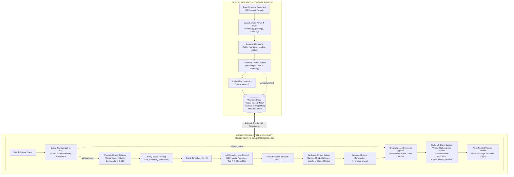
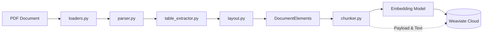
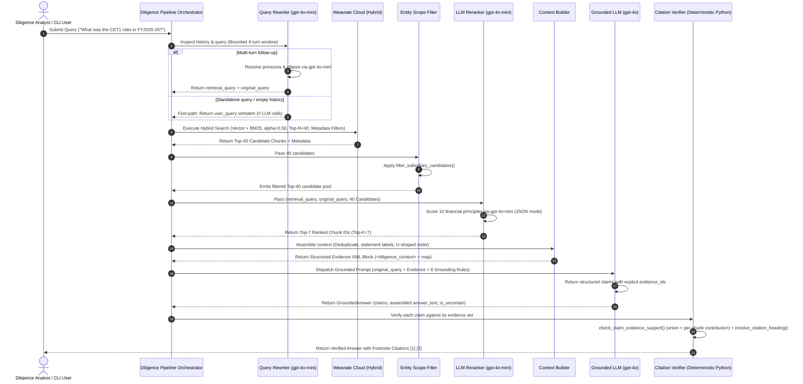
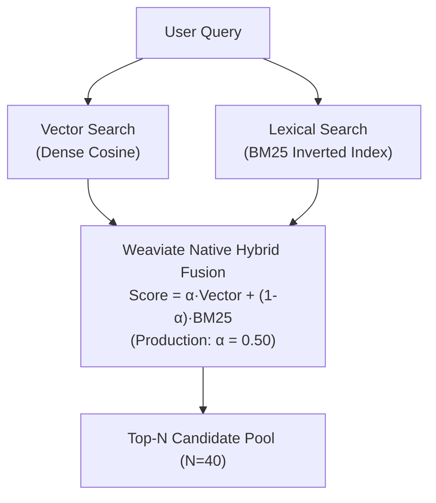
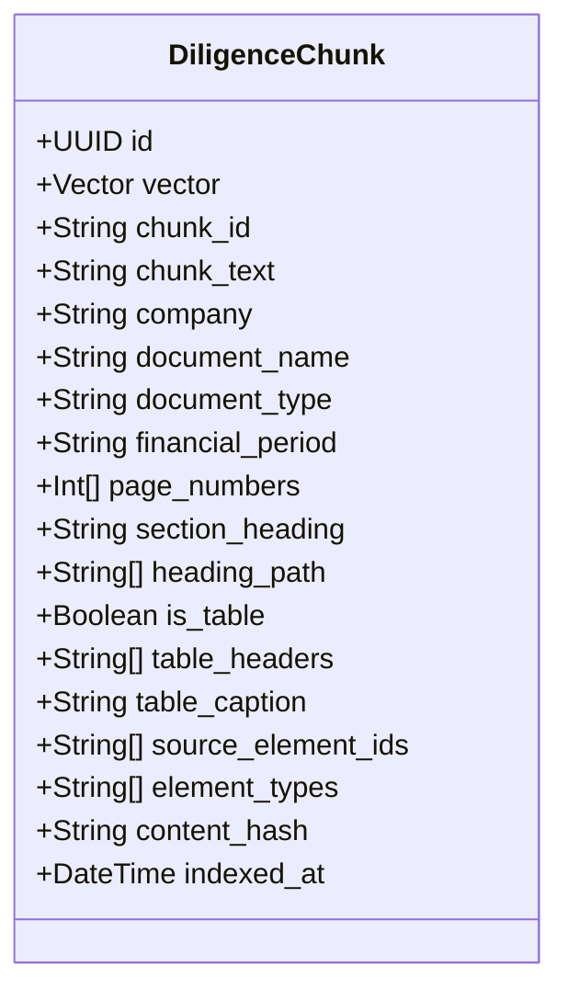
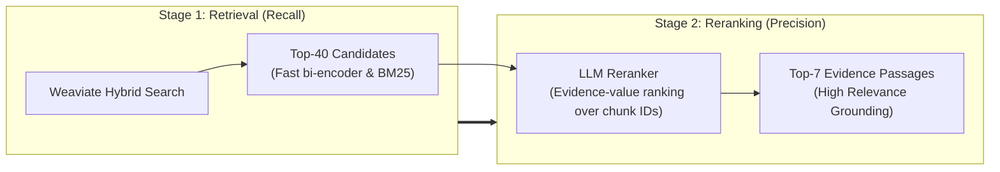
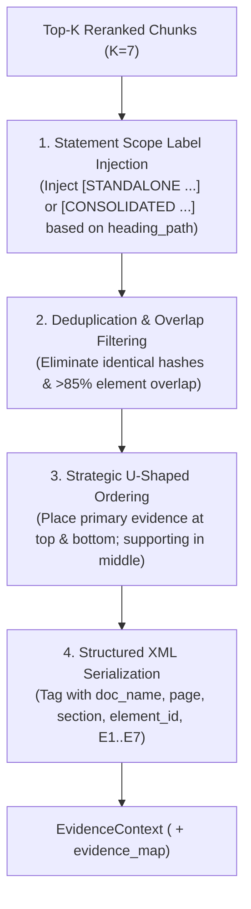
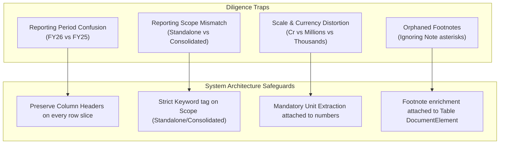
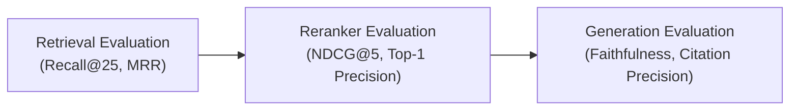

# RAG Architecture Design: Post-Ingestion Retrieval, Reranking & Grounded Generation

**Document Type:** System Architecture Specification (Parallel Design Track)  
**Status:** Approved for Implementation Planning  
**Scope:** Post-Chunking Pipeline (Vector & Lexical Indexing, Hybrid Retrieval, LLM Reranking, Context Construction, Grounded LLM Generation, Citation Attribution, and Evaluation)  
**Target Document Scope:** Corporate Annual Reports (e.g., HDFC Bank FY2025-26), 10-K/10-Q Filings, M&A Agreements, and Virtual Data Room (VDR) Documents  

---

## 1. RAG Architecture Overview

The **AI Due Diligence Co-pilot** is a high-precision, source-grounded Retrieval-Augmented Generation (RAG) platform. In corporate diligence, errors carry severe financial, regulatory, and legal liabilities. Generic conversational RAG architectures fail in this domain because:
1. They hallucinate numbers when evidence is incomplete.
2. They mix up adjacent financial reporting periods (e.g., reporting FY2024-25 numbers for FY2025-26).
3. They fail to isolate Standalone statements from Consolidated statements.
4. They confuse currencies and reporting scales (thousands, millions, crores).
5. They lose the audit trail connecting synthesized insights to original PDF coordinates.

To resolve these challenges, the system enforces a strict dual-track architecture:
* **The Document Ingestion Track (Offline Data Preparation):** Deterministically extracts text, parses tables, resolves multi-column layout geometry, partitions blocks, and emits enriched, provenance-tagged chunks.
* **The Query & Generation Track (Online Diligence Pipeline):** Ingests user queries, resolves conversational references via `gpt-4o-mini`, executes metadata-scoped hybrid retrieval (Dense Vector + BM25 Lexical) in Weaviate Cloud, refines candidates via LLM reranking (`gpt-4o-mini`), constructs structured evidence contexts with statement labels, synthesizes answers with `gpt-4o`, and verifies citations deterministically.



---

## 2. Offline Ingestion Pipeline (Document Side)

The offline ingestion pipeline is responsible for turning unstructured PDF binaries into structured, queryable knowledge. **Its sole job is data preparation.** It does not execute ad-hoc searches, answer questions, or make LLM analytical judgments.

### 2.1 The Ingestion Dataflow



1. **Document Validation ([`loaders.py`](../src/due_diligence/ingestion/loaders.py)):** Verifies file format, SHA-256 hash, non-emptiness, and generates a [`ValidatedDocument`](../src/due_diligence/ingestion/document.py).
2. **Font & Glyph Translation ([`font_mappings.py`](../src/due_diligence/ingestion/font_mappings.py)):** Remaps private-use unicode glyphs and normalizes standalone nil dashes (`–`, `—`) into explicit `[NIL/NOT DISCLOSED]` markers.
3. **Table Extraction ([`table_extractor.py`](../src/due_diligence/ingestion/table_extractor.py)):** Applies 3-tier extraction (Tier 1 column-projection, Tier 2 Gemini Flash vision fallback, Tier 3 graceful degradation) and enforces a 5-point quality gate.
4. **Spatial Reconciliation ([`layout.py`](../src/due_diligence/ingestion/layout.py)):** Cookie-cutters table regions, detects multi-column reading orders (reading top-to-bottom within each column before moving right), eliminates text duplication, and outputs typed [`DocumentElement`](../src/due_diligence/ingestion/elements.py) streams.
5. **Document-Aware Chunking (`chunker.py` - Current Task 4):**
   - Keeps tables atomic with their headers, captions, and footnotes.
   - Respects section boundaries (never joins paragraphs from disparate chapters).
   - Enriches every chunk with breadcrumb hierarchy (`heading_path`), page numbers, and unique deterministic IDs.
6. **Dense Embedding Generation:** Generates high-dimensional vector representations of chunk content using a dedicated embedding model.
7. **Weaviate Indexing:** Writes chunk text, dense vectors, and structured metadata into Weaviate Cloud.

---

## 3. Online Query Pipeline (Query Side)

The online query pipeline operates in real time when an analyst asks a diligence question. 

### 3.1 Step-by-Step Query Execution Lifecycle



---

## 4. Retrieval Subsystem Design

Diligence documents present a fundamental retrieval paradox:
* **Analyst queries are conceptual:** *"What are the bank's provisions for non-performing loans?"* (Requires dense vector matching to connect "provisions" to "credit loss allowances" and "stage 3 assets").
* **Analyst queries are hyper-specific:** *"What was the CRAR under Basel III on March 31, 2026?"* (Requires exact lexical matching for acronyms, regulatory standards, dates, and schedule numbers).

Single-retriever architectures consistently fail in virtual data rooms. Dense vectors fail on exact metrics and section numbers, while keyword search fails on conceptual synonyms. **Hybrid retrieval is mandatory.**

### 4.1 Dense Vector Retrieval

* **Role:** Conceptual discovery and semantic synonymy.
* **Why It Exists:** Connects queries to passages that share meaning but use different vocabulary (e.g., query *"financial health"* matching passage *"solvency and capital adequacy ratios"*).
* **Embedding Model Requirements:**
  - **Context Window:** Minimum 512 tokens; preferably 2048+ tokens to avoid truncation of comprehensive financial disclosure chunks.
  - **Domain Sensitivity:** Strong performance on technical, legal, and financial prose (e.g., `text-embedding-3-large`, `bge-large-en-v1.5`, or `voyage-finance-2`).
  - **Symmetric vs. Asymmetric Retrieval:** Must support query instruction prefixes (e.g., `Represent this query for retrieving relevant financial documentation:`) if using asymmetric models like BGE.
* **Consistency Invariant:** The exact same embedding model, normalization, and dimensional reduction (if any) used during offline indexing must be used for query vector generation.
* **Strengths:** Captures paraphrased intent; robust against minor misspellings; understands financial conceptual relationships.
* **Weaknesses:** **Blind to exact numbers and dates.** In high-dimensional semantic space, `"FY2024-25"` and `"FY2025-26"` have a cosine similarity of $\approx 0.98$ because they appear in identical syntactic contexts. Vector search cannot distinguish which year is which without metadata or keyword assistance.

### 4.2 BM25 / Lexical Retrieval

* **Role:** Exact string, identifier, and numeric matching.
* **Why It Exists in Diligence RAG:**
  - **Exact Acronyms & Ratios:** `CET1`, `CRAR`, `LCR`, `EBITDA`, `ARR`, `NPA`.
  - **Accounting Standards & Schedules:** `IndAS 116`, `Schedule 14`, `Note 18.2`, `Form 10-K Item 1A`.
  - **Reporting Periods & Dates:** `March 31, 2026`, `FY2025-26`, `Q3 FY26`.
  - **Entity & Auditor Names:** `BSR & Co. LLP`, `HDFC Life Insurance Co. Ltd.`.
  - **Currency Units:** `₹ crore`, `USD millions`, `bps`.
* **Tokenization & Inverted Index Requirements:**
  - Tokenizer must **not** strip hyphens in fiscal periods (e.g., preserving `FY2025-26` as an atomic token rather than splitting into `FY2025` and `26`).
  - Stopword lists must be customized: generic English stopwords (such as "A", "B", "I", "II", "1", "2") must **not** be dropped, as they represent schedule identifiers, exhibit tags, and roman numeral disclosures.
* **Strengths:** Precision matching on technical codes, section headers, and exact numbers.
* **Weaknesses:** Cannot handle synonyms; fails when the analyst asks for *"debt covenants"* and the document only mentions *"negative pledge"* or *"indebtedness limits"*.

### 4.3 Hybrid Fusion Strategy

Weaviate provides native hybrid retrieval combining vector similarity and BM25 scores using the $\alpha$ balancing parameter:

$$\text{Score} = \alpha \times \text{VectorScore} + (1 - \alpha) \times \text{BM25Score}$$



* **Production Hybrid Weight ($\alpha = 0.50$):**
  - Perfectly balances dense semantic matching ($\alpha=0.50$) with exact keyword precision ($1-\alpha=0.50$).
  - For exact regulatory queries (e.g., *"Schedule 4 Capital"*), the strong BM25 score elevates the exact page even when narrative embeddings vary.
* **Candidate Pool Size ($N = 40$):**
  - Hybrid retrieval casts a wide net, fetching the Top 40 candidates.
  - This guarantees high candidate recall across multi-page disclosure notes and financial schedules, ensuring the reranker has ample context to select from.

---

## 5. Weaviate Conceptual Data Model

The Weaviate collection (e.g., `DiligenceChunk`) represents the storage and retrieval schema. It stores the chunk text, vector embedding, and structured provenance metadata.



### Property Rationale & Specification

| Property Name | Weaviate Data Type | Searchable / Indexed | Purpose & RAG Responsibility |
| :--- | :--- | :--- | :--- |
| `chunk_id` | `text` (keyword) | Filterable | Unique deterministic ID (`doc_name_pXX_cYY`) for trace-back and citation resolution. |
| `chunk_text` | `text` | Vectorized + BM25 | The actual payload (narrative prose or GitHub-Flavored Markdown table) fed into the LLM context. |
| `company` | `text` (keyword) | Filterable + BM25 | Entity name (e.g., *"HDFC Bank"*). Essential for multi-deal and tenant filtering. |
| `document_name` | `text` (keyword) | Filterable + BM25 | Original filename (e.g., `hdfc-bank__annual-report__fy2025-26.pdf`). Used in citations. |
| `document_type` | `text` (keyword) | Filterable | Document taxonomy (`annual_report`, `10-k`, `credit_agreement`, `board_presentation`). |
| `financial_period` | `text` (keyword) | Filterable + BM25 | Reporting period (`FY2025-26`, `Q3_2025`). Prevents multi-year data contamination. |
| `page_numbers` | `int[]` | Filterable | 1-indexed source pages spanned by this chunk (e.g., `[378]`, or `[380, 381]`). Basis of citation. |
| `section_heading` | `text` | Filterable + BM25 | Immediate section title (e.g., *"Note 14: Asset Quality"*). Inherited from layout heading stack. |
| `heading_path` | `text[]` | Filterable | Full hierarchical breadcrumb (e.g., `["Financial Statements", "Notes", "Note 14"]`). |
| `is_table` | `boolean` | Filterable | Discriminator indicating tabular content. Allows boosting tables for quantitative queries. |
| `table_headers` | `text[]` | BM25 | Column header labels. Enables BM25 to locate tables by column title (e.g., *"Basic EPS"*). |
| `table_caption` | `text` | BM25 | Table title or schedule description (e.g., *"Schedule 12 - Contingent Liabilities"*). |
| `source_element_ids` | `text[]` | Filterable | Deterministic IDs of original [`DocumentElement`](../src/due_diligence/ingestion/elements.py) objects composing this chunk. |
| `element_types` | `text[]` | Filterable | Types of content inside the chunk: `["table"]`, `["narrative"]`, `["heading", "narrative"]`. |
| `content_hash` | `text` (keyword) | Filterable | SHA-256 hash of raw chunk content for deterministic deduplication during batch ingestion. |

---

## 6. Metadata Filtering Strategy

Metadata filtering narrows the candidate pool *before* or *during* retrieval. 

```
                                    User Query
                                        │
                         Unambiguous Entity or Period?
                                        │
                         ┌──────────────┴──────────────┐
                        YES                            NO
                         │                             │
                         ▼                             ▼
              Apply Hard Filter               Execute Unfiltered
             (company, period)                 Broad Hybrid Search
                         │                             │
                         └──────────────┬──────────────┘
                                        ▼
                            Weaviate Hybrid Retrieval
```

### 6.1 When Metadata Filtering Improves Retrieval
1. **Multi-Company Data Rooms:** In an M&A deal room containing 5 peer banks, filtering by `company == "HDFC Bank"` prevents competitor numbers from polluting the candidate set.
2. **Targeted Annual Questions:** When the user explicitly asks: *"What was the FY2025-26 net profit?"*, pre-filtering by `financial_period == "FY2025-26"` eliminates historical filings from FY2023 or FY2024.
3. **Document-Type Scoping:** When an analyst asks for *"Credit ratings in the annual report"*, filtering by `document_type == "annual_report"` avoids fetching older investor deck slides.

### 6.2 The "Over-Filtering" Trap (When Filtering Destroys Retrieval)
Applying aggressive metadata filters blindly can eliminate crucial evidence:
* **The Comparative Growth Problem:**  
  *User asks:* *"How did retail advances grow in FY2025-26 compared to the previous year?"*  
  *The Danger:* If the system filters strictly on `financial_period == "FY2025-26"`, it may exclude the FY2024-25 baseline numbers if they reside in a historical section or prior-year column.
* **The Cross-Section Disclosure Problem:**  
  *User asks:* *"What are the bank's cyber risk disclosures?"*  
  *The Danger:* If the system filters by `section_heading == "Risk Factors"`, it completely misses cyber disclosures located in *"Information Technology Note 34"* or the *"Corporate Governance Report"*.

### 6.3 Safe Filtering Rules of Engagement
1. **Company Filter:** Apply as a **Hard Pre-Filter** whenever the entity is explicitly specified or active in the deal room session.
2. **Financial Period Filter:** Apply as a **Soft Filter** (or BM25 boost) rather than a hard boolean gate, unless the user explicitly demands standalone data for that year alone.
3. **Section Heading Filter:** **Never apply as a hard boolean gate** at retrieval time. Let BM25 and vector search discover the relevant section naturally.

---

## 7. Reranking Subsystem Design

Hybrid retrieval is a **candidate generator**, not an evidence selector. Its job is to maximize **recall** ($N=40$). The reranker's job is to maximize **precision** ($K=7$).



### 7.1 Why Reranking is Critical in Due Diligence
In bi-encoder vector search, the query and document are converted into vectors independently: $\text{sim}(q, d) = \vec{q} \cdot \vec{d}$. The model never sees the query words and document words interacting directly.

The production **LLM Reranker (B5)** takes the retrieval query, the original user
question, and all Top-40 B4 candidates together and returns an ordered list of
chunk IDs by direct evidence value. It detects whether the exact relationship
demanded by the query (e.g., *"indemnification cap as a percentage of enterprise
value"*) is actually satisfied by the passage — including entity scope
(standalone vs consolidated vs subsidiary), metric scope (actual vs regulatory
minimum), and primary-statement priority — rather than just containing similar
financial jargon. Tables are first-class evidence, never penalized for being tables.

> Historical note: B5 previously used local cross-encoder profiles (Ettin-17M demo,
> BGE-large reference, and a two-stage hybrid). Those were removed because
> cross-encoders systematically demoted dense financial tables/schedules. The
> measurements below are preserved as historical records only.

### 7.2 Reranker Profile (Current Production)

**Single-stage LLM reranker (`gpt-4o-mini`, configurable via `LLM_RERANKER_MODEL`):**
scores the full Top-40 B4 candidate pool per query and returns at most Top-7 chunk
IDs (`ranked_chunk_ids`) as strict JSON. Unknown/duplicate IDs are rejected, fewer
than 7 valid IDs yields fewer results, and API failures fall back deterministically
to B4 input order. No local weights, no model loading, no cross-encoder fallback.

| Profile / Model | Candidates Scored ($N$) | Output Evidence ($K$) | Historical Latency Reference |
| :--- | :--- | :--- | :--- |
| **LLM (gpt-4o-mini, current)** | **40** | **7** | measured per benchmark run (see validation reports) |
| Ettin-17M (removed) | 25 | 5 | ~1.05 s/query CPU (historical) |
| BGE-Large (removed) | 25 | 5 | ~50.6 s/query CPU (historical) |

### 7.3 Configurable Defaults ($N$, $C$, and $K$)
* **Top-$N$ Retrieval ($N = 40$):** Initial candidate budget retrieved by Weaviate hybrid search (BM25 + vector).
* **Rerank Candidate Count ($C = 40$ default):** Number of Top B4 candidates forwarded to LLM reranking (via `rerank_candidate_count`).
* **Top-$K$ Evidence ($K = 7$):** Context budget selected after LLM ranking. 7 passages fit the generation context with full table text preserved.

---

## 8. Query Rewriting Guidelines

Query rewriting is an **online query optimization technique**, but in legal and financial diligence, careless query rewriting is dangerous. A rewritten query that injects assumptions or hallucinates a ticker can corrupt the entire retrieval chain.

### 8.1 The Two Query Classes

```
                          User Inbound Message
                                   │
                   Is there conversation history?
                                   │
                    ┌──────────────┴──────────────┐
                   YES                            NO
                    │                             │
         Contains pronouns or                      │
         missing entity/metric?                    │
                    │                             │
             ┌──────┴──────┐                      │
            YES            NO                     │
             │             │                      │
             ▼             ▼                      ▼
        Execute Safe      Pass Raw               Pass Raw
          Rewriter         Query                  Query
```

1. **Standalone Queries (Never Rewrite):**
   - *Example:* *"What was HDFC Bank's Capital Adequacy Ratio in FY2025-26 under Basel III?"*
   - *Action:* **Execute as-is.** The query is self-contained. Any rewrite risks stripping regulatory acronyms or injecting hallucinated synonyms.
2. **Conversational / Follow-up Queries (Rewriting Permitted):**
   - *Example Turn 1:* *"What was the bank's total provision for bad loans in FY26?"*
   - *Example Turn 2:* *"What about the previous year?"*
   - *Action:* **Rewrite.** Resolves the ellipsis into: *"What was HDFC Bank's total provision for bad loans in FY2024-25?"*

### 8.2 Strict Rewriter Invariants
* **Zero Fact Injection:** The rewriter must **never** add facts, numbers, or assumptions not explicitly present in the conversation history.
* **Preserve Financial Syntax:** Never rewrite or simplify technical terms (e.g., do not rewrite *"IndAS 109 expected credit loss"* to *"loan loss estimation"*).
* **Entity & Period Anchoring:** If Turn 1 established `company = "HDFC Bank"`, Turn 2 must retain that entity anchor.

### 8.3 Production Implementation & Configuration
- **Model Selection:** `gpt-4o-mini` (configured via `Settings.query_rewriter_model`, env `QUERY_REWRITER_MODEL`), executed at `temperature=0.0` with `max_tokens=256`.
- **Fast-Path Invariant:** If conversation history is empty or whitespace-only, the rewriter immediately returns `user_query` verbatim with **zero LLM API calls**, eliminating latency overhead for standalone questions.
- **Bounded History Window:** Slices history to the most recent 4 turns (messages, not full dialogue exchanges), preventing token bloat and context drift.
- **Prompt Injection Defense:** Strict XML sanitization escapes `<conversation_history>`, `<current_query>`, and `<rewritten_query>` tags.
- **Decoupled Dual Queries:** Emits `retrieval_query` to optimize B4 hybrid search and B5 reranking, while preserving `original_query` for B7 generation to prevent subtle conversational phrasing shifts.

---

## 9. Context Construction Stage

The Context Builder sits between the Reranker and the LLM. It takes the Top-$K$ ($K=7$) reranked chunks and formats them into an organized, readable evidence block.

### 9.1 Context Assembly Pipeline



1. **Statement Scope Disambiguation:** Injects explicit `[STANDALONE ...]` or `[CONSOLIDATED ...]` labels derived from `heading_path` to prevent the generator from blending parent and group figures.
2. **Deduplication:** Chunks with identical `content_hash` or $>85\%$ overlapping `source_element_ids` are pruned, keeping only the highest-scoring candidate.
3. **Strategic U-Shaped Ordering:** Counteracts the "lost-in-the-middle" effect by positioning the strongest evidence (Ranks #1 and #2) at the top and bottom of the prompt context, with secondary evidence in the middle.
4. **Token Indirection:** Assigns deterministic evidence identifiers (`E1`, `E2`, ..., `E7`) and constructs an `evidence_map` mapping each token to its source chunk metadata.

### 9.2 Standardized Context Wire Format

```xml
<diligence_context document="hdfc-bank__annual-report__fy2025-26.pdf">
  <evidence 
    id="E1" 
    page="378" 
    section="Standalone Financial Statements" 
    heading_path="Standalone Financial Statements > Balance Sheet"
    is_table="true"
    element_id="hdfc_p378_table_0">
    | Capital and Liabilities | Schedule | As of 31-03-2026 (₹ Cr) | As of 31-03-2025 (₹ Cr) |
    |---|---|---|---|
    | Capital | 1 | 759.70 | 754.20 |
    | Reserves and Surplus | 2 | 442,120.50 | 385,400.10 |
    | Deposits | 3 | 2,345,600.00 | 2,035,200.00 |
  </evidence>

  <evidence 
    id="E2" 
    page="402" 
    section="Notes to Accounts" 
    heading_path="Notes to Accounts > Note 14: Capital Adequacy"
    is_table="false"
    element_id="hdfc_p402_narr_3">
    As of March 31, 2026, the Bank's Common Equity Tier 1 (CET1) ratio stood at 16.4% against the regulatory minimum requirement of 8.0% including Capital Conservation Buffer.
  </evidence>
</diligence_context>
```

---

## 10. Grounded Generation Subsystem

The Generation Subsystem synthesizes the final diligence answer. In this system, the LLM is treated as a **grounded reasoning engine, not a source of corporate facts**.

### 10.1 Grounding Decision Matrix

| Evidence State | System Behavior & Generation Protocol |
| :--- | :--- |
| **1. Direct & Complete** | Synthesize direct answer. Every fact, date, or number must carry an explicit evidence citation: `[E1]`. |
| **2. Partial Answer** | Answer the covered portion clearly with citations; explicitly declare what remains unknown: *"The report details retail deposits (₹12,450 Cr) [E1], but corporate deposit breakdowns are not disclosed."* |
| **3. Contradictory Evidence** | Surface the exact conflict verbatim: *"Note 14 states CET1 is 16.4% [E2], whereas Table 3.2 reports 16.1% [E4]. Both sources are shown for review."* Never average or pick one arbitrarily. |
| **4. Insufficient Evidence** | State clearly: *"The ingested document does not contain sufficient information to answer this question."* Suggest the specific schedule or exhibit that might house the missing data. |
| **5. Unmentioned Metric** | Explicit uncertainty declaration: *"Not disclosed in the ingested document."* Never invent or extrapolate an estimate. |

### 10.2 Separation of Fact vs. Interpretation
The prompt instructions enforce an explicit cognitive divide:
* **Verbatim Facts:** Must be quoted or directly extracted with strict fidelity to source units, currencies, and signs.
* **Analytical Interpretation:** If the model computes a growth percentage or compares two metrics, it must label the calculation explicitly:  
  *Example:* *"Net profit grew by 15.2% (Calculated: (₹44,200 Cr - ₹38,350 Cr) / ₹38,350 Cr from [E1])."*

### 10.3 Production Implementation & 8 Grounding Rules
- **Model & Configuration:** Powered by **`gpt-4o`** (`Settings.generation_model`), operating at `temperature=0.0` with `response_format={"type": "json_object"}`.
- **8 Non-Negotiable Grounding Rules:**
  1. Strict evidence boundary: only facts from `<diligence_context>` may be used.
  2. Mandatory `[EX]` citations on every factual claim.
  3. Zero financial invention: never extrapolate unmentioned metrics.
  4. Explicit fact vs. calculation separation.
  5. Strict scope isolation: never blend Standalone and Consolidated metrics.
  6. Faithful unit and currency retention.
  7. Deterministic negative refusal: output `"Not disclosed in the ingested document."` when proof is absent.
  8. Valid token syntax: emit only existing `[EX]` tags.
- **Zero-Evidence Fast Path:** If `EvidenceContext` is empty, returns an explicit refusal (`is_uncertain=True`) without calling the LLM.

---

## 11. Citation Architecture & Provenance Chain

Due diligence answers are useless without proof. A user must be able to click any sentence and immediately view the exact source page.

### 11.1 The Unbroken Provenance Thread

```
[Raw PDF: Page 378, BBox (54.0, 120.5, 550.0, 720.0)]
                          │
                          ▼
[DocumentElement: Table (element_id='hdfc_p378_table_0')]
                          │
                          ▼
[Weaviate Chunk: chunk_id='hdfc_p378_c0', pages=[378], heading='Balance Sheet']
                          │
                          ▼
[Retrieved Evidence Snippet: id='E1']
                          │
                          ▼
[LLM Synthesized Statement + [E1] Tag]
                          │
                          ▼
[Deterministic CitationVerifier (check_claim_evidence_support)]
                          │
                          ▼
"Deposits totaled ₹23,45,600 Cr [1]"
[1] hdfc-bank__annual-report__fy2025-26.pdf, Page 378, Standalone Balance Sheet
```

### 11.2 Citation Invariants & Active Verification Gate
1. **Deterministic Token Indirection:** The LLM returns structured claims with evidence IDs. B7 places the internal tokens (`[E1]`, `[E2]`) deterministically, and B8 translates them into human-readable citations. The LLM is never allowed to type page numbers from memory.
2. **Active Claim-Support Gate (`check_claim_evidence_support`):** Deterministic Python verifier inspects each structured claim against its complete evidence set:
   - Every cited evidence ID must exist in the current `EvidenceContext`.
   - The union of cited chunks must contain every headline number ($\ge 4$ digits, %, currency) and multi-word named entity in the claim.
   - Every cited chunk must contribute at least one checkable anchor, or meaningful lexical support for qualitative claims.
   - One claim may cite several chunks; one chunk may support several claims. Each claim is verified independently.
   - If verification fails, the claim is `partially_supported` or `unverified`, and the failing token is demoted to `[Unverified: EX]`.
3. **Nearest Heading Resolution (`resolve_citation_heading`):** Resolves the nearest true section heading, filtering out data rows, Total rows, and footnote markers.
4. **Missing Page Graceful Fallback:** If a document lacks physical page numbers, the citation reports `[Page: Unknown, Section: ...]` rather than guessing.

---

## 12. Financial-RAG Specific Requirements

Corporate filings have subtle structural traps that cause catastrophic errors in naive RAG systems. The architecture incorporates explicit safeguards:



1. **Comparative Year Columns (FY26 vs. FY25):**  
   Financial statements present comparative columns side-by-side. If a chunker splits a table across lines without repeating column headers, the LLM misattributes FY25 numbers to FY26.  
   *Architecture Fix:* The [`Table`](../src/due_diligence/ingestion/elements.py) model renders headers on every chunked sub-table slice.
2. **Standalone vs. Consolidated Statements:**  
   In banking and conglomerate reports, parent-only figures (Standalone) differ massively from group figures (Consolidated).  
   *Architecture Fix:* `layout.py` tracks the top-level section breadcrumb (e.g., `["Consolidated Financial Statements", "Balance Sheet"]`) and stores it in Weaviate's `heading_path`.
3. **Scale & Currency Preservation:**  
   Indian annual reports report in `₹ Crore` (10 million INR) or `₹ Lakh` (100,000 INR), whereas US SEC filings report in `$ Thousands` or `$ Millions`.  
   *Architecture Fix:* Ingestion extracts currency headers (e.g., `(₹ in crore)`) and prepends them as a mandatory caption to all table chunks.

---

## 13. Failure Modes & Mitigation Matrix

| Failure Mode | Root Cause in RAG | Architectural Mitigation Strategy |
| :--- | :--- | :--- |
| **1. Wrong Company** | Multi-tenant deal room data bleed | Hard Weaviate metadata filter on `company` enforced on every retrieval call. |
| **2. Wrong Financial Year** | Vector similarity blindness between adjacent years (`FY25` vs `FY26`) | BM25 lexical boost for fiscal year tokens + clear comparative column headers in tables. |
| **3. Standalone/Consolidated Bleed** | Semantic similarity between parent & group balance sheets | Section heading hierarchy (`heading_path`) explicitly included in chunk text and BM25 index. |
| **4. Currency / Unit Misreporting** | Table units separated from table cells by distance | Unit header (`(₹ in crore)`) enriched into table metadata and rendered on every chunk. |
| **5. Sub-table Row Truncation** | Naive character-limit chunking slicing through a row | Layout-aware chunker keeps table rows atomic; chunks table by row boundaries with headers. |
| **6. Lost Footnote Disclosures** | Footnotes placed at page bottom separated from cell | `layout.py` spatial footnote reconciliation attaches footnotes directly to the [`Table`](../src/due_diligence/ingestion/elements.py) element. |
| **7. Multi-Column Story Jumble** | Left-to-right naive page text stream extraction | `layout.py` gutter detection sorts text top-to-bottom in Column 1 before Column 2. |
| **8. Double-Ingested Table Text** | Table parsed as table AND also as narrative prose | Spatial table bounding box exclusion in `layout.py` guarantees `multiply_owned == 0`. |
| **9. False Positive Hallucination** | LLM attempting to be "helpful" when metric is absent | Strict system prompt instruction: emit `"Not disclosed in the ingested document"` when context lacks proof. |
| **10. Fabricated Page Numbers** | Model guessing page coordinates from memory | Model outputs only evidence IDs (`[E1]`); Citation Engine deterministically injects page numbers. |
| **11. Silent Missing Documents** | Corrupted PDF stream or scan without OCR | Loader SHA-256 verification + Preflight character reconciliation delta gate ($\le 5\%$). |
| **12. Reranker Omission** | Setting Top-$K$ too small for multi-part synthesis queries | Set configurable $K=5-7$; Context Builder clusters related section siblings automatically. |

---

## 14. Evaluation & Benchmarking Framework

Evaluation must be designed *before* implementing retrieval and generation. We measure three distinct stages:



### 14.1 Metrics Definition
1. **Retrieval Metrics (Weaviate Hybrid):**
   - **Recall@40:** Does the Top-40 candidate pool contain the known ground-truth source chunk? Target: $\ge 95\%$.
   - **MRR (Mean Reciprocal Rank):** Where does the first relevant chunk appear in the initial retrieval?
2. **Reranker Metrics (LLM Reranker):**
   - **Precision@7:** What proportion of the Top-7 reranked passages are genuinely relevant? Target: $\ge 80\%$.
   - **Rank Shift:** Measures whether the LLM Reranker successfully promoted relevant chunks from low ranks (#15–40) into the Top-7.
3. **Generation & Attribution Metrics:**
   - **Faithfulness (Hallucination Rate):** Every claim must be 100% entailment-backed by context. Target: $1.00$ (Zero hallucination tolerance).
   - **Citation Precision & Recall:** Does every claim link to the correct page? Are all relevant pages cited? Target: $\ge 95\%$.

### 14.2 Initial Golden Benchmark Dataset (25 Curated Diligence Queries)

The following 25 ground-truth test cases are tailored to the HDFC Bank FY2025-26 Annual Report:

| ID | Diligence Query | Target Category | Ground-Truth Location / Target Evidence |
| :--- | :--- | :--- | :--- |
| **Q01** | What was the bank's total deposit base as of March 31, 2026? | Financial Metric | Standalone Balance Sheet (Page 378, Schedule 3) |
| **Q02** | What was the Common Equity Tier 1 (CET1) ratio at the end of FY2025-26? | Regulatory Capital | Note 14: Capital Adequacy (Page 402) |
| **Q03** | How much was spent on employee payments and provisions in FY26? | P&L Statement | Standalone Profit & Loss (Page 379, Schedule 16) |
| **Q04** | What was the percentage growth in net profit between FY25 and FY26? | Multi-Year Comparison | Profit & Loss Statement (Page 379, audited comparative columns) |
| **Q05** | What was the basic and diluted Earnings Per Share (EPS) for FY26? | Financial Metric | Profit & Loss Statement (Page 379, EPS section) |
| **Q06** | What were the total contingent liabilities on March 31, 2026? | Risk / Off-Balance Sheet | Schedule 12: Contingent Liabilities (Pages 378 & 392) |
| **Q07** | What is the total provision for non-performing loans (NPLs) in FY26? | Asset Quality | Notes to Accounts: Note 14 & Provisioning tables |
| **Q08** | What were the key growth drivers cited in the retail banking franchise? | Narrative Commentary | Management Discussion & Analysis (Multi-column narrative pages) |
| **Q09** | How many Board of Directors meetings were held during FY2025-26? | Governance Disclosure | Corporate Governance Report: Board Attendance Matrix (Page 343) |
| **Q10** | Who were the joint statutory auditors who signed the FY2025-26 audit report? | Legal / Compliance | Standalone Independent Auditor's Report Signature Block (Page 377) |
| **Q11** | What is the bank's Liquidity Coverage Ratio (LCR) for the reporting period? | Liquidity Risk | Basel III Pillar 3 Disclosures / LCR schedule |
| **Q12** | What were the total gross advances as of March 31, 2026? | Balance Sheet | Schedule 9: Advances (Page 378 & Schedule 9 Note) |
| **Q13** | Did the bank report any material restatements of prior period financials? | Accounting Policies | Note 1: Summary of Significant Accounting Policies |
| **Q14** | What was the net cash flow from operating activities in FY2025-26? | Cash Flow Statement | Standalone Cash Flow Statement (Page 380, continuation on 381) |
| **Q15** | What are the key provisions regarding employee stock options (ESOPs)? | HR & Governance | Notes to Accounts: Employee Stock Option Scheme Note |
| **Q16** | What is the total tier 2 subordinated debt outstanding? | Capital Structure | Schedule 4: Borrowings (Subordinated debt breakdown) |
| **Q17** | What is the breakdown of priority sector lending advances? | Regulatory Lending | Priority Sector Lending Disclosure section |
| **Q18** | What was the dividend per share declared for FY2025-26? | Shareholder Return | Director's Report / Note on Dividend Distribution |
| **Q19** | What are the primary cybersecurity risk disclosures mentioned? | Operational Risk | Risk Management Note / Technology Disclosures |
| **Q20** | How did operating profit compare between Standalone and Consolidated accounts? | Scope Comparison | Multi-document / Multi-statement cross-comparison (Page 379 vs 480) |
| **Q21** | What are the exposure limits for single borrower and group borrower concentration? | Credit Concentration | Prudential Exposure Norms Disclosure |
| **Q22** | What are the terms of the outstanding senior unsecured bonds? | Debt Schedules | Long-Term Debt Disclosure Note |
| **Q23** | What was the effective tax rate for the fiscal year? | Tax Disclosures | Income Tax Reconciliation Note |
| **Q24** | What was the bank's market share in private commercial credit cards? | Unanswerable / Extrapolated | Test refusal: Verify system outputs explicit uncertainty if absent. |
| **Q25** | What was the valuation cap for the Series C acquisition of FinTech Corp? | Negative Control | Test refusal: Metric does not exist in filing; must output `"Not disclosed"`. |

---

## 15. Architectural Decisions Register

| Decision Area | Status | Decision Made / Current Production | Rationale & Alternatives Considered |
| :--- | :--- | :--- | :--- |
| **Primary Vector Store** | **Decided (Live)** | **Weaviate Cloud (v4 SDK)** | Native vector + BM25 hybrid search, tenant metadata filtering, zero local mock stores (`DiligenceChunk`, 1,984 objects). |
| **Candidate Budget ($N$)** | **Decided (Live)** | **$N = 40$** | High recall across multi-page disclosure notes. Configured in `Settings.retrieval_top_n`. |
| **Evidence Context ($K$)** | **Decided (Live)** | **$K = 7$** | Context budget selected by LLM reranking. Configured in `Settings.rerank_top_k`. |
| **Hybrid Balance ($\alpha$)** | **Decided (Live)** | **$\alpha = 0.50$** | 50% dense vector, 50% BM25 lexical. Balanced semantic discovery and exact term precision. |
| **Query Rewriter Model** | **Decided (Live)** | **OpenAI `gpt-4o-mini`** | Dedicated model (`Settings.query_rewriter_model`). Fast, cost-efficient reference resolution across 4-turn window with zero-LLM fast path. |
| **Reranker Model (B5)** | **Decided (Live)** | **OpenAI `gpt-4o-mini` (LLM Reranker)** | Single-stage LLM reranker evaluating 10 financial principles in JSON mode. Replaced cross-encoders (BGE/Ettin) to eliminate 50s CPU latency and 512-token table truncation. |
| **Grounded Generator (B7)** | **Decided (Live)** | **OpenAI `gpt-4o`** | High-fidelity synthesis in JSON mode enforcing 8 non-negotiable grounding rules and `[EX]` citations. |
| **Citation Attribution (B8)** | **Decided (Live)** | **Deterministic Python (`CitationVerifier`)** | Verifies each claim against its evidence set via `check_claim_evidence_support()`, resolves nearest headings via `resolve_citation_heading()`, translates tokens to footnotes `[1]`, `[2]`. |
| **Embeddings Model** | **Decided (Live)** | **OpenAI `text-embedding-3-large` (1,536 dims)** | High semantic accuracy on financial tables and terminology (1,984 objects indexed in Weaviate Cloud). Local BGE supported as optional offline fallback. |

---

## 16. Verification & Architectural Non-Interference Check

* **Non-Interference with Ingestion:** This specification strictly covers **post-chunking** subsystems. It does not alter `loaders.py`, `table_extractor.py`, `layout.py`, or the active implementation of `chunker.py` in Phase 1 Task 4.
* **Compliance with `AGENTS.md`:** 
  - Strictly adheres to the Single-Document MVP slice (HDFC Bank annual report first).
  - Enforces zero uncited financial data and explicit uncertainty declarations (`"Not disclosed"`).
  - Retains Weaviate Cloud as the sole vector store.
* **Traceable Provenance:** Every chunk in Weaviate maintains an unbroken link back to the exact page number and bounding box coordinates generated by the preflight-verified layout engine.
