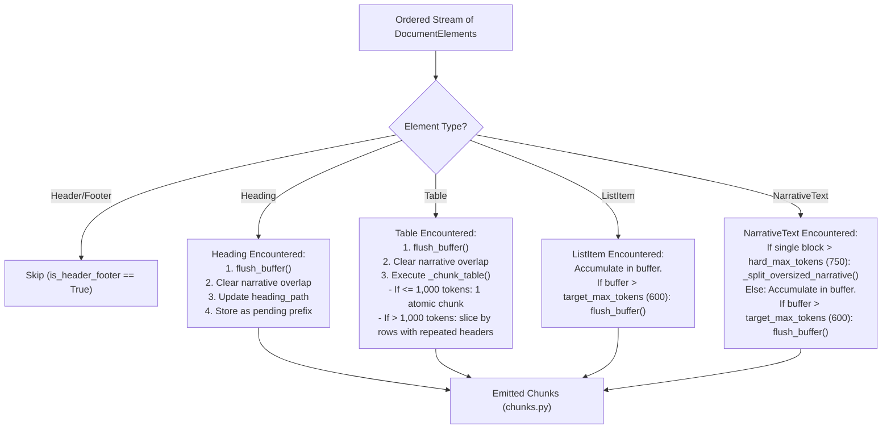
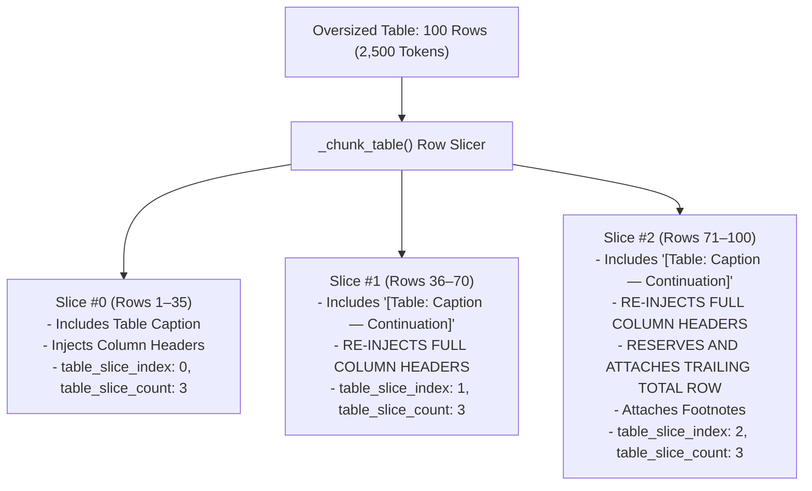

# Document-Aware Chunking Engine: From First Principles to Production RAG

---

## 1. Why Chunking is Needed in RAG

### 1.1 The Non-Technical Intuition (The Filing Cabinet Analogy)
Imagine you are handed a **678-page corporate annual report** filled with financial statements, executive letters, legal footnotes, and debt tables. You need to hire a team of research assistants to answer specific investor questions in seconds (for example: *"What was the bank's total contingent liabilities in FY2025-26?"*).

No human or AI can ingest all 678 pages into working memory in milliseconds. If you feed an entire 678-page PDF directly into a Large Language Model (LLM):
1. **Context Window Saturation & Cost:** Ingesting 600,000+ words per query costs significant money and incurs high seconds-to-minutes inference latency.
2. **"Lost in the Middle" Degradation:** LLMs suffer from severe attention degradation when answering specific factual queries over massive context windows. They pay attention to the beginning and end, while crucial numbers buried on page 389 are overlooked.
3. **Retrieval Impossibility:** Bi-encoder dense vector models (like OpenAI's `text-embedding-3-large`) map a text passage into a single fixed-dimensional geometric vector (e.g., 1,536 dimensions). Compressing 678 pages into one 1,536-dimensional vector washes out every specific detail into meaningless noise.

To make search possible, you must segment the document into smaller, coherent, organized **index cards** (called **chunks**) and store them neatly in a database. When an investor asks a question, your search system retrieves only the 5 to 7 most relevant index cards.

### 1.2 The Catastrophic Failure of Naive "Paper Shredder" Chunking
Most generic RAG tutorials recommend naive splitting:
> *"Split every 500 characters with a 50-character overlap."*

In corporate due diligence, naive character or token chunking is disastrous:

```
THE NAIVE FIXED-CHARACTER CHUNKING DISASTER:

Original Financial Schedule:
┌──────────────────────────────────────┬──────────────────────┬──────────────────────┐
│ Schedule 12: Contingent Liabilities   │ As of 31-03-2026     │ As of 31-03-2025     │
├──────────────────────────────────────┼──────────────────────┼──────────────────────┤
│ Claims against bank not acknowledged │ 2,450,100            │ 2,120,400            │
│ Guarantees on behalf of constituents │ 18,920,400           │ 16,800,200           │
│ Other contingent items               │ 12,808,958           │ 11,540,100           │
├──────────────────────────────────────┼──────────────────────┼──────────────────────┤
│ Total                                │ 34,179,458           │ 30,460,700           │
└──────────────────────────────────────┴──────────────────────┴──────────────────────┘

Resulting Chunk 1 (Cut lands after the word "Guarantees"):
┌────────────────────────────────────────────────────────────────────────────────────┐
│ Schedule 12: Contingent Liabilities   │ As of 31-03-2026     │ As of 31-03-2025     │
│ Claims against bank not acknowledged │ 2,450,100            │ 2,120,400            │
│ Guarantees                                                                         │
└────────────────────────────────────────────────────────────────────────────────────┘

Resulting Chunk 2 (Severed numbers with zero column headers, severed from caption!):
┌────────────────────────────────────────────────────────────────────────────────────┐
│ on behalf of constituents │ 18,920,400           │ 16,800,200                      │
│ Other contingent items    │ 12,808,958           │ 11,540,100                      │
│ Total                     │ 34,179,458           │ 30,460,700                      │
└────────────────────────────────────────────────────────────────────────────────────┘
```

**Why this breaks RAG:**
- **Lost Schema:** If Chunk 2 is retrieved, the LLM sees `18,920,400` and `34,179,458`, but has **zero column headers**! It cannot determine whether the left column is FY26 or FY25, or whether figures represent rupees, thousands, or lakhs.
- **Lost Context:** The word "Schedule 12: Contingent Liabilities" was isolated in Chunk 1. Chunk 2 has no mention of "Contingent Liabilities". A BM25 lexical search for *"Contingent Liabilities Total"* will fail to match Chunk 2 because the keyword was severed.
- **Destroyed Provenance:** A character splitter knows nothing about PDF pages. It cannot inform the legal team which physical page contains the audit trail.

---

## 2. Core Hierarchy: Page vs. Element vs. Chunk

In our system, document processing follows a strict three-tier hierarchy:

```
┌──────────────────────────────────────────────────────────────────────────────────┐
│ 1. PDF Page (Physical Container)                                                 │
│    - 1-indexed physical sheet in the PDF (e.g., Page 389)                        │
│    - Contains arbitrary raw text spans, visual lines, coordinates, and images    │
└────────────────────────────────────────┬─────────────────────────────────────────┘
                                         │ parsed & reconciled by layout.py
                                         ▼
┌──────────────────────────────────────────────────────────────────────────────────┐
│ 2. Document Element (Semantic Intermediate Representation)                       │
│    - Strongly typed, discrete semantic unit (NarrativeText, Heading, ListItem,   │
│      Table) defined in elements.py                                               │
│    - Carries 2D spatial bounding box (x0, y0, x1, y1), page number, entity_scope │
│    - Preserves internal integrity (a Table element contains all its rows/headers)│
└────────────────────────────────────────┬─────────────────────────────────────────┘
                                         │ grouped & sized by chunker.py
                                         ▼
┌──────────────────────────────────────────────────────────────────────────────────┐
│ 3. Chunk (Retrieval-Ready Unit)                                                  │
│    - Immutable, strongly typed Pydantic unit defined in chunks.py                │
│    - Sized to fit embedding models and LLM attention windows                     │
│    - Enriched with full heading_path ancestry, source_element_ids, page_numbers  │
│    - Formatted as Markdown text ready for dense embedding & BM25 indexing        │
└──────────────────────────────────────────────────────────────────────────────────┘
```

1. **Page:** Physical layout container. Multiple unrelated topics can live on one page, or a single table can span four pages.
2. **Element:** Atomic syntactic component extracted from the page. A paragraph, a section title, a single bullet point, or an entire extracted table matrix.
3. **Chunk:** Sized, search-optimized representation assembled from one or more elements (or a slice of an oversized table) carrying full breadcrumbs for downstream retrieval.

---

## 3. Why Financial Reports Require Structure-Aware Chunking

Financial reports are fundamentally different from novels or news articles:
1. **Dense Relational Grids (Tables):** Numbers derive meaning strictly from their row header (e.g., *"Demand Deposits"*) and column header (e.g., *"As of March 31, 2026 (₹ in Thousands)"*). Severing rows from columns renders numbers meaningless.
2. **Entity Disambiguation (Standalone vs. Consolidated):** Large corporations publish two parallel financial statements: the parent company alone (*Standalone*) and the group plus all subsidiaries (*Consolidated*). The row labels (*"Total Advances"*, *"Net Profit"*) are identical. Only structural section headings disambiguate them.
3. **Multi-Page Continuations:** Financial notes (e.g., Note 18: Related Party Disclosures) span across page boundaries. A structure-aware chunker must track section state continuously across page transitions.
4. **Summary & Footnote Cohesion:** A financial schedule consists of: (a) Caption, (b) Column Headers, (c) Line items, (d) Trailing Total row, and (e) Footnotes. If any of these are separated, hallucinations occur.

---

## 4. The Intermediate Representation: `DocumentElement`

Defined in [`src/due_diligence/ingestion/elements.py`](../../src/due_diligence/ingestion/elements.py), the `DocumentElement` hierarchy serves as the universal contract between PDF parsing/layout analysis and the chunking engine.

```python
class DocumentElement(BaseModel):
    model_config = ConfigDict(frozen=True)

    element_id: str                          # e.g., "elem_00123"
    element_type: Literal["narrative", "heading", "list_item", "table"]
    page_number: int                         # 1-indexed source PDF page
    bbox: tuple[float, float, float, float]  # (x0, y0, x1, y1) in PDF points
    document_name: str                       # e.g., "hdfc-bank__annual-report__fy2025-26.pdf"
    section_heading: str | None = None       # Immediate section title enclosing element
    entity_scope: str = "hdfc_bank_general"  # "hdfc_bank_standalone", "hdfc_bank_consolidated", etc.
    metadata: dict[str, Any] = Field(default_factory=dict)
```

### The 4 Subclasses

#### 1. `NarrativeText`
Represents standard prose paragraphs:
```python
class NarrativeText(DocumentElement):
    element_type: Literal["narrative"] = "narrative"
    text: str  # Cleaned prose paragraph content
```

#### 2. `Heading`
Represents section titles, chapter headers, or note titles:
```python
class Heading(DocumentElement):
    element_type: Literal["heading"] = "heading"
    text: str  # Heading label or title (e.g., "SCHEDULE 12 - CONTINGENT LIABILITIES")
    level: int = Field(default=1, ge=1, le=6)  # Structural depth (1 to 6)
```

#### 3. `ListItem`
Represents bullet points, lettered covenants, or numbered lists:
```python
class ListItem(DocumentElement):
    element_type: Literal["list_item"] = "list_item"
    text: str
    marker: str | None = None  # e.g., "•", "-", "1.", "(a)"
```

#### 4. `Table`
Represents structured 2D matrices extracted via Tier 1/2 table extractors:
```python
class Table(DocumentElement):
    element_type: Literal["table"] = "table"
    headers: list[str] = Field(default_factory=list)
    rows: list[list[str]] = Field(default_factory=list)
    markdown: str = ""
    caption: str | None = None
    footnotes: list[str] = Field(default_factory=list)
    is_borderless: bool = False
    is_continuation: bool = False
    continuation_from_page: int | None = None
    confidence_score: float = 1.0
    needs_review: bool = False
    extraction_status: Literal["successful", "needs_review"] = "successful"
    extraction_method: Literal["tier1", "tier2_gemini", "tier3"] = "tier1"
    review_reasons: list[str] = Field(default_factory=list)
```

---

## 5. How Layout Analysis Produces Ordered Elements

Before chunking begins, [`src/due_diligence/ingestion/layout.py`](../../src/due_diligence/ingestion/layout.py) performs spatial layout reconciliation on each page:
1. **Reading Order Sorting:** In multi-column financial layouts, naive top-to-bottom reading mixes left and right columns. Layout analysis groups text blocks into columns and sorts them in natural reading order.
2. **Single-Owner Spatial Invariant:** Every visual text block or bounding box on the PDF page must have **exactly one owner**: either it is assigned to an extracted `Table`, or it belongs to a `Heading`, `NarrativeText`, or `ListItem`. Overlapping duplicate extraction is mathematically banned (`unowned_block_count == 0` and `multiply_owned_block_count == 0`).
3. **Table Exclusion:** Any text span lying within an extracted table's bounding box is suppressed from narrative extraction so table numbers are not duplicated as garbled text.
4. **Header/Footer Suppression:** Running page headers (*"HDFC Bank Limited | Annual Report 2025-26"*) and page number footers are detected and tagged with `is_header_footer=True`, allowing the chunker to skip them.

---

## 6. How the Chunking Engine Operates

The master class [`DocumentChunker`](../../src/due_diligence/ingestion/chunker.py#L151-L634) processes the ordered stream of `DocumentElement`s.



### 6.1 Chunk Size Thresholds (`ChunkingConfig`)
Defined in `chunker.py`:
```python
class ChunkingConfig(BaseModel):
    model_config = ConfigDict(frozen=True)

    target_max_tokens: int = Field(default=600, gt=0)
    hard_max_tokens: int = Field(default=750, gt=0)
    narrative_overlap_tokens: int = Field(default=50, ge=0)
    table_max_tokens: int = Field(default=1000, gt=0)
```
- **`target_max_tokens = 600`:** The soft ceiling for narrative and list accumulation. Once accumulating text crosses 600 tokens, the buffer flushes.
- **`hard_max_tokens = 750`:** If an individual `NarrativeText` element exceeds 750 tokens, it cannot fit into a normal chunk. It is split internally at sentence boundaries.
- **`narrative_overlap_tokens = 50`:** Sliding context window carried from one narrative chunk to the next.
- **`table_max_tokens = 1000`:** Maximum token limit for financial tables. Tables up to 1,000 tokens remain atomic; tables exceeding 1,000 tokens are sliced row-by-row.

### 6.2 Token Counting Engine
Exact token counting is performed using OpenAI's `cl100k_base` BPE tokenizer (`tiktoken`):
```python
def count_tokens(text: str) -> int:
    if not text:
        return 0
    if _TOKENIZER is not None:
        return len(_TOKENIZER.encode(text, disallowed_special=()))
    return max(1, len(text) // 4)
```

---

## 7. The 4 Canonical Chunk Types

Every chunk produced has an explicit `chunk_type`:

```
                             All 1,984 Chunks (Current Rebuilt Corpus)
                                                │
         ┌──────────────────────┬───────────────┴───────────────┬──────────────────────┐
         ▼                      ▼                               ▼                      ▼
    `narrative`              `table`                         `mixed`                 `list`
    Pure Prose             Pure Tables                 Text + Mini-Table         Bullet Points
   (53.2% / 1,056)        (25.8% / 512)                 (18.6% / 369)             (2.4% / 47)
```

1. **`narrative`:** Standard paragraphs from directors' reports, disclosures, or analysis. Includes 50-token overlap if continuous prose.
2. **`table`:** Pure Markdown tabular data, containing table caption, column headers, data rows, and footnotes.
3. **`mixed`:** A short lead-in narrative sentence followed by a list or mini-table under 600 tokens total. Prevents orphaned 15-token introductory sentences.
4. **`list`:** Clusters of bullet items or legal covenants (`•`, `(a)`, `(b)`).

---

## 8. Section Heading Propagation and `heading_path`

In complex financial reports, numbers derive their scope from their enclosing headings.
In [`layout.py`](../../src/due_diligence/ingestion/layout.py) and [`chunker.py`](../../src/due_diligence/ingestion/chunker.py), we maintain an **active heading hierarchy**:

```python
heading_path = [
    "Financial Statements",
    "Standalone Financial Statements",
    "Schedule 12 - Contingent Liabilities"
]
```

### Why RAG Requires `heading_path`:
1. **Standalone vs. Consolidated Disambiguation:** Both balance sheets have a row titled *"Deposits"*. When retrieved, `heading_path` explicitly shows `["Standalone Financial Statements", "Schedule 3"]`, preventing the LLM from reporting standalone deposits when consolidated was requested.
2. **BM25 Lexical Boosting:** In Weaviate Cloud, `heading_path` is indexed as an array of searchable text properties. A search for *"Consolidated contingent liabilities"* scores highly on chunks that possess `"Consolidated"` in their `heading_path`, even if the word is not in the table cells.
3. **Citation Formatting:** When B8 generates user-facing citations, it resolves the human-readable section name directly from `heading_path`.

---

## 9. Oversized Table Slicing and Table Metadata

What happens when a financial schedule contains 100 rows and 2,500 tokens?



### Key Table Slicing Invariants:
1. **Zero Row Severing:** Slicing occurs strictly across row boundaries. No row is split mid-cell.
2. **Repeated Column Headers on Every Slice:** Every generated slice repeats the full Markdown table header:
   ```markdown
   | Particulars | Schedule | As of 31-03-2026 | As of 31-03-2025 |
   |---|---|---|---|
   ```
   An embedding model retrieving Slice #2 understands what each number represents because the schema is present.
3. **Trailing Total Reservation:** The trailing summary row (`Total`) is held back and attached strictly to the final slice.
4. **Rich Table Metadata:** Slices carry explicit metadata properties:
   - `table_group_id`: Common `element_id` tying all slices of the same parent table together.
   - `table_slice_index`: 0-indexed position of this slice.
   - `table_slice_count`: Total number of slices produced for this table.
   - `caption`: Table title or schedule name.
   - `footnotes`: Explanatory notes attached to the table.
   - `confidence_score`: Extraction quality score (0.0 to 1.0).
   - `needs_review`: Boolean flag indicating if visual/quality anomalies were detected.
   - `extraction_method`: `"tier1"`, `"tier2_gemini"`, or `"tier3"`.

---

## 10. Narrative Overlap Behavior

In continuous narrative prose, vital clauses often cross chunk boundaries.
- **Sliding Overlap Window:** When a narrative chunk flushes, its trailing **50 tokens** (`narrative_overlap_tokens = 50`) are captured via `extract_narrative_overlap()` and prepended to the next narrative chunk.
- **Sentence-Boundary Preservation:** The overlap extraction attempts to break cleanly on whitespace or punctuation rather than severing words.
- **Zero Overlap Across Structural Boundaries:**
  - Overlap is **immediately cleared to 0** across major headings (`flush_buffer()` resets overlap).
  - Tables **never produce or receive** narrative overlap.

---

## 11. Deterministic Chunk ID Generation

Every chunk receives a deterministic, reproducible identifier:
```python
def generate_chunk_id(
    document_name: str,
    chunk_index: int,
    source_element_ids: list[str],
    chunk_text: str,
) -> str:
    safe_doc = re.sub(r"[^\w\-.]", "_", document_name)
    content_key = f"{safe_doc}|{chunk_index}|{','.join(source_element_ids)}|{chunk_text}"
    content_hash = hashlib.sha256(content_key.encode("utf-8")).hexdigest()[:12]
    return f"{safe_doc}_c{chunk_index:05d}_{content_hash}"
```
- **Example:** `hdfc-bank__annual-report__fy2025-26.pdf_c01133_a8f921b3e401`
- **Idempotency Guarantee:** If the pipeline runs tomorrow on the same document, identical chunk IDs are generated. In Weaviate Cloud, a deterministic UUIDv5 is derived from this ID, enabling safe, idempotent updates (`--recreate` or in-place upsert) without duplicate entries.

---

## 12. Full Provenance Preservation and Downstream Use

Every chunk stores:
```python
source_element_ids: list[str]  # e.g., ["elem_03412", "elem_03413"]
page_numbers: list[int]        # e.g., [389]
```

### How Chunk Metadata Powers Downstream RAG:
1. **Deduplication in B6 Context Builder:** When retrieval pulls adjacent chunks or overlapping slices, B6 checks `source_element_ids`. If two candidates share $> 85\%$ of the same source elements, the near-duplicate is pruned, saving token budget.
2. **B8 Citation Verification:** When the LLM cites evidence token `[E1]`, B8 looks up `E1` in `evidence_map` and retrieves `page_numbers`, `heading_path`, and `source_element_ids`. It generates verified citations such as:
   `[1] HDFC Bank Annual Report FY2025-26, Page 389 (Schedule 12 - Contingent Liabilities)`
3. **Auditing & Grounding Gates:** B8 runs `check_claim_evidence_support()`, verifying that every claimed entity and number is supported by the claim's cited chunks and that every cited chunk contributes.

---

## 13. The Q06 Chunk-Boundary Problem: Analysis & Current Safeguards

During golden benchmark evaluation, question **Q06** (*"What were the Bank's total contingent liabilities as of March 31, 2026 under both Standalone and Consolidated statements?"*) uncovered a critical failure mode in RAG chunking.

### 13.1 The Vulnerability: Semantic Cohesion Severing
A financial schedule must remain semantically unified. Specifically, the following three components must **never** be separated across chunk boundaries:
1. **The Schedule Heading / Caption:** (e.g., *"Schedule 12 - Contingent Liabilities"*)
2. **The Line Items:** (e.g., claims, exchange contracts, guarantees)
3. **The Trailing Total Row:** (e.g., *"Total: ₹34,179,458,972 thousand"*)

```
WHAT HAPPENED IN THE ORIGINAL BUGGY INGESTION:

Page 389 PDF Stream:
┌────────────────────────────────────────────────────────┐
│ [Schedule 11: Other Liabilities]                       │
│ Line items...                                          │
│ Total ................................. 12,450,100     │ <--- Rule-less Total row at bottom of box
├────────────────────────────────────────────────────────┤
│ [Schedule 12: Contingent Liabilities]                  │
│ Line items...                                          │
│ Total ................................. 34,179,458,972 │ <--- Rule-less Total row at bottom of box
└────────────────────────────────────────────────────────┘

The Cascading Failure:
1. Tier 1 Table Extraction clipped the bounding box too tightly:
   The rule-less "Total" row sat 2 points below the table border and was DROPPED.
2. In Schedule 12, the layout engine mistook the preceding stray text as a caption:
   Schedule 11's Total was misattached as Schedule 12's caption!
3. Chunker chunked the severed pieces:
   Chunk A had line items without a Total row.
   Chunk B had numbers without the "Schedule 12" title.
4. Downstream RAG Result:
   The LLM retrieved line items without the official Total row.
   It either hallucinated an incorrect sum or failed the grounding check!
```

### 13.2 The Current Five-Layer Safeguards in Source Code
To make chunking bulletproof against this failure mode, five distinct safeguards were implemented across the codebase:

1. **Hard Schedule Boundary Flushing in `chunker.py` (`is_schedule_boundary_heading`):**
   ```python
   # elements.py
   SCHEDULE_HEADING_PATTERN = re.compile(
       r"^\s*(SCHEDULE\s+[A-Z0-9]+|NOTE\s+\d+|NOTES\b|ANNEXURE\b|EXHIBIT\b)",
       re.IGNORECASE,
   )
   ```
   When `elem` matches `is_schedule_boundary_heading(elem.text)`, `chunker.py` executes an immediate `flush_buffer()` and clears all narrative overlap. No content, list item, or overlap from an earlier schedule can ever leak into a new schedule chunk.

2. **Trailing Total-Row Preservation in `table_extractor.py` (`extend_box_for_trailing_total`):**
   In [`src/due_diligence/ingestion/table_extractor.py`](../../src/due_diligence/ingestion/table_extractor.py), when a table bounding box terminates immediately above a line beginning with `"Total"`, the bounding box is dynamically expanded downwards to capture the summary row within the table element.

3. **Table Caption Guard in `layout.py` (`is_valid_table_caption`):**
   In [`src/due_diligence/ingestion/layout.py`](../../src/due_diligence/ingestion/layout.py), a candidate caption line is strictly validated. Any line matching `TOTAL_ROW_PATTERN` (`is_total_row_label`) is rejected as a caption. A Total row is recognized as a data row of the table above it, never a caption for the table below it.

4. **Total Row Reserved for Final Slice in `chunker.py` (`_chunk_table`):**
   When an oversized table must be sliced, `_chunk_table()` checks if the last row is a Total row (`is_total_row_label`). If so, it holds the Total row back from intermediate slices and guarantees it is appended to the **final slice**, ensuring the statement total is never stranded alone or attached to the wrong slice.

5. **Citation Heading Resolution & Numeric Grounding Checks in `citation_verifier.py`:**
   - `resolve_citation_heading()`: When citing a table chunk, B8 excludes lines containing `"Total"`, table pipes (`|`), or `"Footnotes:"`, ensuring citations attribute to the true section heading rather than an internal data row.
   - `check_numeric_grounding()`: B8 checks that headline numbers cited in answers appear in the chunk text directly associated with the relevant subject row.

---

## 14. Provenance Validation Invariant

In [`chunker.py`](../../src/due_diligence/ingestion/chunker.py#L636-L690), the function `verify_chunking_provenance()` enforces mathematical content preservation:

$$\sum \text{Active Elements} \subseteq \bigcup_{c \in \text{Chunks}} c.\text{source\_element\_ids}$$

$$\sum_{s \in \text{Table Slices}} \text{Rendered Rows}(s) \equiv \text{Original Table Rows}$$

1. **Zero Non-Header/Footer Element Loss:** Every non-header/footer element produced by layout analysis must appear in at least one chunk.
2. **Table Row Conservation:** The sum of all data rows across all generated slices of a table must equal the exact row count of the source `Table` element.

---

## 15. Corpus Rebuild Statistics (Current Production Baseline)

Following the implementation of the Q06 boundary and layout fixes, the entire canonical corpus was re-extracted, re-chunked, re-embedded, and re-indexed into Weaviate Cloud:

| Metric | Original Run (2026-09-25) | Rebuilt Baseline (2026-09-28) | Status |
| :--- | :--- | :--- | :--- |
| **Total Source Document Elements** | 11,036 elements | **11,008 elements** | Fully reconciled |
| **Total Canonical Chunks** | 1,988 chunks | **1,984 chunks** | Production baseline |
| **Total Weaviate Vectors** | 1,988 vectors | **1,984 vectors** | Indexed in `DiligenceChunk` |
| **Narrative Chunks** | 1,059 (53.3%) | **1,056 (53.2%)** | Pure prose |
| **Table Chunks** | 511 (25.7%) | **512 (25.8%)** | Pure tables & table slices |
| **Mixed Chunks** | 371 (18.7%) | **369 (18.6%)** | Lead-in text + mini-tables |
| **List Chunks** | 47 (2.4%) | **47 (2.4%)** | Bullet items & covenants |
| **Chunks > 1,000 Tokens** | 0 (0.00%) | **0 (0.00%)** | 100% hard ceiling compliance |
| **Active Embedding Model** | OpenAI `text-embedding-3-large` (1,536 dims) | OpenAI `text-embedding-3-large` (1,536 dims) | Production |
| **Active Reranker Model (B5)** | Cross-Encoder (historical) | **LLM Reranker (`gpt-4o-mini`)** | Current Production |

---

## 16. Key Takeaways for Production RAG Engineering

1. **Chunking is Retrieval Engineering:** Document chunking determines the ceiling of RAG performance. No prompt engineering or LLM reasoning can recover a financial number that was severed from its table headers during ingestion.
2. **Preserve Two-Dimensional Relationships:** Tables must be kept intact with repeated column headers on every slice and trailing Total rows locked to the final slice.
3. **Structural Headings Disambiguate Identical Labels:** Standalone and consolidated metrics share identical row names; `heading_path` is mandatory for retrieval and generation accuracy.
4. **Hard Boundaries at Section Starts:** Schedules and notes must flush buffers immediately to prevent cross-section contamination.
5. **Deterministic Provenance Enables Legal Auditability:** Tracking `source_element_ids` and 1-indexed page numbers enables courtroom-grade citation verification.
