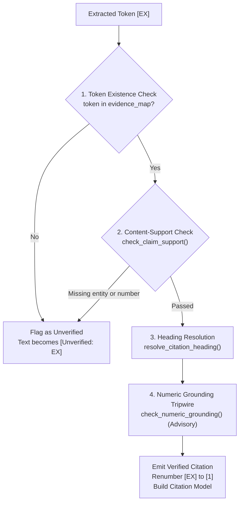

# Citation Verification & Provenance Attribution (Phase B8)

---

## 1. What is this?

### 1.1 The Non-Technical Intuition (The Courtroom Deposition Analogy)
Imagine a financial due diligence attorney preparing an investment committee memorandum. The attorney writes:
> *"The bank's statutory auditors for FY2025-26 were Batliboi & Purohit and B S R & Co. LLP."*

If the investment committee partner asks: *"Where did you get that from?"* and the attorney points to **Page 369**, the partner flips to Page 369 and discovers a page titled "Independent Auditor's Report" that discusses audit methodologies but **contains neither auditor's name**!

Even if the fact itself was true (the names appear on Pages 495–496 of the annual report), the citation on Page 369 is a **false attribution**. In a legal dispute or financial audit, an unverified citation destroys credibility.

In our production pipeline, **Phase B8 (Citation Verification)** acts as the meticulous paralegal:
1. It verifies that every citation token (`[E1]`, `[E2]`) emitted by the generation model genuinely exists in the retrieved evidence set.
2. It executes a **content-support gate** (`check_claim_support()`), verifying that the specific numbers and named entities cited in the claim actually exist inside the cited chunk's text.
3. It resolves the internal token (`[E1]`) into a clean human footnote (`[1]`) accompanied by an immutable audit ledger containing the exact document name, 1-indexed PDF page numbers, and resolved section headings.

---

## 2. Where does it fit in the RAG Pipeline?

Phase B8 is the final quality and provenance gateway of the online pipeline:

```
[Phase B7: GroundedAnswer]
"Batliboi & Purohit and B S R & Co. LLP were appointed auditors [E1]."
cited_evidence_ids: ["E1"]
                         │
                         ▼
[Phase B6: EvidenceContext.evidence_map]
"E1" ──► EvidenceItem(
           chunk_id="hdfc_c01452_b8a1",
           document_name="hdfc-bank__annual-report__fy2025-26.pdf",
           page_numbers=[495, 496],
           section_heading="Consolidated Financial Statements",
           text="... Batliboi & Purohit, Chartered Accountants ... B S R & Co. LLP ..."
         )
                         │
                         ▼
┌────────────────────────────────────────────────────────────────────────┐
│               PHASE B8: CITATION VERIFIER (citation_verifier.py)        │
│ 1. Token Existence Check: Is 'E1' present in context.evidence_map?     │
│ 2. Claim Support Gate: Does E1 text contain "Batliboi" & "B S R"?      │
│ 3. Numeric Grounding Tripwire: Do headline numbers sit under labels?   │
│ 4. Heading Resolution: Nearest heading above content (excluding tables)│
│ 5. Footnote Renumbering: Replaces [E1] with [1], flags bad [Unverified]│
└────────────────────────────┬───────────────────────────────────────────┘
                             │
                             ▼
[VerifiedAnswer: Production Diligence Output]
"Batliboi & Purohit and B S R & Co. LLP were appointed auditors [1].

Sources & Diligence Provenance:
[1] [hdfc-bank__annual-report__fy2025-26.pdf, Page 495, Page 496, Consolidated Financial Statements]"
```

---

## 3. What did WE implement?

Phase B8 is fully implemented in [`src/due_diligence/agents/citation_verifier.py`](../../src/due_diligence/agents/citation_verifier.py):

### Core Components:
1. **`CitationVerifier` Class:** Master verification engine that parses `GroundedAnswer` instances, checks evidence presence, executes content-support checks, replaces tokens with footnotes, and builds structured citations.
2. **`check_claim_support(answer_text, token, item)`:** Algorithmic content-support gate verifying that every headline number and multi-word named entity in the citing segment is present in the chunk text.
3. **`check_numeric_grounding(answer_text, token, item, question)`:** Advisory tripwire validating that headline numbers sit under table rows or sentences sharing subject keywords with the user's question.
4. **`resolve_citation_heading(item)`:** Dynamic heading resolver that inspects the chunk text for the nearest heading-like line above the cited content, excluding data rows, Total summary rows, and footnote markers.
5. **Typed Pydantic Models:**
   - [`Citation`](../../src/due_diligence/agents/citation_verifier.py#L400-L465): Immutable citation record holding `citation_number`, `evidence_id`, `chunk_id`, `document_name`, `page_numbers`, `section_heading`, `heading_path`, `source_element_ids`, `chunk_type`, and `snippet`.
   - [`VerifiedAnswer`](../../src/due_diligence/agents/citation_verifier.py#L467-L498): Output container holding `answer_text` (with `[1]` markers), `raw_answer_text` (with `[EX]` tokens), `citations: list[Citation]`, `unverified_citations: list[str]`, `is_uncertain: bool`, and `grounding_warnings: list[str]`.

---

## 4. What Citation Verification Actually Does

Phase B8 executes four sequential verification layers:



### Layer 1: Token Existence & Structure Validation
The verifier scans `answer_text` for bracketed tokens:
```python
re.finditer(r"\[([^\]]+)\]", raw_text)
```
- Supports single tokens (`[E1]`), grouped tokens (`[E1, E2]`), and malformed tokens (`[EX]`, `[Eabc]`).
- Checks if the token exists as an active key in `context.evidence_map`. If the model emits `[E99]` when only `E1`..`E7` were provided, `E99` is rejected immediately.

### Layer 2: Content-Support Gate (`check_claim_support()`)
A resolvable chunk ID is **necessary but not sufficient**. The chunk text must actually contain the specific claim attributed to it:
1. **Per-Token Segment Isolation:** A citation token supports the claim *immediately preceding it* (the text since the previous citation token or sentence start), not unrelated numbers in earlier parts of the sentence.
2. **Abbreviation-Safe Splitting:** Periods in titles and abbreviations (`"B. S. R."`, `"Co."`, `"Ltd."`) are protected so entity names are not severed across sentences.
3. **Headline Number Verification:** Every number with $\ge 4$ digits, percentages (`%`), or currency labels must exist in normalized form (`_normalize_number()`) in the chunk text.
   - *Exemptions:* Explanatory date expressions (e.g. *"FY2025-26"*), inline calculated results (e.g. `A - B = C`), and explicit derivations marked `(Calculated ...)`.
4. **Named Entity Verification:** Capitalized multi-word entity runs (e.g. *"Batliboi & Purohit"*) are extracted. At least 50% of the entity's words must exist in the chunk text.
   - *Exemptions:* Primary entity names (*"HDFC Bank"*) are governed by document metadata, not chunk text presence.

### Layer 3: Dynamic Heading Resolution (`resolve_citation_heading()`)
When a chunk is assembled, its metadata contains `section_heading`. However, a multi-schedule page may contain an embedded heading inside the chunk text:
```python
def resolve_citation_heading(item: EvidenceItem) -> str | None:
    # Scans lines in item.text for the nearest heading-like line above content
    # Strictly ignores table rows (|), Total rows, and footnote markers
    ...
```
This guarantees that citing a Schedule 12 disclosure lists `"Schedule 12 - Contingent Liabilities"` rather than an inherited parent heading or a `"Footnotes:"` header line.

### Layer 4: Numeric Grounding Tripwire (`check_numeric_grounding()`)
An advisory sanity check:
- Locates the exact table row or sentence containing the cited number in the chunk.
- Checks whether the row label shares subject keywords with the user's question (e.g., verifying that a number cited for *"advances"* sits under a row containing *"Advances"* or *"Gross Advances"*).
- **Advisory Only:** Emits warnings to `VerifiedAnswer.grounding_warnings` for analyst inspection; does not fail verification or discard citations.

---

## 5. What Citation Verification DOES NOT Do

It is vital to understand the architectural boundary of Phase B8:

> [!WARNING]
> **CRITICAL BOUNDARY:**  
> Phase B8 **DOES NOT** perform full semantic claim-level entailment (Natural Language Inference / NLI).

1. **No Logical Entailment Modeling:** B8 does not run a DeBERTa-v3 NLI model or an LLM judge to determine whether a complex argumentative conclusion logically follows from the premises.
2. **No Factual Truth Judgment:** B8 does not decide whether a financial claim is economically true or false. It only verifies **attribution fidelity**: did the cited chunk contain the numbers and entities claimed in the text?
3. **Lexical & Normalized Match:** B8 checks normalized tokens, exact numbers, and entity word overlaps. It does not rewrite or repair ungrounded claims.

---

## 6. Pedagogical Case Study: The Q10 Auditor Provenance Failure

During golden benchmark evaluation, question **Q10** (*"Who are the statutory auditors of HDFC Bank for FY2025-26?"*) revealed why token-existence checks alone are insufficient for due diligence.

```
THE Q10 FAILURE TRACE (What Went Wrong):

1. Phase B6 Context Builder assembled evidence items:
   - E1 (Pages 495–496: Consolidated Statements):
     Text: "... M/s M.M. Nissim & Co. LLP and M/s B S R & Co. LLP were appointed ...
            Batliboi & Purohit and B S R & Co. LLP ..."  [CONTAINS AUDITOR NAMES]
   - E6 (Page 369: Independent Auditor's Report):
     Text: "Report on the Audit of the Standalone Financial Statements ...
            Basis for Opinion ... Key Audit Matters ..."  [NAMELESS OPINION BODY]

2. Phase B7 Grounded Generator wrote the answer:
   "The statutory auditors of HDFC Bank for FY2025-26 were Batliboi & Purohit
    and B S R & Co. LLP [E6]."

3. The Subtle Catastrophe:
   - The LLM had both auditor names in its working context (via E1).
   - But the LLM attributed the claim exclusively to [E6] (Page 369).
   - Page 369 was a nameless page! The actual names only appeared on Page 495.

4. The Old Verifier Passed It!
   Under the old token-existence check:
   - Is 'E6' in evidence_map? YES.
   - Result: Verified citation emitted pointing to Page 369!
   - A human auditor clicking the citation found ZERO auditor names on Page 369.
```

### The Solution: The Content-Support Gate
When `check_claim_support()` was introduced:
1. It extracted the claim segment: `"The statutory auditors of HDFC Bank for FY2025-26 were Batliboi & Purohit and B S R & Co. LLP"`
2. It extracted the entity runs: `["Batliboi & Purohit", "B S R & Co. LLP"]`
3. It checked Chunk E6 text: neither `"Batliboi"` nor `"B S R"` appeared in E6!
4. **Result:** `check_claim_support()` failed E6.
5. In the final answer, the citation token was stripped and replaced with `[Unverified: E6]`, and an explicit warning was logged:
   `"[E6] cited claim names entity 'Batliboi & Purohit' unsupported by evidence text (chunk hdfc_c01124)"`

When the pipeline was re-evaluated, B7 selected E1 (the genuine auditor disclosure), and B8 cleanly verified the citation to Pages 495–496 with zero warnings.

---

## 7. Concepts I Learned

### Python Concepts
- **Callable Regex Renumbering:** Using `re.sub(pattern, replacer_func, text)` with an in-memory dictionary to sequentially renumber arbitrary tokens (`[E3]` $\to$ `[1]`, `[E7]` $\to$ `[2]`).
- **Abbreviation Protection Masking:** Replacing abbreviation periods with temporary Unicode sentinel bytes (`\u0001`) during sentence segmentation and restoring them afterward.
- **Set Word-Fraction Heuristics:** Implementing robust multi-word entity matching (`hits * 2 >= len(words)`) to tolerate variations in punctuation while strictly rejecting unsupported entities.

### RAG Concepts
- **Attribution vs. Grounding:** A statement can be grounded in the context window overall, but attributed to the wrong chunk. RAG systems must verify attribution per citation.
- **Deterministic Citation Indirection:** Forcing LLMs to emit abstract tokens (`[EX]`) and resolving coordinates in Python eliminates hallucinated page numbers.
- **Fail-Safe Citation Degeneracy:** When an LLM cites an ungrounded chunk, the citation must be visibly marked as `[Unverified: EX]`, alerting the human reviewer without crashing the system.

---

## 8. Summary Comparison: Verification Checks in Phase B8

| Check Name | Target Inspected | Failure Action | Purpose |
| :--- | :--- | :--- | :--- |
| **Token Existence** | `evidence_map` | Replaces with `[Unverified: EX]` | Stops hallucinated tokens (e.g. `[E99]`) |
| **Claim Support** | Cited Chunk Text | Replaces with `[Unverified: EX]` | Stops false attribution (e.g. Q10 auditor failure) |
| **Heading Resolution** | Chunk Text Lines | Falls back to section heading | Eliminates table/footnote noise in citations |
| **Numeric Grounding** | Row/Sentence Labels | Logs advisory warning | Flags numbers misaligned with question subjects |

---

## 9. Things to Remember

1. **B8 is a Verification Gate:** Resolves tokens and verifies claim support; does not generate new answers.
2. **Not Full NLI:** Verifies lexical and normalized entity/number support; does not evaluate semantic entailment.
3. **The Q10 Lesson:** A model can possess the right fact in context but cite the wrong page. Content-support checking is mandatory.
4. **1-Indexed Page Preservation:** Every verified citation renders exact, 1-indexed PDF page coordinates.
5. **Clear Warning Annotations:** Advisory warnings are preserved in `VerifiedAnswer.grounding_warnings` for human diligence teams.
