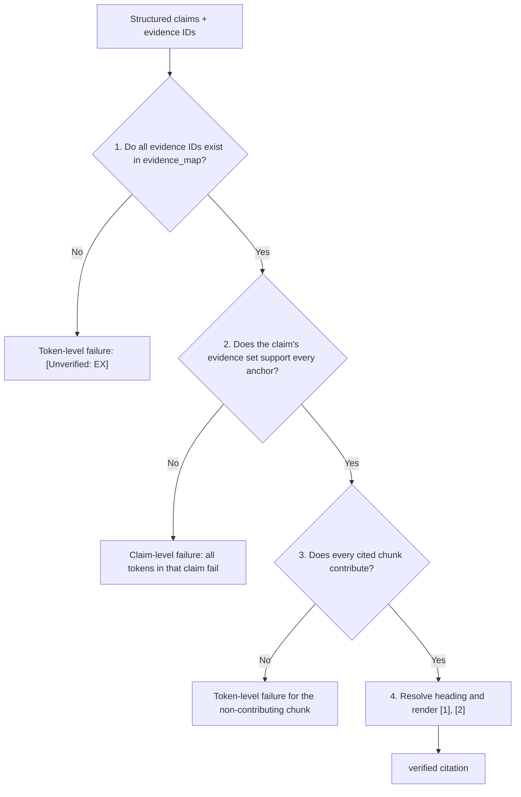

# Citation Verification & Provenance Attribution (Phase B8)

---

## 1. What is this?

### 1.1 The Non-Technical Intuition (The Courtroom Deposition Analogy)

Imagine a financial due diligence attorney preparing an investment committee memorandum. The attorney writes:

> *"The bank's statutory auditors for FY2025-26 were Batliboi & Purohit and B S R & Co. LLP."*

If the investment committee partner asks *"Where did you get that from?"* and the attorney points to **Page 369**, the partner flips to Page 369 and finds an "Independent Auditor's Report" that discusses audit methodology but **contains neither auditor's name**.

Even if the fact itself is true (the names appear on Pages 495-496), the citation on Page 369 is a **false attribution**. In a legal dispute or financial audit, one unverified citation destroys credibility.

Phase B8 is the meticulous paralegal:

1. It checks that every evidence ID emitted by B7 actually exists in the retrieved evidence set.
2. It verifies that the cited evidence supports the **specific claim** it is attached to, not merely that the evidence exists.
3. It resolves internal tokens (`[E1]`) into user-facing footnotes (`[1]`) with exact document, page, and section coordinates.
4. It never invents coordinates. Unsupported citations become `[Unverified: EX]`.

### 1.2 The Important Change: Claims Are Now Explicit

Earlier versions of B8 tried to infer which text a citation supported by looking at the text immediately before each `[EX]` token. That positional approach broke on adjacent citations:

```text
Revenue grew 12% [E1] [E2]
```

For `E2`, the "text since the previous citation" was empty. An empty segment had no numbers or entities to check, so it passed without verifying anything.

The system now uses an explicit **claim → evidence IDs** representation produced by B7:

```json
{
  "claims": [
    {
      "text": "HDFC Bank had 9,689 branches as of March 31, 2026.",
      "evidence_ids": ["E1"]
    },
    {
      "text": "Nine of those branches were Digital Banking Units (DBUs).",
      "evidence_ids": ["E2"]
    }
  ]
}
```

B7 places the `[EX]` tokens deterministically. B8 verifies each claim against its own evidence set. The model no longer has to be trusted to put a citation in the right place in free-form prose.

---

## 2. Where does it fit in the RAG Pipeline?

```text
[Phase B7: GroundedAnswer]
claims = [
  { text: "HDFC Bank had 9,689 branches as of March 31, 2026.",
    evidence_ids: ["E1"] },
  { text: "Nine of those branches were Digital Banking Units (DBUs).",
    evidence_ids: ["E2"] }
]
                         |
                         v
[Phase B6: EvidenceContext.evidence_map]
E1 -> EvidenceItem(chunk_id="...", page_numbers=[647], text="...9,689 branches...")
E2 -> EvidenceItem(chunk_id="...", page_numbers=[61],  text="...nine DBUs...")
                         |
                         v
+--------------------------------------------------------------+
| Phase B8: CitationVerifier                                   |
| 1. Resolve every evidence ID against evidence_map            |
| 2. Verify each claim against its complete evidence set       |
| 3. Record verified / partially_supported / unverified        |
| 4. Resolve headings and renumber [E1] -> [1]                 |
+--------------------------------------------------------------+
                         |
                         v
[VerifiedAnswer]
answer_text: "HDFC Bank had 9,689 branches [1]. It had nine DBUs [2]."
citations: [Citation(...), Citation(...)]
claim_verifications: [verified, verified]
```

B8 is the final online stage. It does not retrieve, rerank, or generate. It only verifies attribution and renders citations.

---

## 3. What did we implement?

Phase B8 is implemented in [`src/due_diligence/agents/citation_verifier.py`](../../src/due_diligence/agents/citation_verifier.py), with the B7 claim schema in [`src/due_diligence/agents/generator.py`](../../src/due_diligence/agents/generator.py).

### Core components

1. **`Claim` (B7 model)**

   ```python
   class Claim(BaseModel):
       text: str
       evidence_ids: list[str]
   ```

   One claim can cite one or many evidence IDs. The same evidence ID can support several claims.

2. **`GroundedAnswer.claims` (B7 output)**

   B7 now returns structured claims plus the assembled `answer_text`, `cited_evidence_ids`, and `is_uncertain`. The old free-form `answer_text` schema is still accepted as a fallback.

3. **`check_claim_evidence_support(claim_text, evidence_ids, items)` (B8)**

   Verifies one claim against its complete evidence set. It returns:

   - claim-level failures that invalidate the whole evidence set; and
   - token-level failures that apply only to one evidence ID.

4. **`ClaimVerification` (B8 result model)**

   ```python
   ClaimVerification(
       text="HDFC Bank had 9,689 branches.",
       evidence_ids=["E1", "E2"],
       status="verified",
       reasons=[],
   )
   ```

   Status values:

   - `verified`: every cited evidence ID resolved and contributed support.
   - `partially_supported`: at least one cited evidence ID failed.
   - `unverified`: no cited evidence ID passed, or the claim had no evidence.

5. **`VerifiedAnswer.claim_verifications`**

   The user-facing answer keeps the existing `[1]`, `[2]` footnotes. The per-claim audit trail is available separately for diagnostics and future UI layers.

6. **`resolve_citation_heading(item)`**

   Resolves the nearest real section heading, ignoring table rows, Total rows, and footnote markers.

7. **`check_numeric_grounding(...)`**

   Advisory tripwire that checks whether a headline number sits under a table row or sentence sharing subject keywords with the question. It emits warnings but does not by itself fail a citation.

---

## 4. Why positional citation parsing was replaced

### 4.1 The adjacent-citation bug

Consider:

```text
Revenue grew 12% [E1] [E2]
```

The old verifier split the sentence by citation position:

- For `E1`: segment = `"Revenue grew 12% "`
- For `E2`: segment = `" "` (empty)

The empty segment had no headline numbers or entities. `check_claim_support()` returned no failures, so `E2` was marked verified. That is exactly the failure mode where a citation passes because a token exists, not because evidence supports a claim.

### 4.2 Why prompt wording alone is not enough

Even a perfect prompt can be violated by the model. The verifier must remain authoritative. The fix therefore changes the **data contract and verification path**, not just the instructions:

```text
LLM
 |
 v
structured claims + evidence IDs
 |
 v
Python validation of IDs
 |
 v
claim/evidence support verification
 |
 v
verified / partially_supported / unverified
 |
 v
final renderer
```

### 4.3 The five supported citation patterns

The verifier must handle all of these without assuming claims and citations are one-to-one:

| Pattern | Example | Behaviour |
| :--- | :--- | :--- |
| One claim → one citation | `Claim A → E1` | Verify E1 against A. |
| One claim → multiple citations | `Claim A → E1, E2` | Verify the claim against the complete set. |
| Multiple claims → different citations | `Claim A → E1`, `Claim B → E2` | Verify each claim independently. |
| Multiple claims → shared citation | `Claim A → E1`, `Claim B → E1` | Verify E1 separately against A and B. |
| Multiple claims → multiple citations | `Claim A → E1, E2`, `Claim B → E2, E3` | Each claim passes only on its own evidence set. |

E1 passing for Claim A must never automatically verify Claim B. Evidence supports a **claim/evidence pair**, not an evidence item globally.

---

## 5. Structured verification semantics

### 5.1 Step 1: validate evidence IDs

B7 rejects IDs that are not in the active `EvidenceContext` before returning a `GroundedAnswer`. If a caller hand-builds a `GroundedAnswer` with `E999`, B8 still refuses to verify it.

Malformed claim structures are also rejected during parsing:

- `claims` must be a JSON array;
- each claim must be an object or string;
- empty claim text is dropped;
- evidence IDs are normalized (`e1`, `[E1]` → `E1`).

### 5.2 Step 2: verify the claim against its evidence set

For `Claim A → [E1, E2]`:

1. Resolve E1 and E2 from `evidence_map`. Missing IDs produce token-level failures.
2. Build the union of the resolved chunk texts.
3. Extract the claim's **checkable anchors**:
   - headline numbers (≥ 4 digits, percentages, currency/unit values);
   - multi-word named entities.
4. Every anchor must appear somewhere in the union. If an anchor is absent from all cited chunks, the claim fails.
5. Every cited chunk must contribute at least one checkable anchor. This prevents an irrelevant second citation from being silently accepted.
6. For a qualitative claim with no numbers or entities, require at least one content-word overlap with each cited chunk. If the claim has no checkable content at all, it is not verified.

This is the important distinction:

- **Union check:** the claim as a whole is supported.
- **Contribution check:** each cited source actually contributes something.

Neither check alone is sufficient. Union-only matching lets irrelevant citations pass. Contribution-only matching can reject a valid split across sources. Both are required.

### 5.3 Step 3: assign a claim status

| Outcome | Status |
| :--- | :--- |
| All evidence IDs resolve and contribute; all anchors found | `verified` |
| At least one evidence ID resolves and contributes, but another fails | `partially_supported` |
| No evidence ID passes, or no evidence IDs were provided | `unverified` |

A `partially_supported` claim is **not** fully verified. The failing token is rendered as `[Unverified: EX]`.

Shared evidence is handled conservatively. If `E1` supports Claim A but fails Claim B, the final renderer marks `[E1]` unverified everywhere. The per-claim `ClaimVerification` records preserve the distinction, so diagnostics can still show that E1 passed for A and failed for B.

### 5.4 Step 4: render footnotes

Verified tokens are assigned footnote numbers in order of first appearance and replaced with `[1]`, `[2]`, etc. Unverified tokens become `[Unverified: EX]`.

Example:

```text
Claim A: "Revenue grew 12%."  -> E1 (supports), E2 (does not)
```

Internal result:

```text
ClaimVerification(status="partially_supported", evidence_ids=["E1", "E2"])
```

Rendered answer:

```text
Revenue grew 12% [1] [Unverified: E2].
```

The claim does not look fully grounded when only part of its evidence set is grounded.

---

## 6. The four verification layers



### Layer 1: Evidence ID existence

A token is valid only if it exists in `context.evidence_map`. During B7 parsing, unknown IDs raise `GeneratorModelError`. During B8 verification, any unknown ID is marked unverified and never receives a page number.

### Layer 2: Claim/evidence support

This is the core gate. The verifier does not infer claim boundaries from citation position. It uses the explicit claim text.

- Headline numbers must be present in normalized form.
- Multi-word entities must have sufficient word overlap with the cited text.
- Date fragments, inline equation results, and explicit `(Calculated: ...)` derivations are handled specially.
- Primary-entity names such as "HDFC Bank" are governed by statement-scope metadata rather than repeated chunk text.

### Layer 3: Per-chunk contribution

For `Claim A → [E1, E2]`, E1 and E2 must each contribute. A second citation that contains none of the claim's anchors or meaningful words is not accepted just because the claim is supported by E1.

### Layer 4: Heading resolution and rendering

`resolve_citation_heading()` inspects the chunk for the nearest heading-like line. It excludes table data rows, Total rows, and footnote lines. The final citation contains the document name, 1-indexed pages, section heading, chunk ID, and an excerpt.

---

## 7. What B8 does NOT do

> [!WARNING]
> **CRITICAL BOUNDARY:** B8 does not perform full semantic entailment (NLI).

1. **No logical entailment model.** It does not run a DeBERTa NLI model or an LLM judge to prove that a complex conclusion follows from the premises.
2. **No factual truth judgment.** It does not decide whether a financial claim is economically true. It checks attribution fidelity: are the claimed numbers and entities in the cited evidence?
3. **No claim rewriting.** It does not repair an unsupported claim. It flags it and preserves the failure visibly.
4. **Not a substitute for analyst review.** `[Unverified: EX]` is a safety signal, not a legal conclusion.

The deterministic gate is intentionally conservative. A claim can still be analytically weak or misleading even when its numbers appear in the cited chunk.

---

## 8. Pedagogical case study: the Q10 auditor provenance failure

Question Q10: *"Who are the statutory auditors of HDFC Bank for FY2025-26?"*

### The failure trace

1. B6 assembled:
   - E1 (Pages 495-496): contains "Batliboi & Purohit" and "B S R & Co. LLP".
   - E6 (Page 369): an auditor's report body with no auditor names.
2. B7 wrote:
   ```text
   The statutory auditors ... were Batliboi & Purohit and B S R & Co. LLP [E6].
   ```
3. The old token-existence check passed because E6 existed.
4. A human clicking Page 369 would find no auditor names.

### The correction

The content-support gate extracts the named entity runs from the claim:

```text
["Batliboi & Purohit", "B S R & Co. LLP"]
```

Neither appears in E6, so E6 fails. The token becomes `[Unverified: E6]` and a warning records the unsupported entity.

In the re-run, B7 cited E1 (the genuine disclosure), and B8 verified the citation against Pages 495-496 with no warnings.

The broader lesson: a model can have the right fact in its context and still attach it to the wrong page. Claim-level attribution checking is mandatory.

---

## 9. Concepts learned

### Python and modelling

- **Explicit data contracts beat text heuristics.** A `Claim(text, evidence_ids)` model removes the need to guess which text a token belongs to.
- **Per-claim result models.** `ClaimVerification` makes success and failure auditable instead of hiding it in a list of warning strings.
- **Normalization before comparison.** Evidence IDs, numbers, and entity names must be normalized before matching.
- **Union plus contribution checks.** A claim can be supported by several chunks, but every cited chunk must contribute something.
- **Immutable Pydantic models.** `Citation`, `Claim`, and `VerifiedAnswer` are frozen so verification results cannot be silently mutated downstream.

### RAG and due diligence

- **Attribution is not the same as grounding.** A fact can be present somewhere in the context window but attached to the wrong citation.
- **Citations are pairs, not global flags.** E1 being valid for Claim A says nothing about Claim B.
- **Fail visibly, not silently.** Unsupported claims must surface as `[Unverified: EX]`, not as plausible-looking footnotes.
- **Prompt rules are necessary but insufficient.** The Python verifier must enforce the contract independently of the LLM.
- **One-to-many and many-to-many are normal.** A claim can need multiple sources; one source can support multiple claims.

---

## 10. Verification checks at a glance

| Check | Target | Failure action | Purpose |
| :--- | :--- | :--- | :--- |
| Evidence ID existence | `evidence_map` | `[Unverified: EX]` | Stops hallucinated tokens such as `[E999]` |
| Claim/evidence union | Claim anchors vs. cited chunks | Claim-level failure | Stops claims missing a required number or entity |
| Per-chunk contribution | Each cited chunk | Token-level failure | Stops irrelevant extra citations |
| Qualitative lexical support | Claim words vs. chunk words | Token-level failure | Stops vacuous passes for claims with no numbers/entities |
| Heading resolution | Chunk text lines | Fallback heading | Prevents table/footnote noise in citations |
| Numeric grounding | Row/sentence labels | Advisory warning | Flags numbers that may belong to a different subject |

---

## 11. Regression coverage

The structured-citation work is covered by tests for:

- one claim → one citation;
- one claim → multiple citations;
- multiple claims → different citations;
- multiple claims → shared citation;
- one claim → adjacent citations (no empty-segment pass);
- unsupported second citation (`partially_supported`, not fully verified);
- unknown evidence ID;
- two atomic claims in one sentence;
- the HDFC branch/DBU output pattern;
- parser rejection of unknown IDs and normalization of embedded tokens;
- legacy free-form answers with a single citation.

Relevant files:

- `tests/unit/test_citation_verifier.py`
- `tests/unit/test_generator.py`
- `tests/integration/test_cli_integration.py`

---

## 12. Things to remember

1. **B8 is a verification gate, not a generator.** It verifies and renders; it never writes new claims.
2. **Claims are explicit.** The model returns `text` and `evidence_ids`; Python verifies the pair.
3. **One claim may have many citations.** Atomicity is about the factual assertion, not the number of sources.
4. **One citation may support many claims.** Verify it independently for each claim.
5. **Union and contribution are both required.** The claim must be supported as a whole, and every cited chunk must contribute.
6. **Not full NLI.** The gate checks normalized numbers, entities, and lexical support, not deep semantic entailment.
7. **Fail visibly.** Unsupported citations become `[Unverified: EX]` with a diagnostic.
8. **Preserve provenance.** Every verified citation resolves to exact 1-indexed pages and a real section heading.
9. **Shared evidence fails closed.** If a shared evidence ID fails any claim that cites it, the rendered token is unverified globally; per-claim statuses retain the finer detail.
