# Architectural Evolution: From Prototype to Production Due Diligence RAG

---

## 1. Executive Summary & Purpose

The **AI Due Diligence Co-pilot** analyzes complex corporate financial filings, regulatory disclosures, and contractual agreements. Over the course of its development, the system evolved from a classic textbook RAG prototype (PyMuPDF text dumps, fixed-character chunking, cross-encoder reranking) into a specialized, audit-grade corporate diligence engine.

This document traces the complete **architectural and implementation evolution** across all 13 phases. It details:
- What was originally built and tested.
- What empirical failure modes or latency bottlenecks were discovered.
- What architectural decisions were made and why specific components were deprecated or replaced.
- How the current production pipeline functions today.

---

## 2. Chronological Architecture Evolution

```mermaid
flowchart TD
    subgraph IngestionEvolution["1. Document Parsing & Structure Invariants"]
        P1["Phase 1: PDF Parsing & Symbol Font Normalization<br/>- Discovered: Greek/Wingdings encoding corruption in tables<br/>- Solution: Custom font remapping & nil-dash normalization"]
        P2["Phase 2: 3-Tier Table Extraction & Total Row Safeguards<br/>- Discovered: Rule-less Total rows clipped by bounding boxes<br/>- Solution: extend_box_for_trailing_total() & is_valid_table_caption()"]
        P3["Phase 3: Spatial Layout Reconciliation<br/>- Discovered: 51% multi-column interleaving & double-counting<br/>- Solution: Cookie-cutter spatial partitioning & single-owner invariant"]
        P4["Phase 4: Document-Aware Chunking & Q06 Safeguards<br/>- Discovered: Q06 schedule severing (caption separated from total)<br/>- Solution: Hard schedule flushes, repeated headers, total-row lock"]
    end

    subgraph StorageEvolution["2. Vector Space & Storage Invariants"]
        P5["Phase 5: Dense Embeddings (OpenAI text-embedding-3-large)<br/>- 1,536-dim Matryoshka reduction"]
        P6["Phase 6: Weaviate Cloud BYOV & Corpus Rebuild<br/>- Rebuilt canonical corpus: 11,008 elements -> 1,984 chunks -> 1,984 vectors<br/>- 10-point pre-indexing invariant gate; deterministic UUIDv5"]
    end

    subgraph RetrievalEvolution["3. Retrieval & Entity Scope"]
        P7["Phase 7: Native Hybrid Retrieval (B4)<br/>- Balanced alpha = 0.50 (50% Dense Vector + 50% BM25)<br/>- Expanded candidate pool from N=25 to N=40"]
        P8["Phase 8: Entity Scope Filtering<br/>- Discovered: Q04 subsidiary profit leakage (HDBFSL vs parent bank)<br/>- Solution: filter_subsidiary_candidates() isolating parent from subsidiaries"]
    end

    subgraph RerankingEvolution["4. Reranker Revolution (Cross-Encoder -> LLM)"]
        P9["Phase 9: Removal of Cross-Encoders & Migration to LLM Reranker (B5)<br/>- Discovered: 50.6s CPU latency, 512-token table truncation, narrative bias<br/>- Solution: Replaced cross-encoders with gpt-4o-mini (10 principles, Top-7 output)"]
    end

    subgraph GenerationEvolution["5. Grounded Generation & Citation Verification"]
        P10["Phase 10: Evidence Context Builder (B6)<br/>- Statement-scope labels ([STANDALONE ...] vs [CONSOLIDATED ...])<br/>- Token indirection (E1..Ek) & multi-tier deduplication (>85% overlap)"]
        P11["Phase 11: Grounded Generation (B7)<br/>- GPT-4o JSON mode enforcing 8 non-negotiable grounding rules"]
        P12["Phase 12: Citation Verification & Content-Support Gate (B8)<br/>- Discovered: Q10 false auditor provenance (cited nameless p369 chunk)<br/>- Solution: check_claim_support() enforcing entity & number presence"]
        P13["Phase 13: Golden Evaluation Benchmark (B9)<br/>- 50 curated diligence questions across 16 failure modes"]
    end

    IngestionEvolution --> StorageEvolution
    StorageEvolution --> RetrievalEvolution
    RetrievalEvolution --> RerankingEvolution
    RerankingEvolution --> GenerationEvolution
```



---

## 3. Deep Dive: Phase-by-Phase Transformations

### Phase 1: Symbol-Font Handling & Nil-Dash Normalization
- **The Problem:** In corporate annual reports, financial figures frequently contain special symbol characters: bullet dots, footnote symbols, and custom em-dashes representing zero or non-applicable values (e.g. `—` or `-`). Naive PyMuPDF text dumps extracted these as garbled Unicode escape sequences (`\ufffd`, `\x07`) or Greek letters (`Symbol`, `Wingdings`), corrupting numerical parsing.
- **The Solution:** Implemented `SymbolFontMapper` in [`src/due_diligence/ingestion/font_mappings.py`](../../src/due_diligence/ingestion/font_mappings.py) and preflight font scanning in [`preflight.py`](../../src/due_diligence/ingestion/preflight.py). Mapped private-use symbol glyphs to standard Unicode punctuation and normalized standalone dashes into explicit `NIL` markers.

---

### Phase 2: Table Extraction & Trailing Total-Row Preservation
- **The Problem:** Financial tables in India lack outer borders. Bounding box detectors clipped tables at the last horizontal vector line. However, the final summary row (*"Total: ₹34,179,458,972"*) sat 5 points below the rule. As a result, the Total row was dropped from the table element. Worse, the orphaned Total row was subsequently misidentified by the layout engine as the caption for the next schedule!
- **The Solution:**
  1. Implemented a 3-tier extraction engine in [`src/due_diligence/ingestion/table_extractor.py`](../../src/due_diligence/ingestion/table_extractor.py): Tier 1 (local projection), Tier 2 (Gemini Flash vision fallback), Tier 3 (graceful degradation).
  2. Built `extend_box_for_trailing_total()`: Scans visual lines immediately below table bounding boxes and stretches the box downward to encompass summary Total rows.
  3. Built `is_valid_table_caption()` in [`layout.py`](../../src/due_diligence/ingestion/layout.py): Rejects lines beginning with `"Total"` or composed mostly of digits from becoming table captions.

---

### Phase 3: Spatial Layout Reconciliation & The Single-Owner Invariant
- **The Problem:** Over 51% of annual report pages use 2-column or 3-column layouts. Reading straight across the page horizontally interleaved sentences from different columns. Furthermore, naive systems double-counted table text as both tables and messy paragraphs.
- **The Solution:** Built `reconcile_page_elements()` in [`src/due_diligence/ingestion/layout.py`](../../src/due_diligence/ingestion/layout.py):
  1. **Cookie-Cutter Spatial Partitioning:** Tables claim their visual bounding boxes first, excluding table text from narrative extraction.
  2. **Gutter Histogram Analysis:** Detects vertical whitespace gutters to sort text top-to-bottom within Column 1 before Column 2.
  3. **The Single-Owner Invariant:** Enforces `unowned_block_count == 0` and `multiply_owned_block_count == 0` across all 678 pages. Every visual block has exactly one owner.
  4. **Active Heading Stack:** Propagates `section_heading` and `heading_path` across pages so disclosures inherit full section ancestry.

---

### Phase 4: Structure-Aware Chunking & The Q06 Chunk-Boundary Lesson
- **The Problem (Discovered during Q06 evaluation):** When answering contingent liabilities, the system hallucinated numbers because naive chunking split Schedule 12 into multiple pieces: the title and line items in Chunk A, and the Total row in Chunk B. When retrieved in isolation, neither chunk contained the complete answer.
- **The Solution:** Built [`src/due_diligence/ingestion/chunker.py`](../../src/due_diligence/ingestion/chunker.py):
  1. Enforced hard schedule boundaries (`is_schedule_boundary_heading` flushes buffers immediately).
  2. Sliced oversized tables row-by-row while **re-injecting full column headers on every slice**.
  3. **Total Row Reservation:** Trailing Total rows are locked to the final slice of an oversized table.
  4. Formed 4 canonical chunk types: `narrative` (53.2%), `table` (25.8%), `mixed` (18.6%), `list` (2.4%).

---

### Phase 5 & 6: Vector Indexing & Corpus Rebuild Baseline
- **The Evolution:**
  - Embedding Provider: OpenAI `text-embedding-3-large` Matryoshka-reduced to 1,536 dimensions.
  - Weaviate Cloud: Implemented BYOV (`Configure.Vectorizer.none()`) in [`weaviate_store.py`](../../src/due_diligence/retrieval/weaviate_store.py) with `hfresh` vector indexing and BM25 inverted indexing across 21 schema properties.
  - **Corpus Rebuild (2026-09-28):** Following the Q06 boundary and layout fixes, the corpus was completely rebuilt and re-indexed:
    - Elements: Reconciled from 11,036 to **11,008 elements**.
    - Chunks: Rebuilt from 1,988 to **1,984 canonical chunks**.
    - Weaviate: 1,984 vectors indexed with deterministic UUIDv5.

---

### Phase 7 & 8: Retrieval Expansion & Entity Scope Filtering
- **The Evolution of Budgets:**
  - Initial configuration: $\alpha = 0.60$, candidate pool $N = 25$.
  - Current production configuration: **$\alpha = 0.50$** (balanced 50% dense vector / 50% BM25 lexical), candidate pool expanded to **$N = 40$** to guarantee high multi-page recall.
- **Entity Scope Isolation (Q04 Fix):**
  - In Q04, hybrid search retrieved Page 304 (HDB Financial Services Limited - HDBFSL) and reported its PAT (₹2,544 Cr) as HDFC Bank's net profit (₹74,671 Cr).
  - Built [`src/due_diligence/core/entity_scope.py`](../../src/due_diligence/core/entity_scope.py): Ingests `entity_scope` tags (`hdfc_bank_standalone`, `hdfc_bank_consolidated`, `hdb_financial_services`).
  - Added `filter_subsidiary_candidates()` immediately after B4 retrieval: systematically filters out subsidiary chunks when the query targets the parent bank.

---

### Phase 9: The Reranker Revolution (Cross-Encoder Removal -> LLM Reranker)
On **2026-09-29**, the cross-encoder reranking architecture was completely eliminated and replaced with a dedicated LLM reranker.

```
WHY CROSS-ENCODERS WERE DEPRECATED:

1. Severe CPU Latency:
   - The large cross-encoder took ~50.6 seconds per query on 4 CPU threads.
   - Initial cold weight load took 1,157 seconds (~19.3 minutes).
   - The lightweight cross-encoder reduced latency to 1.01s but lacked financial schedule discrimination.

2. Severe 512-Token Truncation:
   - 28% of candidate table pairs exceeded the 512-token ceiling of cross-encoders.
   - Trailing rows and Total rows were clipped before scoring!

3. Structural Narrative Bias:
   - Cross-encoders pre-trained on MS-MARCO favored wordy executive prose over
     dense, numerical Markdown tables, systematically demoting balance sheet schedules.
```

- **The Current B5 Architecture:**
  - Implemented [`LLMReranker`](../../src/due_diligence/retrieval/reranker.py#L167-L371) powered by `gpt-4o-mini` (temperature=0.0, JSON object mode).
  - Scores **40 candidate chunks** against **10 financial ranking principles** (tables are first-class evidence, primary statements over commentary, entity scope, direct answerability).
  - Strict output contract: `{"ranked_chunk_ids": [...]}`. Validates IDs, drops duplicates, appends unranked fallbacks, and outputs **Top-7 evidence passages** ($K=7$).
  - Latency: **~1.3 to 1.5 seconds** per query across all 40 candidates.

---

### Phase 10 & 11: Context Assembly & Grounded Generation
- **Context Builder (B6):**
  - Maps complex chunk IDs to context-local tokens (`E1`..`E7`) and builds `evidence_map`.
  - Prunes near-duplicates (>85% element overlap).
  - Escapes XML delimiters (`<evidence>`, `<diligence_context>`) to stop prompt injection.
  - **Statement-Scope Labels:** Injects `[STANDALONE FINANCIAL STATEMENT ...]` and `[CONSOLIDATED FINANCIAL STATEMENT ...]` directly into evidence text.
- **Grounded Generation (B7):**
  - Powered by `gpt-4o` in JSON mode under **8 strict grounding rules**.
  - Synthesizes answers citing `[EX]` tokens; fast-paths to `"Not disclosed in the ingested document."` if evidence is empty.

---

### Phase 12: Citation Verification & The Q10 Auditor Case Study
- **The Q10 Root Cause:**
  - When asked for statutory auditors, B6 held E1 (pp. 495–496, consolidated report, containing both auditor names) and E6 (p. 369, independent auditor's report, nameless body).
  - B7 correctly named both firms ("Batliboi & Purohit" and "B S R & Co. LLP"), but cited only `[E6]`.
  - The old verifier passed it because `E6` existed in `evidence_map`. But Page 369 contained zero auditor names!
- **The Solution:**
  - Built `check_claim_support()` for the legacy free-form path and later `check_claim_evidence_support()` for structured claims in [`src/due_diligence/agents/citation_verifier.py`](../../src/due_diligence/agents/citation_verifier.py): verifies that every headline number and multi-word named entity in a claim appears in the claim's cited evidence.
  - Failed citations are converted to `[Unverified: EX]` and logged with explicit warnings.
  - Built `resolve_citation_heading()`: resolves the nearest heading above cited content, ignoring table rows, Total rows, and footnote markers.
  - **Important Distinction:** B8 verifies lexical and normalized entity/number content-support; it does **NOT** perform full semantic claim-level entailment (NLI).

---

### Phase 13: Golden Evaluation Benchmark (Phase B9)
- Implemented automated benchmark runner [`BenchmarkRunner`](../../src/due_diligence/evaluation/runner.py) and evaluator [`DiligenceEvaluator`](../../src/due_diligence/evaluation/evaluator.py).
- Evaluates 50 curated diligence questions across 16 diligence failure modes:
  - Set 1 (Q01–Q25): Core banking, ratios, segment reporting, negative controls.
  - Set 2 (Q26–Q50): Operations, ESG tables, subsidiary isolation, governance, and entity follow-ups.

---

### Phase 14: Query Rewriter Dedicated Model Transition (`gpt-4o-mini`)
- **The Architecture Change:**
  - Query Rewriter previously shared `Settings.generation_model` (`gpt-4o`) with B7 Grounded Generation.
  - Reference resolution (resolving pronouns, entity anchors, and comparative years across a bounded 4-turn history) does not require the extensive parametric synthesis capacity of `gpt-4o`.
  - Introduced dedicated `Settings.query_rewriter_model` defaulting to **`gpt-4o-mini`** (env `QUERY_REWRITER_MODEL`).
  - Achieved >80% latency and cost reduction on multi-turn conversational queries with zero degradation in reference resolution fidelity.
  - Empty-history fast path continues to bypass LLM inference completely for standalone queries.

---

### Phase 15: Structured Claim/Evidence Verification (B7 and B8)

- **The Problem:** B8 originally inferred claim boundaries from citation position in free-form text. Adjacent citations such as `Revenue grew 12% [E1] [E2]` gave the second token an empty preceding segment. An empty segment had no anchors, so it could pass vacuously. A citation could also be verified globally for one claim and then reused to imply support for another.
- **The Data-Contract Change:** B7 now returns `claims: [{text, evidence_ids}]`. `Claim` carries the claim text and its evidence set. B7 assembles `[EX]` tokens deterministically from `evidence_ids`; the model no longer places tokens in free-form prose.
- **The Verification Change:** `check_claim_evidence_support()` verifies each claim against its complete evidence set:
  - every cited evidence ID must resolve;
  - the union of cited chunks must contain every headline number and named entity;
  - every cited chunk must contribute at least one checkable anchor (or lexical support for qualitative claims).
- **Per-claim statuses:** `ClaimVerification` records `verified`, `partially_supported`, or `unverified`. Evidence supports a claim/evidence pair, never a globally cached evidence item.
- **Rendering:** Verified tokens still render as `[1]`, `[2]`; failing tokens become `[Unverified: EX]`.
- **Regression coverage:** one-to-many, many-to-one, many-to-many, adjacent citations, unsupported second citations, unknown IDs, and the HDFC branch/DBU output.

---

## 4. Architectural Summary: Yesterday vs. Today

| Subsystem | Historical / Early Design | Current Production Architecture | Rationale for Evolution |
| :--- | :--- | :--- | :--- |
| **PDF Extraction** | Unstructured PyMuPDF text stream | Layout-aware elements + Font remapping | Eliminates multi-column text scrambling and symbol corruptions |
| **Table Extraction** | Simple horizontal line clipping | 3-Tier engine + `extend_box_for_trailing_total` | Prevents trailing Total rows from being clipped or misattached |
| **Table Captions** | Nearest line using `istitle()` | Guarded by `is_valid_table_caption()` | Prevents Total rows from masquerading as table captions |
| **Chunking Engine** | Naive character splitting | Layout-aware chunker with repeated headers | Preserves 2D table schemas and enforces hard schedule boundaries |
| **Corpus Baseline** | 1,988 chunks / vectors | **1,984 chunks / vectors** | Rebuilt post-Q06 boundary and layout fixes |
| **Embedding Model** | Local model default | **OpenAI `text-embedding-3-large` (1,536 dims)** | Higher retrieval fidelity |
| **Query Rewriter** | `gpt-4o` (shared `generation_model`) | **Dedicated `gpt-4o-mini` (`query_rewriter_model`)** | >80% latency & cost reduction on conversational queries with zero quality loss |
| **Retrieval Pool** | Top-25 ($\alpha = 0.60$) | **Top-40 ($\alpha = 0.50$)** | Higher candidate recall across multi-page notes; balanced fusion |
| **Entity Scoping** | No filtering (Subsidiary leakage) | **`filter_subsidiary_candidates()`** | Prevents subsidiary numbers (e.g. HDBFSL) from polluting bank queries |
| **Reranker (B5)** | **Cross-Encoders** | **LLM Reranker (`gpt-4o-mini`)** | Eliminated 50.6s CPU latency, 512-token table truncation, and prose bias |
| **Reranker Budget** | Top-5 evidence passages | **Top-7 evidence passages** | Accommodates multi-chunk financial evidence |
| **Statement Labels** | Raw chunk text | Injected `[STANDALONE ...]` labels in B6 | Enforces Standalone vs. Consolidated disambiguation in B7 |
| **Grounded Generator (B7)** | `gpt-4o` (general prompt) | **`gpt-4o` with structured claims + evidence IDs** | Enforces zero hallucination, strict unit fidelity, and explicit claim/evidence mapping |
| **Citation Verifier**| Token-existence check only | **Per-claim content-support gate** | Catches false attribution (Q10) and adjacent-citation vacuous passes |
| **Verification Scope**| Positional text segments | **Explicit claim/evidence pairs** | Supports one-to-many, many-to-one, and many-to-many citations |

---

## 5. Architectural Invariants to Preserve

1. **Source Code is Authoritative:** Any discrepancy between documentation and code must be resolved in favor of the source code.
2. **Deterministic Provenance:** Every chunk, vector, and citation must trace back to 1-indexed physical PDF page coordinates.
3. **The Single-Owner Invariant:** Every visual text block on a page must have exactly one structural owner (`unowned == 0`, `duplicate == 0`).
4. **Token Indirection:** LLMs emit claim text with evidence IDs; deterministic Python places `[EX]` tokens and resolves physical coordinates.
5. **Fail Loudly on Ungrounded Claims:** When evidence is missing, state `"Not disclosed in the ingested document."` and flag unverified citations.
