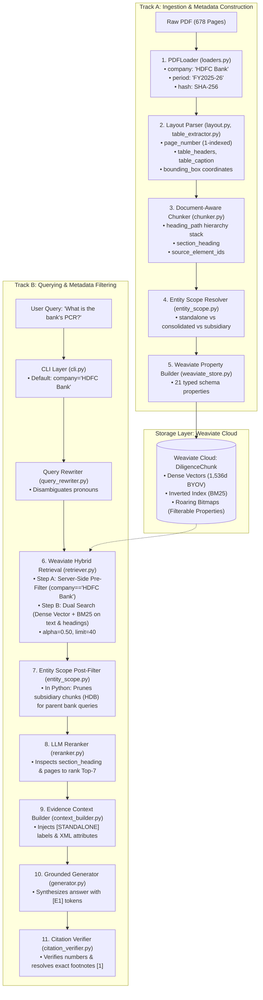

# Metadata Architecture, Generation & Retrieval Engine (Phase B1–B8)

---

## 1. What is this?

### 1.1 The Non-Technical Intuition: Why Naive RAG Destroys Financial Diligence
Imagine handing an analyst a **678-page corporate annual report** (such as HDFC Bank FY2025-26) and asking:
> *"What is the bank's provision coverage ratio, and what was its net interest income?"*

In a traditional "naive" RAG (Retrieval-Augmented Generation) system:
1. The 678-page PDF is blindly cut into arbitrary 500-word blocks.
2. An AI embedding model turns each text block into a list of 1,536 numbers (a dense vector).
3. The user's question is converted into a vector, and the database retrieves the 10 closest vectors using cosine similarity.

#### Why This Breaks Down Completely in Corporate Due Diligence:
- **Parent vs. Subsidiary Conflation:** The annual report contains financial disclosures for the parent bank (*HDFC Bank Limited*) alongside operating subsidiaries (*HDB Financial Services Limited*, *HDFC Life Insurance*, *HDFC ERGO General Insurance*). Both the parent bank and the non-banking financial subsidiary (*HDB Financial*) report "Net Interest Income", "Gross NPA ratios", and "Provision Coverage Ratios". A naive semantic search cannot tell them apart and will happily cite HDB Financial's ratio for an HDFC Bank question.
- **Standalone vs. Consolidated Confusion:** A corporation publishes two distinct balance sheets: *Standalone* (the banking entity alone) and *Consolidated* (the bank plus all group entities). Mixing up these figures in an M&A context is catastrophic.
- **Table Blindness:** Financial tables in PDFs are often rows of bare numbers (e.g., `45,210  41,120`). Without knowing the table column header (*"As at March 31, 2026"*) and the section heading (*"Schedule 4 - Borrowings"*), the vector alone has no semantic meaning.
- **Audit Failure:** When an investment committee or legal auditor reads an answer, they require exact proof: *"Which exact filing, fiscal year, physical page, and schedule did this number come from?"* Naive RAG cannot provide verifiable provenance.

---

### 1.2 The Real-World Analogy: The Library Card Catalog
Think of a massive research library containing **1,000,000 pages** across 50 corporations:

```
NAIVE SEARCH (Shouting in the Library):
You shout: "What was the net profit in FY2025-26?"
The librarian runs through every aisle, pulling any page that mentions "net profit".
Result: You get 5 pages from Apple, 3 from Tata Motors, and 2 from HDFC Bank.

METADATA-DRIVEN SEARCH (The Velvet Rope + Card Catalog):
Each page has an immutable digital index card:
  ├── Company: HDFC Bank
  ├── Period: FY2025-26
  ├── Document: Annual Report
  ├── Scope: Standalone Financial Statements
  ├── Section: Schedule 4 - Borrowings
  └── Page: 378

Step 1: The librarian locks the door to the other 49 companies (Pre-Filtering).
Step 2: Inside the HDFC Bank FY2025-26 aisle, the librarian searches for "net profit".
Step 3: If you asked about the parent bank, the librarian ignores the subsidiary shelves.
Step 4: You receive the answer stamped with the exact book, section, and page coordinates.
```

---

## 2. Where does it fit in the RAG Pipeline?

Metadata is not an afterthought added at the end; it is **constructed during offline ingestion (Track A)**, **indexed into Weaviate Cloud (Track B)**, and **enforced at every stage of online retrieval and verification**:



---

## 3. What did WE Implement?

The metadata and filtering architecture spans 8 core modules:

- [`src/due_diligence/ingestion/loaders.py`](../../src/due_diligence/ingestion/loaders.py):
  - [`PDFLoader`](../../src/due_diligence/ingestion/loaders.py#L48-L115): Validates file headers, computes SHA-256 integrity checksums, and tags document-level `company` and `financial_period`.
- [`src/due_diligence/ingestion/layout.py`](../../src/due_diligence/ingestion/layout.py) & [`table_extractor.py`](../../src/due_diligence/ingestion/table_extractor.py):
  - Preserves exact physical 1-indexed `page_number`, spatial bounding boxes, and first-class table metadata (`table_headers`, `table_caption`, `table_group_id`).
- [`src/due_diligence/ingestion/chunker.py`](../../src/due_diligence/ingestion/chunker.py) & [`chunks.py`](../../src/due_diligence/ingestion/chunks.py):
  - [`DocumentChunker`](../../src/due_diligence/ingestion/chunker.py#L260-L405): Maintains active heading stacks (`heading_path`), page spans (`page_numbers`), and audit references (`source_element_ids`).
- [`src/due_diligence/core/entity_scope.py`](../../src/due_diligence/core/entity_scope.py):
  - [`resolve_entity_scope()`](../../src/due_diligence/core/entity_scope.py#L96-L185): Deterministic 5-step classification tagging chunks as Standalone, Consolidated, or Subsidiary.
  - [`filter_subsidiary_candidates()`](../../src/due_diligence/core/entity_scope.py#L187-L245): Query-time Python filter suppressing subsidiary contamination.
- [`src/due_diligence/retrieval/weaviate_store.py`](../../src/due_diligence/retrieval/weaviate_store.py):
  - [`build_weaviate_properties()`](../../src/due_diligence/retrieval/weaviate_store.py#L223-L268): Maps chunk payloads into 21 flat Weaviate schema properties with strict filterable/searchable tokenization.
- [`src/due_diligence/retrieval/retriever.py`](../../src/due_diligence/retrieval/retriever.py):
  - [`WeaviateHybridRetriever`](../../src/due_diligence/retrieval/retriever.py#L87-L383): Compiles `_build_filter()`, executes server-side pre-filtering, and extracts metadata back into typed `RetrievalResult` objects.
- [`src/due_diligence/cli.py`](../../src/due_diligence/cli.py):
  - Command-line argument parser injecting `--company "HDFC Bank"` default for single-document deal-room execution.
- [`src/due_diligence/agents/citation_verifier.py`](../../src/due_diligence/agents/citation_verifier.py):
  - Translates abstract tokens into user-facing footnotes `[1]` using retrieved `document_name`, `page_numbers`, and `section_heading`.

---

## 4. Step-by-Step Lifecycle: From Generation to Retrieval

```
┌──────────────┐     ┌──────────────┐     ┌──────────────┐     ┌──────────────┐
│ 1. INGESTION │ ──> │ 2. CHUNKING  │ ──> │ 3. INDEXING  │ ──> │ 4. RETRIEVAL │
└──────────────┘     └──────────────┘     └──────────────┘     └──────────────┘
```

### Step 1: Document Ingestion (Foundational Provenance)
In [`src/due_diligence/ingestion/loaders.py`](../../src/due_diligence/ingestion/loaders.py#L54-L107):
When the PDF is first loaded from disk, `PDFLoader.validate_and_load()` verifies that the file is a valid PDF and attaches top-level provenance:
- `company`: e.g. `"HDFC Bank"`
- `financial_period`: e.g. `"FY2025-26"`
- `document_name`: e.g. `"HDFC_Bank_Annual_Report_2025-26.pdf"`
- `content_hash`: SHA-256 hexadecimal hash computed from raw bytes.

---

### Step 2: Spatial Layout & 3-Tier Table Extraction
In [`src/due_diligence/ingestion/layout.py`](../../src/due_diligence/ingestion/layout.py) and [`table_extractor.py`](../../src/due_diligence/ingestion/table_extractor.py):
As the 678 pages are processed:
1. Every paragraph and heading receives its **exact physical 1-indexed page number** (e.g. `page_number = 378`).
2. Table extractors detect multi-column financial grids and attach:
   - `table_headers`: list of column names (e.g., `["Particulars", "As at March 31, 2026", "As at March 31, 2025"]`).
   - `table_caption`: title text above the table.
   - `table_group_id`: unique identifier tying multi-page table slices together.

---

### Step 3: Document-Aware Chunking & Heading Hierarchy
In [`src/due_diligence/ingestion/chunker.py`](../../src/due_diligence/ingestion/chunker.py#L260-L405):
Rather than slicing blindly at token counts, `DocumentChunker` tracks document semantics:
- **Heading Stack (`heading_path`):** Maintains active hierarchy breadcrumbs, e.g.:
  `["Financial Statements", "Notes to Accounts", "Note 18 - Capital Adequacy"]`
- **Immediate Heading (`section_heading`):** The closest parent section: `"Note 18 - Capital Adequacy"`.
- **Page Numbers (`page_numbers`):** A list of unique physical pages. If a paragraph crosses a page break, `page_numbers = [378, 379]`.
- **Source Elements (`source_element_ids`):** List of underlying layout element IDs for mathematical reconstruction audits.

---

### Step 4: Deterministic Entity Scope Resolution
In [`src/due_diligence/core/entity_scope.py`](../../src/due_diligence/core/entity_scope.py#L96-L185):
To eliminate parent-subsidiary financial confusion, each chunk is stamped with an immutable `entity_scope`:

```python
# src/due_diligence/core/entity_scope.py (Hierarchical Evaluation)
def resolve_entity_scope(heading_path, section_heading, text, page_numbers):
    # 1. Check headings for explicit subsidiary names
    if "hdb financial" in headings_lower:
        return "hdb_financial_services"
    if "hdfc life" in headings_lower:
        return "hdfc_life"
    ...
    # 2. Check dedicated subsidiary report pages (Pages 304–308)
    if 304 <= page <= 308:
        return "hdb_financial_services"

    # 3. Check Primary Financial Statement schedule boundaries
    if 369 <= page <= 493:
        return "hdfc_bank_standalone"       # Standalone Statements & Notes
    if 494 <= page <= 580:
        return "hdfc_bank_consolidated"     # Consolidated Statements & Notes

    # 4. Fallback
    return "hdfc_bank_general"
```

---

### Step 5: Weaviate Collection Schema & Storage
In [`src/due_diligence/retrieval/weaviate_store.py`](../../src/due_diligence/retrieval/weaviate_store.py#L386-L415):
When uploaded to Weaviate Cloud, properties are divided into two indexing strategies:

```
┌────────────────────────────────────────────────────────────────────────┐
│ WEAVIATE CLUSTER: DiligenceChunk Collection (1,984 Objects)            │
├────────────────────────────────────────────────────────────────────────┤
│ FILTERABLE PROPERTIES (tokenization=FIELD, index_filterable=True)      │
│ • company: "HDFC Bank"                                                 │
│ • financial_period: "FY2025-26"                                        │
│ • document_name: "HDFC_Bank_Annual_Report_2025-26.pdf"                 │
│ • document_type: "pdf"                                                 │
│ • is_table: true / false                                               │
│ • page_numbers: [378]                                                  │
│ • chunk_type: "table" / "narrative"                                    │
│ • heading_path: ["Financial Statements", "Notes", "Note 18"]          │
├────────────────────────────────────────────────────────────────────────┤
│ SEARCHABLE PROPERTIES (tokenization=WORD, index_searchable=True)       │
│ • chunk_text: "... markdown or prose ..."                              │
│ • section_heading: "Note 18 - Capital Adequacy"                        │
│ • table_headers: ["Capital Ratios", "March 2026", "March 2025"]       │
│ • table_caption: "Capital Adequacy Ratio Table"                        │
└────────────────────────────────────────────────────────────────────────┘
```

---

### Step 6: Query Initiation & CLI Parameter Default
In [`src/due_diligence/cli.py`](../../src/due_diligence/cli.py#L422-L426):
When an analyst asks a question in the terminal:
> `"What is the bank's provision coverage ratio?"`

1. `build_arg_parser()` assigns `--company` a default value of `"HDFC Bank"`.
2. This is passed down through `pipeline.run(..., company="HDFC Bank")`.
3. In `pipeline.py` and `retrieval/pipeline.py`, the parameter signature is generic (`company: str | None = None`), allowing multi-tenant expansion, but receives `"HDFC Bank"` from the active execution context.

---

### Step 7: Weaviate Server-Side Pre-Filtering (The Velvet Rope)
In [`src/due_diligence/retrieval/retriever.py`](../../src/due_diligence/retrieval/retriever.py#L204-L242):

```python
# src/due_diligence/retrieval/retriever.py
def _build_filter(self, company, document_name, document_type, financial_period, is_table, filters):
    conditions = []
    if company and company.strip():
        conditions.append(Filter.by_property("company").equal(company.strip()))
    if document_name and document_name.strip():
        conditions.append(Filter.by_property("document_name").equal(document_name.strip()))
    if financial_period and financial_period.strip():
        conditions.append(Filter.by_property("financial_period").equal(financial_period.strip()))
    if is_table is not None:
        conditions.append(Filter.by_property("is_table").equal(is_table))
    ...
    return Filter.all_of(conditions)
```

#### How Server-Side Pre-Filtering Works Inside Weaviate:
1. **Bitset Creation:** Weaviate scans its inverted bitmap index for `company == "HDFC Bank"`. It generates an internal bitset representing all matching object IDs.
2. **Restricted Search Space:** When calculating dense vector cosine distances (1,536 dimensions) and BM25 scores, Weaviate **only evaluates objects present in the bitset**.
3. **No Network Waste:** Objects from other companies are never evaluated, scored, or sent across the network.
4. **Why No "N Candidates Removed" Appears in Trace:** The exclusion happens inside the database on the cloud server. Python only receives the final Top-40 candidates matching the filter, so Python has no count of excluded rows.

---

### Step 8: BM25 Lexical Matching on Metadata
In Step 2 of retrieval, Weaviate calculates BM25 scores. Because `section_heading` and `table_headers` are configured with `index_searchable=True`, BM25 matches user query terms against metadata:

```
User Query: "What was the capital adequacy ratio in Note 18?"
                              │
            ┌─────────────────┴─────────────────┐
            ▼                                   ▼
Matches "capital adequacy"             Matches "Note 18"
in chunk_text                          in section_heading (Metadata!)
```
This ensures that financial schedules consisting purely of tabular numbers are retrieved with high relevance scores.

---

### Step 9: Step 2b Entity-Scope Post-Filtering in Python
In [`src/due_diligence/core/entity_scope.py`](../../src/due_diligence/core/entity_scope.py#L187-L245):
Because the 678-page report contains sections for subsidiaries, all subsidiary chunks have `company: "HDFC Bank"` in Weaviate. Weaviate's database pre-filter alone cannot distinguish between the parent bank and HDB Financial.

Immediately after Weaviate returns the Top-40 candidates, Python executes Step 2b:

```python
# src/due_diligence/core/entity_scope.py
def filter_subsidiary_candidates(query: str, candidates: Sequence[T]) -> list[T]:
    filtered = []
    deprioritized = []

    for cand in candidates:
        scope = cand.entity_scope
        if is_subsidiary_scope(scope):
            # Did the user explicitly ask for this subsidiary?
            if query_targets_subsidiary(query, scope):
                filtered.append(cand)       # User asked about HDB -> KEEP
            else:
                deprioritized.append(cand)  # User asked about parent -> DROP
        else:
            filtered.append(cand)           # Parent bank chunk -> KEEP

    # Safety Guardrail: Never return empty list if all candidates were pruned
    if not filtered:
        return list(candidates)

    return filtered
```

#### The Resulting Trace Metric:
When this filter executes, it logs to the `TraceRecorder`:
`"6 of 40 B4 candidates removed as subsidiary-scoped"`
This guarantees that only parent bank evidence is forwarded to Phase B5 LLM Reranking.

---

### Step 10: Downstream Context Labelling & Citation Verification
Metadata continues to enforce grounding in Phases B6 through B8:

1. **Phase B6 Context Assembly ([`context_builder.py`](../../src/due_diligence/retrieval/context_builder.py)):**
   Uses `entity_scope` to prepend explicit labels into the XML wire format:
   ```xml
   <evidence id="E1" doc="HDFC_Bank_Annual_Report_2025-26.pdf" pages="378" section="Schedule 4 - Borrowings">
   [STANDALONE FINANCIAL STATEMENTS]
   ... markdown table ...
   </evidence>
   ```
2. **Phase B7 Grounded Generation ([`generator.py`](../../src/due_diligence/agents/generator.py)):**
   The LLM synthesizes an answer citing abstract tokens: `"... recorded at 74.3% [E1]."`
3. **Phase B8 Citation Verification ([`citation_verifier.py`](../../src/due_diligence/agents/citation_verifier.py)):**
   Verifies that `74.3%` physically exists in `E1.text`, resolves the nearest true section heading, and translates `[E1]` into the verified footnote:
   `[1] HDFC Bank Annual Report FY2025-26 — Page 378 — Schedule 4 - Borrowings`

---

## 5. Architectural Comparison: Pre-Filtering vs. Post-Filtering

| Dimension | Server-Side Pre-Filtering (Weaviate) | Client-Side Post-Filtering (Python Step 2b) |
| :--- | :--- | :--- |
| **Where it runs** | Weaviate Cloud database engine | Local Python memory (`entity_scope.py`) |
| **Execution Point** | Before vector distance & BM25 scoring | After Weaviate returns Top-40 candidates |
| **Filter Basis** | Global metadata (`company`, `financial_period`) | Semantic scope & query intent (`entity_scope`) |
| **Primary Purpose** | Tenant isolation & compute efficiency | Disambiguating parent bank vs. operating subsidiaries |
| **Compute Impact** | Eliminates 90%+ of irrelevant vector math | Negligible CPU (evaluates 40 candidates in <1 ms) |
| **Failure Mode** | Returns 0 results if filter misconfigured | Safety fallback returns unfiltered candidates if pool empty |

---

## 6. Edge Cases & Production Guardrails

1. **Empty Query Guardrail:**
   If a user submits whitespace, [`WeaviateHybridRetriever.retrieve()`](../../src/due_diligence/retrieval/retriever.py#L283-L287) returns `[]` immediately, bypassing both OpenAI embedding calls and Weaviate cluster queries.
2. **Zero-Result Safety Fallback:**
   If entity-scope filtering eliminates all 40 candidates (e.g., an ambiguous query where all candidates were borderline subsidiary notes), `filter_subsidiary_candidates()` falls back to returning the raw candidate pool rather than crashing downstream LLM stages.
3. **Multi-Page Table Provenance:**
   When a large financial schedule spans across PDF pages (e.g. pages 378 and 379), chunk metadata preserves `table_group_id`, `table_slice_index`, and `table_slice_count`. B8 citation resolution credits all contributing pages: `Page 378, 379`.

---

## 7. Things to Remember

1. **Metadata is Dual-Engine:** In Weaviate, metadata acts as both a **filter** (`index_filterable=True`) and a **search target** (`index_searchable=True` for headings and table headers).
2. **Pre-Filtering Protects Multi-Tenant Data:** Weaviate applies filters *before* computing scores, guaranteeing zero data leakage between companies or years.
3. **Post-Filtering Protects Financial Scope:** Step 2b in Python isolates parent bank disclosures from subsidiaries that share the same annual report filing.
4. **Deterministic Token Indirection:** B7 LLMs emit abstract tokens `[E1]`; deterministic Python in B8 resolves the metadata (`page_numbers`, `document_name`, `section_heading`) into user-facing citations.
